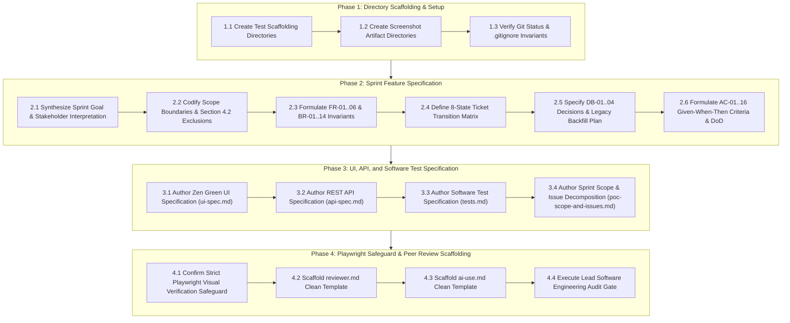

# Technical Implementation Plan: Issue 17 — Sprint 4 Engineering Contract & Software Test Planning

**Feature Identifier:** Issue 17 (`feature/17-spec-and-tests`)  
**Sprint / Milestone:** TokTickIT Lab 4 (Sprint 4) — Actions Taken, Dashboards, Workflow Resolution Gate, and Final Regression  
**Target Branch:** `feature/17-spec-and-tests` (Base: `lab4-staging`)  
**Specification Version:** 1.0.0  
**Authoritative Contract Reference:** [docs/lab-04/specification.md](file:///c:/Users/xande/Documents/Year%203%20Sem%201/CPE%20334/Lab%201/toktickit/docs/lab-04/specification.md)  
**Status:** PROPOSED IMPLEMENTATION PLAN (Awaiting Approval)

---

## 1. Target File Inventory

The following table itemizes all files and directories created, verified, and audited as part of Issue 17 under `docs/lab-04/`, `docs/features/`, test directories, and screenshot artifact paths:

| Action | Target Path | Layer / Component | Description & Responsibility |
| :--- | :--- | :--- | :--- |
| **`[NEW]`** | `docs/lab-04/specification.md` | Feature SDS | Authoritative Feature SDS: Sprint Goal, Stakeholder Request summary, Scope & Exclusions (§4.2), FR-01..06, BR-01..14, State Transition Matrix, Database Decisions (DB-01..04), Migration/Backfill Strategy, Given-When-Then ACs (AC-01..16), and Definition of Done. |
| **`[NEW]`** | `docs/lab-04/ui-spec.md` | UI Specification | Zen Green tokens (`#006B3C`, `#0B7A46`, `#EAF6EF`, `#F5F7F6`), component wireframes for IT Staff Dashboard, Requester Dashboard, Actions Taken Section (line-item table, auto-performer, conditional note), Workflow Controls, responsive breakpoints, and WCAG 2.2 AA accessibility checklist. |
| **`[NEW]`** | `docs/lab-04/api-spec.md` | REST API Contract | API contract for 7 endpoints (`POST/GET/PUT actions-taken`, `GET requester/staff/admin dashboards`, `PATCH status`), DTO schemas, query parameters, validation rules, HTTP status codes (`200`, `201`, `400`, `401`, `403`, `404`, `409 Conflict`, `422`), and safe error envelopes. |
| **`[NEW]`** | `docs/lab-04/tests.md` | Software Test Spec | Software Test Specification (STS) pyramid, Planned Tests table (`API-01..17`, `UI-01..06`, `E2E-01..03`), Acceptance-Criterion Traceability Matrix mapping AC-01..16 and AC-17.1..17.4 to designated test paths across server, client, and E2E. |
| **`[NEW]`** | `docs/lab-04/poc-scope-and-issues.md` | Sprint Plan | Sprint architecture, Kanban workflow, and 6-issue decomposition (Issues 17 through 22) with branch names, merge order, dependencies, detailed scopes, and acceptance criteria. |
| **`[NEW]`** | `docs/lab-04/reviewer.md` | Peer Review Record | Clean template for tracking pull requests, peer review comments, and author responses for Issues 17 through 22. |
| **`[NEW]`** | `docs/lab-04/ai-use.md` | AI Prompt Record | Clean template for logging AI models, key prompt history (1..8), and the personal reflection essay according to the grading rubric. |
| **`[NEW]`** | `docs/features/17-spec-and-tests/plan.md` | Feature Plan | Technical implementation plan and audit verification checklist for Issue 17. |
| **`[SCAFFOLD]`** | `server/tests/lab-04/.gitkeep` | Backend Tests | Directory placeholder for upcoming Lab 4 API integration tests (`actions-taken.api.test.ts`, `ticket-workflow.api.test.ts`, `requester-dashboard.api.test.ts`, `staff-dashboard.api.test.ts`). |
| **`[SCAFFOLD]`** | `client/src/tests/lab-04/.gitkeep` | Frontend Tests | Directory placeholder for upcoming Lab 4 UI component tests (`StaffDashboard.test.tsx`, `RequesterDashboard.test.tsx`, `ActionsTaken.test.tsx`, `TicketWorkflow.test.tsx`). |
| **`[SCAFFOLD]`** | `e2e/lab-04/.gitkeep` | E2E Tests | Directory placeholder for upcoming Lab 4 Playwright browser specs (`actions-taken-flow.spec.ts`, `ticket-resolution.spec.ts`, `dashboards.spec.ts`). |
| **`[SCAFFOLD]`** | `artifacts/lab-04/screenshots/staff-dashboard/.gitkeep` | Verification Artifacts | Auxiliary screenshot storage directory for IT Staff Dashboard visual verification evidence across Desktop, Tablet, and Mobile. |
| **`[SCAFFOLD]`** | `artifacts/lab-04/screenshots/requester-dashboard/.gitkeep` | Verification Artifacts | Auxiliary screenshot storage directory for Requester Dashboard visual verification evidence across Desktop, Tablet, and Mobile. |
| **`[SCAFFOLD]`** | `artifacts/lab-04/screenshots/actions-taken/.gitkeep` | Verification Artifacts | Auxiliary screenshot storage directory for Actions Taken line-item and modal verification evidence across Desktop, Tablet, and Mobile. |

---

## 2. Execution Phases & Step-by-Step Sequence

---

## 3. Phase 1: Directory Scaffolding & Template Verification

### Step 1.1: Backend, Frontend & E2E Test Scaffolding
Create isolated directory structures matching the approved Software Test Specification:
1. `server/tests/lab-04/`: Anchors Supertest API integration suites.
2. `client/src/tests/lab-04/`: Anchors Vitest + React Testing Library UI component suites.
3. `e2e/lab-04/`: Anchors Playwright multi-role browser end-to-end suites.
4. Populate each directory with `.gitkeep` to maintain version tracking in Git before test files are written.

### Step 1.2: Auxiliary Screenshot Artifact Directories
Create dedicated directories for developer visual review artifacts:
1. `artifacts/lab-04/screenshots/staff-dashboard/`
2. `artifacts/lab-04/screenshots/requester-dashboard/`
3. `artifacts/lab-04/screenshots/actions-taken/`
4. Confirm `.gitignore` correctly ignores PNG screenshot binaries (`artifacts/**/screenshots/`) to keep Git history lightweight while allowing `.gitkeep` directories.

---

## 4. Phase 2: Specification Document Authored & Hardened

Verify that [`docs/lab-04/specification.md`](file:///c:/Users/xande/Documents/Year%203%20Sem%201/CPE%20334/Lab%201/toktickit/docs/lab-04/specification.md) satisfies every course and architectural requirement:

### Step 2.1: Sprint Goal & Stakeholder Request Summary
- **Goal**: Complete the core TokTickIT service-desk workflow by introducing Actions Taken by IT Staff, enforcing final ticket status rules and resolution gates, providing role-appropriate dashboards, and executing full regression hardening under Zen Green.
- **Stakeholder Request**: Captures operational needs for tracking granular technical interventions under tickets, enforcing formal IT staff closing authority, and presenting concise role-based summaries.

### Step 2.2: Included & Explicitly Excluded Scope (§4.2)
- Formulate the 6 included functional areas (Actions Taken, Workflow & Gate, Dashboards, Concurrency, UI Polish, Regression).
- Codify mandatory exclusions: no automatic SLA countdown timers/escalations, no external notifications (SMTP, SMS, LINE), no inventory/costing, no payroll/timesheets, no multi-level approvals, no custom report builders, and no multi-tenant partitioning.

### Step 2.3: Numbered Functional Requirements (FR-01 to FR-06)
- **FR-01**: Actions Taken Record Management (Parent-child structure, create, list, edit, auto-performer, requester read-only).
- **FR-02**: Ticket Status Workflow & Resolution Gate (8-state lifecycle, resolution gate check, cancellation cascade, reopen logic).
- **FR-03**: IT Staff & Administrator Operational Dashboard (Unassigned count, personal workload, status/priority distributions, drill-down).
- **FR-04**: Requester Operational Dashboard (Isolated to authenticated user, open/progress/waiting/resolved counts, drill-down).
- **FR-05**: Concurrency Control & Stale-Update Handling (Optimistic versioning, HTTP 409 Conflict).
- **FR-06**: System Regression Preservation & Hardening (Preserve Labs 1–3, zero errors, accessibility).

### Step 2.4: Numbered Business Rules (BR-01 to BR-14)
- **BR-01**: Action Taken belongs to exactly one Ticket.
- **BR-02**: Ticket Owner coordinates overall ticket; Actions Taken may be performed by different staff members.
- **BR-03**: `performedById` is automatically populated from authenticated session (`req.user.id`).
- **BR-04**: Conditional Follow-Up Note: strictly mandatory when `followUpRequired` is `true`; null/omitted when `false`.
- **BR-05**: Field validations (Description 5–1000 chars, Result 2–1000 chars, non-future timestamp, Attachment notes max 255 chars).
- **BR-06**: Role-based access: IT Staff and Admins have write access; Requesters have read-only access to owned tickets.
- **BR-07**: Inactive staff account check: deactivated staff cannot perform new actions.
- **BR-08**: **Resolution Gate Invariant**: Ticket CANNOT move to `RESOLVED` or `CLOSED` while incomplete actions or unresolved follow-ups remain.
- **BR-09**: **Atomic Cancellation Cascade**: Cancelling a ticket atomically marks open actions cancelled in a single transaction.
- **BR-10**: Advisory Requester Resolution: "Problem Appears Resolved" does NOT directly set status to `RESOLVED`.
- **BR-11**: Authoritative 8-state transition matrix adherence.
- **BR-12**: Optimistic concurrency control via `version` field; stale update yields HTTP 409 Conflict.
- **BR-13**: Requester dashboard isolation: strictly scoped to `requesterId = req.user.id`.
- **BR-14**: Authoritative backend metric calculations: dynamic database aggregations without client-side guessing.

### Step 2.5: Database Decisions & Migration Strategy (§5.1 & §5.2)
- **DB-01**: `ActionTaken` relational model linked to `Ticket` ($1:N$) with cascade on ticket and restrict on performer.
- **DB-02**: Optimistic concurrency control via `version` field on `Ticket` and `ActionTaken`.
- **DB-03**: Performance-optimized composite indexes (`[requesterId, currentStatus, updatedAt]`, `[ownerId, currentStatus, updatedAt]`, `[currentStatus, itPriority]`) ensuring sub-50ms query times.
- **DB-04**: Non-destructive legacy backfill: existing tickets have $N=0$ actions; graceful prospective resolution gate evaluation.
- Document atomic migration procedure, idempotent seed data requirements, and rollback SQL commands.

### Step 2.6: Acceptance Criteria (AC-01 to AC-16) & Product DoD
- Author 16 clear, observable criteria in Given-When-Then format covering all functional aspects.
- Define a 10-point Product Definition of Done (DoD) enforcing zero regressions, accessibility, and 100% test pass rate.

---

## 5. Phase 3: UI, API, and Software Test Specification Alignment

### Step 3.1: Zen Green UI Specification (`docs/lab-04/ui-spec.md`)
- **Theme Tokens**: Formalize `--color-primary-green: #006B3C`, `--color-secondary-green: #0B7A46`, `--color-pale-green: #EAF6EF`, `--color-page-bg: #F5F7F6`.
- **Operational Dashboards**: Layouts and wireframes for IT Staff Dashboard (5 metric cards, recent tickets, quick actions) and Requester Dashboard (4 metric cards, isolated scope, drill-downs).
- **Actions Taken Line-Item UI**:
  - Incorporate [`line-item-section.pdf`](file:///c:/Users/xande/Documents/Year%203%20Sem%201/CPE%20334/Lab%201/toktickit/docs/ui/line-item-section.pdf) principles: dedicated tab, upper-right add button with tooltip, ordered item number (`No.`), alternating row shading, read-only auto-performer badge, and conditional follow-up expansion.
  - Form validation: leading red asterisk (`*`) on required fields; red border and tooltip-style error message on empty conditional follow-up note.
- **Workflow Controls**: Status transition dropdown showing permitted next states only; inline resolution gate warning callout when open actions block resolution.
- **Responsive Layouts**: Desktop ($\ge 1200\text{px}$), Tablet ($768\text{px}-1024\text{px}$), Mobile ($< 768\text{px}$) with zero horizontal scroll; multi-column tables collapse into stacked cards.
- **WCAG 2.2 AA Checklist**: Contrast ratios $\ge 4.5:1$, visible focus ring, semantic HTML, non-color-only status badges.

### Step 3.2: REST API Specification (`docs/lab-04/api-spec.md`)
- Document all 7 endpoints with URL params, request bodies, response payloads, validation rules, and HTTP status codes:
  1. `POST /api/v1/tickets/:id/actions-taken` (201, 401, 403, 404, 422)
  2. `GET /api/v1/tickets/:id/actions-taken` (200, 401, 403, 404)
  3. `PUT /api/v1/tickets/:id/actions-taken/:actionId` (200, 401, 403, 404, 409, 422)
  4. `GET /api/v1/dashboards/requester` (200, 401)
  5. `GET /api/v1/dashboards/staff` (200, 401, 403)
  6. `GET /api/v1/dashboards/admin` (200, 401, 403)
  7. `PATCH /api/v1/staff/tickets/:id/status` (200, 400, 401, 403, 404, 409 Conflict)
- Define standard response envelopes and safe error formats masking sensitive internal state.

### Step 3.3: Software Test Specification (`docs/lab-04/tests.md`)
- Define 4-tier testing pyramid: Unit (Vitest), API Integration (Vitest + Supertest), UI Component (Vitest + RTL), E2E (Playwright).
- Planned Tests table specifying 26 tests: `API-01..17`, `UI-01..06`, `E2E-01..03`.
- Traceability Matrix mapping `AC-01` through `AC-16` to concrete test file paths.
- Traceability table mapping Issue 17 criteria (`AC-17.1` through `AC-17.4`).

### Step 3.4: Sprint Scope & Issue Decomposition (`docs/lab-04/poc-scope-and-issues.md`)
- Decompose Sprint 4 into 6 bounded issues:
  - Issue 17: Sprint 4 Engineering Contract & Test Planning (`feature/17-spec-and-tests`)
  - Issue 18: Actions Taken Data Model, Migration & API Foundation (`feature/18-actions-taken-data`)
  - Issue 19: Actions Taken User Interface & Line-Item Interaction (`feature/19-actions-taken-ui`)
  - Issue 20: Ticket Status Workflow State Machine & Resolution Gate (`feature/20-ticket-workflow`)
  - Issue 21: Role-Appropriate Dashboards & Analytics (`feature/21-role-dashboards`)
  - Issue 22: Final End-to-End Regression, Accessibility & Polish Release (`feature/22-regression-release`)

---

## 6. Phase 4: Playwright Safeguard & Peer Review Scaffolding

### Step 4.1: Playwright Visual Verification Separation Safeguard
- Formulate and enforce the strict auxiliary verification rule:
  > *"Playwright screenshot generation (saving PNG artifacts to `artifacts/lab-04/screenshots/`) is strictly an auxiliary visual verification step for human developer review and grading evidence. Playwright visual screenshot comparisons are never mixed into this automated Software Test Specification or unit test assertions."*
- Ensure no visual diff assertions (`toHaveScreenshot`) contaminate the functional test suites.

### Step 4.2: Peer Review Record Template (`docs/lab-04/reviewer.md`)
- Author a clean markdown template with empty tables and placeholders for:
  - Header: Author, Peer Reviewer, Repository, Base Staging Branch.
  - Section 1: Pull Requests I Authored (table with PR #, Feature Branch, Target Branch, Linked Issue, Reviewer Verdict, Merged By).
  - Section 2: Reviewer Comments Received & Author Responses for Issues 17 through 22.
  - Section 3: Pull Requests I Reviewed for my peer partner.

### Step 4.3: AI Prompt & Reflection Template (`docs/lab-04/ai-use.md`)
- Author a clean markdown template with empty tables and placeholders for:
  - Section 1: AI Specification & Coding Model Information (Tool, Models, Roles, Invariant).
  - Section 2: Key Prompt Table (8 rows with Category, Goal, Prompt Summary, AI Output Summary, Evaluation).
  - Section 3: My Reflection placeholder for the student's personal reflection essay.

### Step 4.4: Lead Software Engineering Audit Gate
- Execute formal audit verifying 100% compliance across scope alignment, acceptance criteria traceability, test specifications, Zen Green styling, REST API schemas, and visual test isolation.
- Produce explicit `CONTRACT REVIEW: PASS` verdict.

---

## 7. Verification & Readiness Checklist for Issue 17

- [x] All 7 documentation files created under `docs/lab-04/` (`specification.md`, `ui-spec.md`, `api-spec.md`, `tests.md`, `poc-scope-and-issues.md`, `reviewer.md`, `ai-use.md`).
- [x] Directory scaffolding created with `.gitkeep` placeholders under `server/tests/lab-04/`, `client/src/tests/lab-04/`, `e2e/lab-04/`, and `artifacts/lab-04/screenshots/`.
- [x] All 14 Business Rules (`BR-01` to `BR-14`) and 6 Functional Requirements (`FR-01` to `FR-06`) codified.
- [x] Resolution gate rules (`BR-08`), cancellation cascade (`BR-09`), auto-performer (`BR-03`), and conditional follow-up note (`BR-04`) explicitly defined.
- [x] All 7 REST API endpoints documented with request/response schemas and HTTP status codes (including `409 Conflict`).
- [x] All 16 Acceptance Criteria (`AC-01` to `AC-16`) and Issue 17 criteria (`AC-17.1` to `AC-17.4`) mapped to test files.
- [x] Playwright visual screenshot generation strictly isolated from automated test specifications in `tests.md`.
- [x] `reviewer.md` and `ai-use.md` maintained as clean, uncluttered templates.
- [x] Formal Lead Engineering Audit completed with `CONTRACT REVIEW: PASS`.
- [x] Zero application code, backend routes, React components, or test files written.

