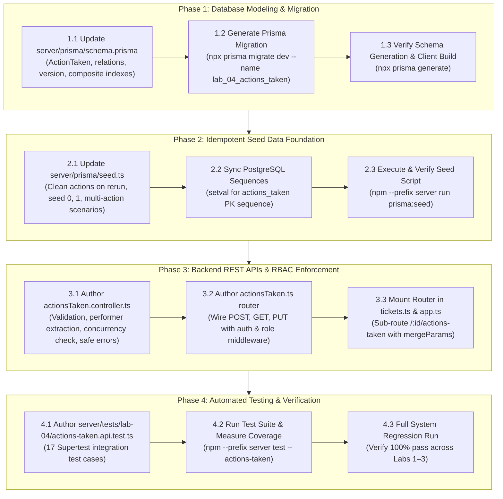

# Technical Implementation Plan: Issue 18 — Actions Taken Data Model, Migration, Seed Data & Backend APIs

**Feature Identifier:** Issue 18 (`feature/18-actions-taken-foundation`)  
**Sprint / Milestone:** TokTickIT Lab 4 (Sprint 4) — Actions Taken, Dashboards, Workflow Resolution Gate, and Final Regression  
**Target Branch:** `feature/18-actions-taken-foundation` (Base: `lab4-staging`)  
**Specification Version:** 1.0.0  
**Authoritative Contract Reference:** [`docs/features/18-actions-taken-foundation/contract.md`](file:///c:/Users/xande/Documents/Year%203%20Sem%201/CPE%20334/Lab%201/toktickit/docs/features/18-actions-taken-foundation/contract.md)  
**Status:** PROPOSED TECHNICAL IMPLEMENTATION PLAN (Awaiting Approval)  

---

## 1. Target File Inventory

The table below enumerates all files to be created or modified across database schemas, Prisma migrations, seed files, backend controllers, routers, and test suites. No frontend React UI components are modified in this issue (deferred to Issue 19):

| Action | File Path | Component / Layer | Responsibility & Key Changes |
| :--- | :--- | :--- | :--- |
| **`[MODIFY]`** | `server/prisma/schema.prisma` | Database / Schema | Add `ActionTaken` model; add `actionsTaken ActionTaken[]` on `Ticket` and `User` (`StaffActionsTaken`); add `version Int @default(1)` on `Ticket`; add composite indexes. |
| **`[NEW]`** | `server/prisma/migrations/20261029170000_lab_04_actions_taken/migration.sql` | Database / Migration | Versioned DDL migration creating `actions_taken` table, adding `version` to `tickets`, creating foreign keys and indexes. |
| **`[MODIFY]`** | `server/prisma/seed.ts` | Database / Seed | Add seed data for tickets with 0, 1, and multiple actions performed by different IT Staff members; toggle follow-up flags; reference attachment notes; sync sequences. |
| **`[NEW]`** | `server/src/controllers/actionsTaken.controller.ts` | Backend / Controller | Implement request handlers: `handleCreateActionTaken`, `handleGetActionsTaken`, `handleUpdateActionTaken` with validation and error envelopes. |
| **`[NEW]`** | `server/src/routes/actionsTaken.ts` | Backend / Router | Express router for `/api/v1/tickets/:ticketId/actions-taken` with middleware chaining (`authenticate`, `requirePasswordChanged`, `requireRole`). |
| **`[MODIFY]`** | `server/src/routes/tickets.ts` | Backend / Router | Mount `actionsTakenRouter` under `/:id/actions-taken` with `{ mergeParams: true }` for seamless sub-routing. |
| **`[MODIFY]`** | `server/src/app.ts` | Backend / App | Ensure route mounting and `/api/v1` alias routing for actions-taken endpoints. |
| **`[NEW]`** | `server/tests/lab-04/actions-taken.api.test.ts` | Tests / Integration | Comprehensive Supertest API integration suite testing AC-18.1 through AC-18.5 (17 planned test cases). |

---

## 2. Step-by-Step Execution Sequence



---

## 3. Detailed Phase Breakdown

### Phase 1: Prisma Schema Evolution & Migration

#### 1.1 Update `server/prisma/schema.prisma`
1. Define the `ActionTaken` model:
   ```prisma
   // ---------------------------------------------------------------------------
   // 9. Action Taken (Parent-Child Work Tracking by IT Staff - BR-01..BR-05)
   // ---------------------------------------------------------------------------
   model ActionTaken {
     id                Int      @id @default(autoincrement())
     ticketId          Int
     performedById     Int
     actionDateTime    DateTime @default(now())
     actionDescription String   @db.Text
     result            String   @db.Text
     followUpRequired  Boolean  @default(false)
     followUpNote      String?  @db.Text
     attachmentNotes   String?  @db.VarChar(255)
     version           Int      @default(1)
     createdAt         DateTime @default(now())
     updatedAt         DateTime @updatedAt

     ticket      Ticket @relation(fields: [ticketId], references: [id], onDelete: Cascade)
     performedBy User   @relation("StaffActionsTaken", fields: [performedById], references: [id], onDelete: Restrict)

     @@index([ticketId, actionDateTime])
     @@index([performedById])
     @@map("actions_taken")
   }
   ```
2. Update the `Ticket` model:
   - Add field `version Int @default(1)`
   - Add relation `actionsTaken ActionTaken[]`
   - Add composite indexes:
     ```prisma
     @@index([requesterId, currentStatus, updatedAt])
     @@index([ownerId, currentStatus, updatedAt])
     @@index([currentStatus, itPriority])
     ```
3. Update the `User` model:
   - Add relation `actionsTaken ActionTaken[] @relation("StaffActionsTaken")`

#### 1.2 Migration Execution & Verification
1. Run Prisma migration command:
   ```bash
   npx prisma migrate dev --name lab_04_actions_taken
   ```
2. Verify generated SQL file in `server/prisma/migrations/*_lab_04_actions_taken/migration.sql`:
   - Contains `CREATE TABLE "actions_taken" (...)`
   - Contains `ALTER TABLE "tickets" ADD COLUMN "version" INTEGER NOT NULL DEFAULT 1`
   - Contains `ALTER TABLE "actions_taken" ADD CONSTRAINT ...`
   - Contains `CREATE INDEX ...`
3. Generate updated Prisma client bindings:
   ```bash
   npx prisma generate
   ```

---

### Phase 2: Idempotent Database Seeding (`server/prisma/seed.ts`)

#### 2.1 Update Seeding Logic
1. Clean actions taken before inserting demo data:
   ```typescript
   await prisma.actionTaken.deleteMany();
   ```
2. Seed realistic actions taken across existing tickets:
   - **Ticket 1 (`TKT-2026-00001`, IN_PROGRESS - Multi-Staff Collaboration):**
     - Action 1: Performed by `Sompong IT` (ID 6), Wi-Fi signal diagnostic, `followUpRequired: true`, `followUpNote: "Request RF channel survey from Network Engineering"`, `attachmentNotes: "wifi_survey_floor4.pdf"`.
     - Action 2: Performed by `Wichai Support` (ID 7), AP firmware restart, `followUpRequired: false`, `followUpNote: null`.
     - Action 3: Performed by `Anong Network` (ID 8), Replaced patch cable at switch rack, `followUpRequired: false`, `followUpNote: null`.
   - **Ticket 2 (`TKT-2026-00002`, IN_PROGRESS - Single Action):**
     - Action 1: Performed by `Sompong IT` (ID 6), Switch port reset, `followUpRequired: false`, `followUpNote: null`, `attachmentNotes: "switch_config_dump.txt"`.
   - **Ticket 5 (`TKT-2026-00005`, WAITING_FOR_REQUESTER - Pending Follow-Up):**
     - Action 1: Performed by `Wichai Support` (ID 7), Battery health diagnostics, `followUpRequired: true`, `followUpNote: "Awaiting user drop-off at IT service desk"`, `attachmentNotes: "diagnostic_screen.png"`.
   - **Tickets 3 & 4 (`TKT-2026-00003`, `TKT-2026-00004`, NEW & OPEN - Zero Actions):**
     - Intentionally seeded with **0** actions taken to verify empty state arrays (`items: []`, `totalCount: 0`).
   - **Tickets 6 & 7 (`RESOLVED`, `CLOSED` - Historical Actions):**
     - Seeded with 2 completed actions (`followUpRequired: false`).
3. Synchronize PostgreSQL sequence:
   ```typescript
   await prisma.$executeRawUnsafe(
     `SELECT setval(pg_get_serial_sequence('actions_taken', 'id'), coalesce(max(id), 1)) FROM actions_taken;`
   );
   ```
4. Verify by running:
   ```bash
   npm --prefix server run prisma:seed
   ```

---

### Phase 3: REST API Routes & Role Authorization

#### 3.1 Controller Implementation (`server/src/controllers/actionsTaken.controller.ts`)
Implement three core controller functions with strict validation and safe error envelopes:

1. **`handleCreateActionTaken(req: Request, res: Response)`:**
   - **Auth Check:** Verify user has `req.user` and role is `IT_STAFF` or `ADMINISTRATOR`. If role is `REQUESTER`, return `403 Forbidden` (`FORBIDDEN_ACTION_TAKEN_WRITE`).
   - **Target Ticket Check:** Fetch ticket by `ticketId`. If not found, return `404 Not Found`.
   - **Validation:**
     - `actionDescription` (or `description`): Min 5, max 1000 characters.
     - `result`: Min 2, max 1000 characters.
     - `actionDateTime`: If provided, validate ISO format and max +60s clock skew; default to `new Date()`.
     - `attachmentNotes`: Max 255 chars if provided.
     - **Conditional Follow-Up Rule (`BR-04`):** If `followUpRequired === true`, `followUpNote` is mandatory (min 5, max 1000 chars); otherwise set `followUpNote = null`.
   - **Performer Invariant (`BR-03`):** Strictly set `performedById = req.user.id`.
   - **Persistence:** Create in Prisma with `version: 1`, return `201 Created` with serialized `actionTaken`.

2. **`handleGetActionsTaken(req: Request, res: Response)`:**
   - **Target Ticket Check:** Fetch ticket by `ticketId`. If not found, return `404 Not Found`.
   - **Ownership Guard (`BR-06`, `BR-13`):**
     - If user is `REQUESTER`: Verify `ticket.requesterId === req.user.id`. If not owned, return `403 Forbidden` (`FORBIDDEN_TICKET_ACCESS`).
     - If `IT_STAFF` or `ADMINISTRATOR`: Access granted for all tickets.
   - **Query:** Fetch all actions taken where `ticketId = :ticketId`, ordered by `actionDateTime ASC`, including `performedBy: { select: { id: true, name: true, role: true } }`.
   - **Response:** Return `200 OK` with `{ items: [...], totalCount: N }`. Returns `{ items: [], totalCount: 0 }` for zero-action tickets without errors.

3. **`handleUpdateActionTaken(req: Request, res: Response)`:**
   - **Auth Check:** `IT_STAFF` or `ADMINISTRATOR` only; `REQUESTER` returns `403 Forbidden`.
   - **Target Verification:** Check that action exists and belongs to `ticketId`. If not found, return `404 Not Found`.
   - **Concurrency Check (`BR-12`):** Check if `existingAction.version !== req.body.version`. If mismatched, return `409 Conflict` (`CONCURRENCY_CONFLICT`).
   - **Validation:** Apply identical rules for description, result, and conditional follow-up note.
   - **Persistence:** Update fields, increment `version` by 1 (`version: existingAction.version + 1`), return `200 OK` with updated `actionTaken`.

#### 3.2 Router Wiring (`server/src/routes/actionsTaken.ts` & `server/src/routes/tickets.ts`)
1. Create `actionsTakenRouter` with `mergeParams: true`:
   ```typescript
   export const actionsTakenRouter = Router({ mergeParams: true });

   actionsTakenRouter.use(authenticate, requirePasswordChanged);

   actionsTakenRouter.post("/", requireRole(["IT_STAFF", "ADMINISTRATOR"]), handleCreateActionTaken);
   actionsTakenRouter.get("/", handleGetActionsTaken);
   actionsTakenRouter.put("/:actionId", requireRole(["IT_STAFF", "ADMINISTRATOR"]), handleUpdateActionTaken);
   ```
2. Mount in `server/src/routes/tickets.ts`:
   ```typescript
   ticketsRouter.use("/:id/actions-taken", actionsTakenRouter);
   ```
3. Ensure `/api/v1/tickets/:ticketId/actions-taken` and `/api/tickets/:ticketId/actions-taken` resolve seamlessly.

---

### Phase 4: Automated Testing & Playwright Safeguard

#### 4.1 Author Test Suite (`server/tests/lab-04/actions-taken.api.test.ts`)
Implement 17 integration tests using Vitest and Supertest mapping directly to Acceptance Criteria:

| Test Case | Description | Verification Target |
| :--- | :--- | :--- |
| `API-18.01` | IT Staff creates valid Action Taken | Returns `201 Created`, record stored with auto-generated ID, `version: 1` |
| `API-18.02` | Administrator creates Action Taken | Returns `201 Created` |
| `API-18.03` | Performer auto-population from session | Stored `performedById` matches session user, ignoring client payload |
| `API-18.04` | Requester blocked from creating Action Taken | Returns `403 Forbidden` (`FORBIDDEN_ACTION_TAKEN_WRITE`) |
| `API-18.05` | Conditional follow-up note validation | Returns `422 Unprocessable Entity` if `followUpRequired=true` and note missing |
| `API-18.06` | Coerce `followUpNote` to null when false | Stored `followUpNote` is null even if text was passed |
| `API-18.07` | Reject short description (< 5 chars) | Returns `422 Unprocessable Entity` |
| `API-18.08` | Reject short result (< 2 chars) | Returns `422 Unprocessable Entity` |
| `API-18.09` | Reject future action date (> 60s skew) | Returns `422 Unprocessable Entity` |
| `API-18.10` | Retrieve chronological actions list | Returns `200 OK`, items ordered ascending by `actionDateTime` |
| `API-18.11` | Safe empty array for legacy tickets | Returns `200 OK`, `items: []`, `totalCount: 0` |
| `API-18.12` | Requester views actions on owned ticket | Returns `200 OK` |
| `API-18.13` | Block Requester viewing unowned ticket actions | Returns `403 Forbidden` (`FORBIDDEN_TICKET_ACCESS`) |
| `API-18.14` | Update Action Taken with matching version | Returns `200 OK`, fields updated, `version` incremented to 2 |
| `API-18.15` | Optimistic concurrency conflict on stale version | Returns `409 Conflict` (`CONCURRENCY_CONFLICT`) |
| `API-18.16` | Reject edit attempt by Requester | Returns `403 Forbidden` |
| `API-18.17` | Reject action creation by inactive user | Returns `401 Unauthorized` / `403 Forbidden` |

#### 4.2 Playwright Visual Verification Safeguard
- Playwright screenshot capture is strictly an auxiliary verification mechanism.
- Screenshots are saved exclusively in `artifacts/lab-04/screenshots/actions-taken/`.
- No visual assertions or Playwright tests are added to `docs/lab-04/tests.md` or automated Vitest suites.

#### 4.3 Full System Regression Verification
Execute test runner to ensure 100% pass across all existing test suites:
```bash
npm --prefix server test
```

---

## 4. Verification Checkpoints & Definition of Done

- [ ] **Phase 1 Verification:** `npx prisma migrate dev` runs cleanly; `ActionTaken` table and `Ticket.version` created without dropping historical data.
- [ ] **Phase 2 Verification:** `npm --prefix server run prisma:seed` completes idempotently; tickets with 0, 1, and multi-staff actions exist in DB.
- [ ] **Phase 3 Verification:** `POST`, `GET`, `PUT` respond with correct HTTP codes and conform to DTO envelopes.
- [ ] **Phase 4 Verification:** `npm --prefix server test -- actions-taken` passes with 100% success across all 17 test cases.
- [ ] **Regression Verification:** Full server test suite passes with zero failures.

