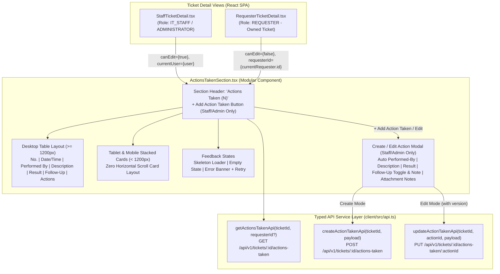

# Feature Engineering Contract: Issue 19 — Actions Taken UI, Ticket Detail Integration & Access Control

**Feature Identifier:** Issue 19: Actions Taken UI, Ticket Detail Integration & Access Control  
**Target Branch:** `feature/19-actions-taken-ui`  
**Base Branch:** `lab4-staging`  
**Sprint / Milestone:** TokTickIT Lab 4 (Sprint 4) — Actions Taken, Dashboards, Workflow Resolution Gate, and Final Regression  
**Specification Version:** 1.0.0  
**Status:** APPROVED ENGINEERING CONTRACT  
**Traceability References:** [AGENTS.md](../../../AGENTS.md), [SE+Lab+4.pdf](../../reference/SE+Lab+4.pdf) (§3, §4.1–§4.4, §7, §8.3, §8.5–§8.6), [TokTickIT-System-Level-SDS-v1.0.pdf](../../reference/TokTickIT-System-Level-SDS-v1.0.pdf) (§7–§10, p. 10–19), [line-item-section.pdf](../../ui/line-item-section.pdf), [specification.md](../../lab-04/specification.md), [ui-spec.md](../../lab-04/ui-spec.md), [api-spec.md](../../lab-04/api-spec.md), [tests.md](../../lab-04/tests.md), [Issue 18 Contract](../18-actions-taken-foundation/contract.md)

---

## 1. Feature Goal & Scope

### 1.1 Purpose & Architectural Objectives
This engineering contract defines the authoritative frontend architecture, UI component specifications, Zen Green theme styling, form interaction and validation rules, role-based access control boundaries, responsive layout adaptations, and automated frontend test specifications for **Issue 19: Actions Taken UI, Ticket Detail Integration & Access Control**.

With the database schema, non-destructive migration, idempotent seed dataset, and REST APIs (`POST`, `GET`, `PUT /api/v1/tickets/:ticketId/actions-taken`) completed in Issue 18, Issue 19 delivers the user-facing **Actions Taken** subsystem embedded directly inside the Ticket Detail screens:

1. **Modular `ActionsTakenSection.tsx` Component (`client/src/components/ActionsTakenSection.tsx`):** A self-contained, accessible React component embedded within both `StaffTicketDetail.tsx` (interactive Create/Edit mode for `IT_STAFF` and `ADMINISTRATOR`) and `RequesterTicketDetail.tsx` (strictly read-only mode for `REQUESTER`).
2. **Chronological Line-Item Presentation:** Displays all recorded technical actions for a ticket in ascending chronological order (`actionDateTime ASC`) with a 1-based ordered item number (`No.`), formatted timestamp, automated performer identity badge with role indicator, action description, technical result, conditional follow-up status badge and note, and optional attachment notes.
3. **Unmistakable Visual Distinction Across Ticket Detail Sections:** Uses KMUTT Zen Green design tokens (`#006B3C`, `#0B7A46`, `#EAF6EF`, `#F5F7F6`) and semantic surface treatments to visually distinguish structured **Actions Taken** (technical work log) from **Public Comments** (requester-staff conversation thread) and **Confidential Internal Notes** (staff-only amber/locked diagnostic stream).
4. **Interactive Create & Edit Workflow for IT Staff and Administrators:** Provides a modal/form interface with a read-only auto-populated **Performed By** field (`BR-03`), live character counters (`BR-05`), a dynamic **Follow-Up Required?** toggle that conditionally reveals and enforces the **Follow-Up Note** field (`BR-04`), blur validation compliance, duplicate-submit protection with a loading spinner, optimistic concurrency (`version`) tracking (`BR-12`), and local form state preservation across recoverable API errors.
5. **Strict Role-Based UI Access Control (`BR-06`):** Enforces complete DOM suppression of all create and edit triggers (`+ Add Action Taken` button, row `Edit` buttons, and editor modal) when viewed by a `REQUESTER` in `RequesterTicketDetail.tsx`, while granting full create and edit capabilities to `IT_STAFF` and `ADMINISTRATOR` users in `StaffTicketDetail.tsx`.
6. **Responsive Multi-Viewport Fidelity:** Renders a structured 7-column line-item table on Desktop ($\ge 1200\text{px}$) and smoothly adapts to stacked Zen Green cards on Tablet ($768\text{px}\text{–}1024\text{px}$) and Mobile ($< 768\text{px}$) viewports with $\ge 44\text{px}$ touch targets and zero horizontal page scrolling.



---

### 1.2 In-Scope Deliverables
* **TypeScript Contract Types (`client/src/types/index.ts`):**
  - `ActionTakenPerformerDTO`: `{ id: number; name: string; role: UserRole }`
  - `ActionTakenDTO`: `{ id: number; ticketId: number; actionDateTime: string; actionDescription: string; result: string; followUpRequired: boolean; followUpNote: string | null; attachmentNotes: string | null; version: number; performedBy: ActionTakenPerformerDTO; createdAt: string; updatedAt: string }`
  - `ActionsTakenListResponseDTO`: `{ items: ActionTakenDTO[]; totalCount: number }`
  - `CreateActionTakenPayload`: `{ actionDateTime?: string; actionDescription: string; result: string; followUpRequired: boolean; followUpNote?: string | null; attachmentNotes?: string | null }`
  - `UpdateActionTakenPayload`: `CreateActionTakenPayload & { version: number }`
* **Typed API Client Functions (`client/src/api.ts`):**
  - `getActionsTakenApi(ticketId: number, activeRequesterId?: number): Promise<ActionsTakenListResponseDTO>`
  - `createActionTakenApi(ticketId: number, payload: CreateActionTakenPayload): Promise<ActionTakenDTO>`
  - `updateActionTakenApi(ticketId: number, actionId: number, payload: UpdateActionTakenPayload): Promise<ActionTakenDTO>`
* **Modular UI Component (`client/src/components/ActionsTakenSection.tsx`):**
  - Chronological list/table and responsive stacked card layout.
  - Create and Edit modal/form with conditional follow-up note logic, blur validation rule, character counters, and error recovery.
  - Loading skeleton, empty state, and error state with retry button.
* **Ticket Detail Integrations:**
  - `client/src/components/StaffTicketDetail.tsx`: Embeds `<ActionsTakenSection />` with full create/edit capabilities for `IT_STAFF` and `ADMINISTRATOR`, positioned clearly between the Attachments section and Public Comments section.
  - `client/src/components/RequesterTicketDetail.tsx`: Embeds `<ActionsTakenSection />` in strict read-only mode (`canEdit={false}`) for the ticket-owning `REQUESTER`.
* **Zen Green Theme Extensions (`client/src/index.css`):**
  - CSS variables and responsive classes for Actions Taken table rows, stacked cards, performer badges, follow-up alert badges, whitish editable vs. creamish read-only fields, and cell validation styles.
* **Automated Frontend Component Tests (`client/src/tests/lab-04/ActionsTaken.test.tsx`):**
  - Comprehensive Vitest + React Testing Library test suite covering rendering, conditional follow-up validation, blur behavior, API submission (create & edit), error preservation, requester read-only enforcement, and responsive layouts.

---

### 1.3 Explicit Exclusions (Out of Scope)
In strict compliance with §4.2 of `SE+Lab+4.pdf` and `docs/lab-04/specification.md` §3.2:
* **No Time-Sheet Billing or Payroll Calculations:** No hourly labor rate inputs, duration timers, billable hours math, or contractor payroll calculations.
* **No Direct Binary File Uploads Inside the Action Form:** Binary files are uploaded exclusively to the parent Ticket via `AttachmentSection.tsx` (`/api/tickets/:id/attachments`). The `attachmentNotes` field in the Action Taken form is strictly an optional text field (`max 255 chars`) describing which ticket attachment to inspect (e.g., `"See battery_diagnostic.png in Ticket Attachments"`).
* **No Action Taken Deletion (`DELETE`):** Recorded technical actions form an immutable audit trail and may only be created (`POST`) or updated (`PUT`), never deleted.
* **No Backend Ticket Status Resolution Gate Changes in Issue 19:** Enforcing the backend `PATCH /api/v1/staff/tickets/:id/status` resolution gate (`409 Conflict` when incomplete actions remain) and status workflow modal controls belong to **Issue 20** (`feature/20-ticket-workflow`).
* **No Operational Dashboards in Issue 19:** Requester, IT Staff, and Administrator dashboard views belong to **Issue 21** (`feature/21-role-dashboards`).

---

### 1.4 Requirements & Business Rules Traceability Matrix

| ID | Source | Summary | Issue 19 Frontend Enforcement |
| :--- | :--- | :--- | :--- |
| **FR-01.1** | `specification.md` | Parent-child relationship ($1:N$ Ticket to Actions Taken) | `ActionsTakenSection` bound to parent `ticketId` |
| **FR-01.2** | `specification.md` | IT Staff & Admin record technical actions (`POST`) | Create mode in `ActionsTakenSection` via `createActionTakenApi` |
| **FR-01.3** | `specification.md` | Auto-populated performer from authenticated session | Read-only `Performed By (Auto)` field displaying session user |
| **FR-01.4** | `specification.md` | Capture date/time, description, result, follow-up, notes | Form fields, character counters, and payload serialization |
| **FR-01.5** | `specification.md` | Display actions in ascending chronological order | Ordered `1..N` list/table sorted by `actionDateTime ASC` |
| **FR-01.6** | `specification.md` | Update existing actions taken (`PUT`) | Edit mode modal pre-populated with existing row & `version` |
| **FR-01.7** | `specification.md` | Requesters have read-only access to owned ticket actions | `canEdit={false}` in `RequesterTicketDetail.tsx` suppresses write UI |
| **FR-05.1–05.3** | `specification.md` | Optimistic concurrency & conflict preservation | Sends `version` on `PUT`; preserves unsaved draft input on `409 Conflict` |
| **BR-01** | `specification.md` | Action belongs to one Ticket | Scoped to `ticketId` prop |
| **BR-02** | `specification.md` | Separate Ticket Owner vs. Action Performer | Any `IT_STAFF`/`ADMINISTRATOR` can add/edit actions regardless of `ownerId` |
| **BR-03** | `specification.md` | Automated Performer Identity | `Performed By` is disabled/read-only and omitted from client write payloads |
| **BR-04** | `specification.md` | Conditional Follow-Up Note Requirement | `followUpNote` visible & mandatory (5–1000 chars) iff `followUpRequired === true` |
| **BR-05** | `specification.md` | Field Length & Timestamp Validations | Date not future; Description 5–1000 chars; Result 2–1000 chars; Attachment Notes $\le 255$ chars |
| **BR-06** | `specification.md` | Role-Based Action Authorization | Write controls rendered exclusively for `IT_STAFF` and `ADMINISTRATOR` |
| **BR-12** | `specification.md` | Optimistic Concurrency Detection | `version` integer passed on `PUT`; `409 Conflict` banner with refresh option |

---

## 2. UI Component Specification (`ActionsTakenSection.tsx`)

### 2.1 Component Props & State Contract

```typescript
export interface ActionsTakenSectionProps {
  ticketId: number;
  /** True for IT_STAFF and ADMINISTRATOR; False for REQUESTER */
  canEdit: boolean;
  /** Current authenticated user (for auto-populating Performed By in Create mode) */
  currentUser?: {
    id: number;
    name: string;
    role: UserRole;
  } | null;
  /** Active requester ID header fallback when viewed from Requester context */
  activeRequesterId?: number | null;
  /** Optional initial actions if pre-loaded, otherwise fetched on mount */
  initialActions?: ActionTakenDTO[];
  /** Optional callback invoked whenever the actions list is loaded, created, or updated */
  onActionsChanged?: (actions: ActionTakenDTO[]) => void;
}
```

### 2.2 Visual Distinction Between Ticket Detail Sections (Zen Green Palette)

To prevent cognitive overload and accidental disclosure on the Ticket Detail screen, the three activity sections use distinct, accessible visual treatments grounded in the KMUTT Zen Green design system (`docs/lab-04/ui-spec.md` §1.1):

| Section Name | Visibility Scope | Surface & Border Tokens | Header & Badge Accent | Purpose & Visual Cue |
| :--- | :--- | :--- | :--- | :--- |
| **1. Actions Taken** | **Shared** (Staff/Admin Create & Edit; Requester Read-Only) | Card: `#FFFFFF` (`--color-surface-card`)<br/>Top Accent Border: `3px solid #006B3C` (`--color-primary-green`)<br/>Table Header: `#EAF6EF` (`--color-pale-green`)<br/>Zebra Rows: `#FFFFFF` / `#F5F7F6` (`--color-page-bg`)<br/>Row Hover: `#F0FDF4` (`--color-action-item-hover`) | Wrench/Clipboard SVG icon in `#006B3C`<br/>Counter pill in `#EAF6EF` text `#006B3C`<br/>Primary button `#006B3C` hover `#0B7A46` | Structured technical work log & line-item engineering record |
| **2. Public Comments** | **Shared** (Requester, IT Staff, Admin) | Card: `#FFFFFF`<br/>Border: `1px solid #E5E7EB`<br/>Comment Bubbles: `#F9FAFB` | Chat Bubble SVG icon<br/>Neutral subtitle `"Visible to Ticket Requester, IT Staff, and Administrators"` | Conversational dialogue & status updates with requester |
| **3. Confidential Internal Notes** | **Restricted** (`IT_STAFF` & `ADMINISTRATOR` only; never rendered for Requester) | Card: `#FFFBEB` (Amber 50)<br/>Border: `1px solid #FCD34D` (Amber 300)<br/>Note Bubbles: `#FFFFFF` border `#FDE68A` | Lock Icon `🔒` + `#92400E` header<br/>`INTERNAL ONLY` badge (`#FFC72C` / `#D97706`) | Confidential staff-only diagnostics & sensitive notes |

### 2.3 Chronological Line-Item Table & Card Attributes

Each `ActionTakenDTO` record in the chronological list (`orderBy: actionDateTime ASC`) renders the following structured attributes:

1. **`No.` (Ordered Item Number):**
   - 1-based sequential integer (`1`, `2`, `3`, ...) preserving chronological execution order (`line-item-section.pdf` Rule 4).
2. **`Date / Time` (`actionDateTime`):**
   - Formatted cleanly as `YYYY-MM-DD HH:mm` in monospace/tabular numerals (`font-variant-numeric: tabular-nums`).
3. **`Performed By` (`performedBy.name` + `performedBy.role`):**
   - Rendered with a soft indigo pill badge (`background: #E0E7FF`, `color: #3730A3`, `--color-action-performer-bg` / `--color-action-performer-text`) displaying the performer's full name alongside a compact role badge (`IT Staff` in `#EAF6EF`/`#006B3C` or `Admin` in `#DBEAFE`/`#1E40AF`).
4. **`Description` (`actionDescription`):**
   - Full technical description of the work carried out (`#1F2937`, `0.875rem`, `white-space: pre-wrap`, `word-break: break-word`).
5. **`Result` (`result`) & `Attachment Notes` (`attachmentNotes`):**
   - Displays the outcome of the action (`#1F2937`, `0.875rem`, `white-space: pre-wrap`).
   - When `attachmentNotes` is non-empty, renders a secondary metadata line directly below `result` in muted text (`#5B6573`, `0.75rem`) with a paperclip icon: `📎 Attachment Note: {attachmentNotes}`.
6. **`Follow-Up` (`followUpRequired` & `followUpNote`):**
   - **When `followUpRequired === true`:**
     - Displays an high-contrast amber alert badge (`background: #FEF3C7`, `color: #92400E`, `border: 1px solid #FCD34D`) with an alert/clock SVG micro-icon and text `"Follow-up Required"`.
     - Renders the mandatory `followUpNote` directly underneath the badge in a highlighted callout box (`font-style: italic`, `color: #92400E`, `font-size: 0.8125rem`): `"Note: {followUpNote}"`.
   - **When `followUpRequired === false`:**
     - Displays a quiet neutral badge (`background: #F3F4F6`, `color: #4B5563`) with a checkmark micro-icon and text `"None"`.
7. **`Actions` Column (Staff/Admin Only):**
   - Rendered **only** when `canEdit === true`.
   - Contains an accessible `Edit` button (`type="button"`, pencil SVG icon + `"Edit"` label, `data-tooltip="Edit this action taken record"`, never native `title`) that opens the Edit Action Taken modal pre-populated with that row's data and `version`.

#### Desktop Line-Item Table Wireframe ($\ge 1200\text{px}$)
```
+----------------------------------------------------------------------------------------------------------------------------+
| 🛠️ Actions Taken (2)                                                                                  [+ Add Action Taken] |
| Recorded technical interventions carried out by IT Staff on this ticket                                                    |
|----------------------------------------------------------------------------------------------------------------------------|
| No. | Date / Time      | Performed By          | Description                  | Result & Attachments  | Follow-Up | Action |
|-----|------------------|-----------------------|------------------------------|-----------------------|-----------|--------|
|  1  | 2026-05-12 10:30 | [Sompong IT]          | Ran hardware battery         | Battery health at 42% | [! Follow | [Edit] |
|     |                  | (IT Staff)            | diagnostic and sensor check  | 📎 battery_diag.png   |  -up Req] |        |
|     |                  |                       |                              |                       | Note: Ord |        |
|-----|------------------|-----------------------|------------------------------|-----------------------|-----------|--------|
|  2  | 2026-05-12 14:15 | [Wichai Support]      | Installed replacement OEM    | Calibration passed    | [✓ None]  | [Edit] |
|     |                  | (IT Staff)            | battery pack                 | 100%, holds charge    |           |        |
+----------------------------------------------------------------------------------------------------------------------------+
```

---

## 3. Form Controls & Interaction Behavior

### 3.1 Create & Edit Action Taken Form / Modal Specification

Clicking `+ Add Action Taken` opens the form in **Create Mode**. Clicking `Edit` on an existing row opens the form in **Edit Mode** for that specific action item.

#### Form Field Specifications

| Field Label | Input Type & Control ID | Required? | Editability & Surface Color | Validation Constraints & Behavior |
| :--- | :--- | :---: | :--- | :--- |
| **Action Date & Time** | `<input type="datetime-local" id="action-datetime-input" />` | **Yes** (`*`) | Editable (`#FFFFFF` whitish surface) | Defaults to current local time on Create; populated from `actionDateTime` on Edit. Cannot be in the future ($> \text{now} + 60\text{s}$, `BR-05`). Invalid/future dates clear on blur. |
| **Performed By (Auto)** | `<input type="text" id="action-performed-by-input" readOnly disabled />` | **Auto** | **Read-Only** (`#F5F7F6` / `#FFFCEB` creamish read-only surface) | Displays `"{currentUser.name} ({roleLabel})"` in Create mode, or `"{action.performedBy.name} ({roleLabel})"` in Edit mode (`BR-03`). Never editable by client. |
| **Action Description** | `<textarea id="action-description-input" rows={3} maxLength={1000} />` | **Yes** (`*`) | Editable (`#FFFFFF` whitish surface) | Trimmed length **5 to 1000 characters** (`BR-05`). Displays live counter `{length} / 1000 characters`. |
| **Result** | `<textarea id="action-result-input" rows={3} maxLength={1000} />` | **Yes** (`*`) | Editable (`#FFFFFF` whitish surface) | Trimmed length **2 to 1000 characters** (`BR-05`). Displays live counter `{length} / 1000 characters`. |
| **Follow-Up Required?** | `<input type="checkbox" id="action-followup-toggle" />` (wrapped in boxed checkbox panel) | Optional Toggle | Editable checkbox/toggle container | Defaults to `false` on Create. Toggling `true` dynamically reveals the **Follow-Up Note** field; toggling `false` hides it. |
| **Follow-Up Note** | `<textarea id="action-followup-note-input" rows={2} maxLength={1000} />` | **Conditional** (`*` when toggle is `true`) | Editable (`#FFFFFF` whitish surface) when visible | **Conditionally visible & required** when `followUpRequired === true`. Trimmed length **5 to 1000 characters** (`BR-04`). Displays live counter `{length} / 1000 characters`. When toggle is `false`, omitted/hidden and sent as `null`. |
| **Attachment Notes** | `<input type="text" id="action-attachment-notes-input" maxLength={255} />` | Optional | Editable (`#FFFFFF` whitish surface) | Optional single-line reference note up to **255 characters** (`BR-05`, e.g., `"See battery_report.pdf in ticket attachments"`). Displays `{length} / 255 characters`. |

### 3.2 Blur Validation vs. Explicit Submit Validation Rule
In strict accordance with `AGENTS.md` §4 ("Blur Validation Rule") and `docs/style-contract.md` §9:
1. **On-Blur Behavior (`onBlur`):**
   - If a user enters an unparseable or future timestamp in **Action Date & Time** during normal data entry, on blur (`onBlur`) the control clears/blanks out (or resets) without displaying a form-level validation error message.
   - Text inputs (`Action Description`, `Result`, `Follow-Up Note`, `Attachment Notes`) do **not** trigger premature red validation banners while the user is tabbing between fields.
2. **Explicit Submit Validation (`onSubmit`):**
   - Field-level and form-level validation messages are triggered **only** when the user clicks the explicit **Save Action** (or **Update Action**) submit button.
   - Any field failing validation on submit receives a crisp red border (`#DC2626`, `--color-field-error-border`), light error background (`#FEF2F2`), `aria-invalid="true"`, and a tooltip-style validation error badge (`role="alert"`) directly beneath the control:
     - Description empty or $< 5$ chars: `"Action description is required (minimum 5 characters)."`
     - Result empty or $< 2$ chars: `"Result is required (minimum 2 characters)."`
     - `followUpRequired === true` and `followUpNote` empty or $< 5$ chars: `"Follow-up note is required when follow-up is needed (minimum 5 characters)."`
     - `actionDateTime` empty or in the future: `"Valid action date/time (not in the future) is required."`
     - `attachmentNotes` $> 255$ chars: `"Attachment notes cannot exceed 255 characters."`

### 3.3 Submit Button Busy State & Duplicate-Submission Guard
- While `POST /api/v1/tickets/:id/actions-taken` or `PUT /api/v1/tickets/:id/actions-taken/:actionId` is in flight:
  - The submit button (`Save Action` / `Update Action`) is immediately disabled (`disabled={isSubmitting}`), preventing double-clicks or duplicate records (`SE+Lab+4.pdf` §8.5).
  - The button displays an accessible loading spinner (`<span className="spinner-border spinner-border-sm me-2" role="status" aria-hidden="true" />`) and changes label to `"Saving..."`.
  - The `Cancel` button and form inputs are disabled while the request is in flight.

### 3.4 Local Form State Preservation on Recoverable Errors
- In compliance with `TokTickIT-System-Level-SDS-v1.0.pdf` (p. 13: *"The UI preserves user input after recoverable errors and clearly identifies fields requiring correction"*) and `FR-05.3`:
  - If the server returns `422 Unprocessable Entity`, `409 Conflict` (optimistic concurrency version mismatch), `500 Internal Server Error`, or a network failure:
    - The modal/form **does not close** and **never discards** the user's typed `actionDescription`, `result`, `followUpRequired`, `followUpNote`, or `attachmentNotes`.
    - An inline error alert (`role="alert"`) is displayed inside the form showing the server's safe error message.
    - Specifically on HTTP `409 Conflict` (`CONCURRENCY_CONFLICT`), the banner explains: *"This action record was modified by another staff member. Click 'Reload Latest & Keep My Edits' to refresh the record version without losing your draft text."* Clicking the reload action fetches the latest list from `GET /api/v1/tickets/:id/actions-taken`, updates the target action's `version` in state, and keeps the user's draft text ready to re-submit.

---

## 4. Access Control & Role Enforcement

### 4.1 Role Enforcement Matrix in UI Components

| User Role | View Component | `canEdit` Prop | Permitted UI Elements | Suppressed UI Elements (DOM Absence) | Backend Guard (`Issue 18`) |
| :--- | :--- | :---: | :--- | :--- | :--- |
| **`REQUESTER`** (Ticket Owner) | `RequesterTicketDetail.tsx` | `false` | • Section header & count badge<br/>• Chronological read-only table / mobile cards<br/>• Performer badge, description, result, follow-up badge & note, attachment notes<br/>• Loading, empty, and retry states | • **No** `+ Add Action Taken` button<br/>• **No** `Actions` column in table<br/>• **No** `Edit` buttons on rows/cards<br/>• **No** Create/Edit modal in DOM | `GET` allowed for owned ticket (`BR-06`, `BR-13`); `POST` & `PUT` rejected with `403 Forbidden` |
| **`IT_STAFF`** | `StaffTicketDetail.tsx` | `true` | • All read-only elements above<br/>• `+ Add Action Taken` button in header<br/>• `Edit` button on every action row/card<br/>• Full Create & Edit modal dialog | None | Full `GET`, `POST`, `PUT` access on all tickets (`BR-02`, `BR-06`) |
| **`ADMINISTRATOR`** | `StaffTicketDetail.tsx` | `true` | • Identical to `IT_STAFF` (full create & edit access) | None | Full `GET`, `POST`, `PUT` access on all tickets (`BR-06`) |

### 4.2 Separation of Ticket Ownership vs. Action Performer (`BR-02`, `BR-03`)
- An `IT_STAFF` or `ADMINISTRATOR` user viewing `StaffTicketDetail.tsx` can create and edit Actions Taken on **any** accessible ticket, even if `ticket.ownerId` is unassigned (`null`) or assigned to a different IT Staff member (`BR-02`).
- When creating a new Action Taken, `Performed By` is always automatically bound to the currently logged-in staff/admin user (`useAuth().user`), never to `ticket.owner` (`BR-03`).

---

## 5. Responsive Layout & Feedback States

### 5.1 Responsive Breakpoint Adaptations (Zero Horizontal Scroll)

In accordance with `docs/lab-04/ui-spec.md` §3, `ActionsTakenSection.tsx` adapts cleanly across all three standard viewport tiers with **zero horizontal page overflow** (`document.documentElement.scrollWidth <= document.documentElement.clientWidth`):

| Viewport Tier | Breakpoint Range | Layout Structure & Adaptation Details |
| :--- | :--- | :--- |
| **Desktop** | $\ge 1200\text{px}$ | • Renders the semantic `<table className="table actions-taken-table">` inside a rounded Zen Green container (`border-radius: 8px`).<br/>• 7 columns for Staff/Admin (`No.`, `Date / Time`, `Performed By`, `Description`, `Result`, `Follow-Up`, `Actions`); 6 columns for Requesters (`Actions` column omitted).<br/>• Alternating row backgrounds (`#FFFFFF` odd, `#F9FAFB` even) with `#F0FDF4` hover highlight. |
| **Tablet** | $768\text{px} - 1024\text{px}$ | • Renders a responsive stacked card grid (`actions-taken-card-list`) or condensed layout where each action is presented in a structured card with a 2-column metadata grid (`Description` and `Result` side-by-side) and full-width follow-up footer.<br/>• Eliminates horizontal table clipping while keeping all 7 data points immediately legible. |
| **Mobile** | $< 768\text{px}$ | • Renders vertical stacked Zen Green cards (`.action-taken-mobile-card`).<br/>• Card Header: `#No.` badge + `Date / Time` on left; `Edit` button (if `canEdit`) on right.<br/>• Performer Bar: `Performed By` indigo badge + role pill.<br/>• Card Body: Stacked labeled blocks for `Description`, `Result`, and `Attachment Notes`.<br/>• Card Footer: `Follow-Up Required` badge + italicized `Follow-Up Note`.<br/>• All interactive buttons (`+ Add Action Taken`, `Edit`, `Save Action`, `Cancel`) enforce `min-height: 44px` touch targets (WCAG 2.5.5). |

### 5.2 Component Feedback States

1. **Loading Skeleton State (`loading === true`):**
   - Renders a container with `aria-busy="true"` and `aria-label="Loading actions taken"` displaying 2 shimmering placeholder rows/cards (`.placeholder-glow` in `#E5E7EB`).
2. **Empty State (`items.length === 0`):**
   - Renders a clean, centered placeholder panel (`background: #F9FAFB`, `border: 1px dashed #D1D5DB`, `border-radius: 8px`, `padding: 2rem`):
   - Primary message: **"No actions taken recorded yet."**
   - Secondary helper text:
     - When `canEdit === true`: *"Click '+ Add Action Taken' above to log technical work performed on this ticket."*
     - When `canEdit === false`: *"IT Staff have not logged any technical actions on this ticket yet."*
3. **Fetch Error State (`fetchError !== null`):**
   - Renders a safe error banner (`role="alert"`, `className="alert alert-danger d-flex justify-content-between align-items-center"`) displaying the error message and an explicit **"Retry"** button (`onClick={loadActions}`) that re-triggers the API fetch.

---

## 6. Automated Frontend Test Mapping (`client/src/tests/lab-04/ActionsTaken.test.tsx`)

All frontend component tests for Issue 19 are implemented in `client/src/tests/lab-04/ActionsTaken.test.tsx` using **Vitest** and **React Testing Library** (`@testing-library/react`, `@testing-library/user-event`), fulfilling planned test items **`UI-03`** and **`UI-04`** in `docs/lab-04/tests.md`.

| Test Case ID | Master STS ID | Requirement / AC Traceability | Test Scenario Description | Expected Deterministic Assertion |
| :--- | :---: | :--- | :--- | :--- |
| **UI-19.01** | `UI-03` | `FR-01.4`, `FR-01.5`, `AC-19.1` | Render chronological list of Actions Taken | Renders ordered item numbers (`1`, `2`), formatted `Date/Time`, `Performed By` names with role badges (`IT Staff`), `Description`, `Result`, `Follow-up Required` badge, `Follow-up Note`, and `Attachment Notes`. |
| **UI-19.02** | `UI-03` | `FR-01.1`, `AC-19.1` | Render Empty State when ticket has 0 actions | When API returns `{ items: [], totalCount: 0 }`, displays `"No actions taken recorded yet."` without table rows or runtime errors. |
| **UI-19.03** | `UI-03` | `FR-01.5`, `AC-19.1` | Render Loading Skeleton & Error Retry states | Shows `aria-label="Loading actions taken"` skeleton while fetch is pending; on API error, renders error alert with `"Retry"` button that re-fetches upon click. |
| **UI-19.04** | `UI-03` | `FR-01.3`, `BR-03`, `AC-19.2` | Auto-populated, read-only Performed By field in Create mode | Clicking `+ Add Action Taken` opens form with `Performed By` pre-filled with authenticated staff user's name and marked `readOnly` / `disabled`. |
| **UI-19.05** | `UI-04` | `BR-04`, `AC-19.3` | Conditional Follow-Up Note toggle visibility & requirement | `Follow-Up Note` input is hidden when `Follow-Up Required?` is unchecked; checking the toggle reveals `Follow-Up Note` with required `*` indicator; unchecking hides it again. |
| **UI-19.06** | `UI-04` | `BR-04`, `BR-05`, `AC-19.3` | Form-level validation on Submit & Blur validation compliance | Tabbing out (`blur`) of an invalid/future date clears the input without showing premature form-level error banners; clicking `Save Action` with missing Description, missing Result, or empty Follow-Up Note (when toggle is `true`) blocks API call and renders field validation messages. |
| **UI-19.07** | `UI-03` | `FR-01.2`, `AC-19.2` | Successful Create Action Taken submission & busy state | Submitting valid fields calls `createActionTakenApi(ticketId, payload)`, disables submit button with `"Saving..."` spinner while in flight, appends the new action to the chronological list, and closes the modal. |
| **UI-19.08** | `UI-03` | `FR-01.6`, `BR-12`, `AC-19.4` | Edit existing Action Taken with version concurrency | Clicking `Edit` on an action row opens modal pre-populated with existing values; modifying `result` and toggling `followUpRequired` off calls `updateActionTakenApi(ticketId, actionId, { ..., version: 1 })` and updates the rendered row to `version: 2`. |
| **UI-19.09** | `UI-04` | `FR-05.3`, `BR-12`, `AC-19.3` | Preserve local form state on recoverable API error (`422` / `409`) | When `createActionTakenApi` or `updateActionTakenApi` rejects with HTTP `422` or `409 Conflict`, modal stays open, displays error banner, and preserves 100% of the user's typed description, result, and follow-up note. |
| **UI-19.10** | `UI-03` | `FR-01.7`, `BR-06`, `AC-19.4` | Requester Read-Only mode enforcement (`canEdit={false}`) | In Requester view (`RequesterTicketDetail.tsx` / `canEdit={false}`), all actions taken are visible, but `+ Add Action Taken` button and row `Edit` buttons are completely absent from the DOM (`queryByRole` returns `null`). |
| **UI-19.11** | `UI-03` | `FR-06.5`, `AC-19.1` | Responsive layout & Zen Green visual distinction | Verifies stacked mobile/tablet card rendering alongside desktop table view and confirms visual distinction between Actions Taken, Public Comments, and Confidential Internal Notes in `StaffTicketDetail.tsx`. |

---

## 7. Acceptance Criteria (AC-19.1 to AC-19.4)

### AC-19.1: Chronological Display, Visual Distinction & Responsive Layout (Maps to `AC-01`, `UI-03`)
- **Given** a ticket with zero, one, or multiple Actions Taken records viewed on either `StaffTicketDetail.tsx` or `RequesterTicketDetail.tsx`,
- **When** the `ActionsTakenSection` component mounts and retrieves data from `GET /api/v1/tickets/:id/actions-taken`,
- **Then** it renders all actions in ascending chronological order displaying `No.`, `Date/Time`, `Performed By` (with role badge), `Description`, `Result`, `Follow-Up Required` badge, `Follow-up Note` (when applicable), and `Attachment Notes`, visually distinguished from Public Comments and Internal Notes using Zen Green tokens (`#006B3C`, `#0B7A46`, `#EAF6EF`, `#F5F7F6`), and adapts cleanly between Desktop table layout ($\ge 1200\text{px}$) and Tablet/Mobile stacked cards ($< 1200\text{px}$) with zero horizontal scrolling (or displays `"No actions taken recorded yet."` when empty).

### AC-19.2: IT Staff / Administrator Action Creation & Auto-Populated Performer (Maps to `AC-01`, `AC-03`, `UI-03`)
- **Given** an authenticated user with role `IT_STAFF` or `ADMINISTRATOR` viewing `StaffTicketDetail.tsx`,
- **When** the user clicks `+ Add Action Taken`, inspects the form, fills in valid `Description` ($\ge 5$ chars) and `Result` ($\ge 2$ chars), and clicks `Save Action`,
- **Then** the `Performed By` field is pre-populated and read-only with the current authenticated user's identity, the submit button enters a disabled `"Saving..."` busy state during submission, `POST /api/v1/tickets/:id/actions-taken` is invoked, and the newly created record is rendered in the chronological list.

### AC-19.3: Conditional Follow-Up Note Validation, Blur Rule & Error Recovery (Maps to `AC-04`, `AC-14`, `UI-04`)
- **Given** an `IT_STAFF` or `ADMINISTRATOR` user interacting with the Create or Edit Action Taken form,
- **When** the `Follow-Up Required?` toggle is switched to `true`,
- **Then** the `Follow-Up Note` input becomes visible and required (`*`), and clicking `Save Action` with an empty or $< 5$-character `Follow-Up Note` blocks submission and displays a field validation error;
- **Furthermore, when** an invalid/future date is blurred during data entry, it blanks out without premature form-level error messages, and if the API returns a recoverable error (`422` or `409 Conflict`), the form preserves all user-entered text and displays an actionable error banner.

### AC-19.4: Edit Mode Concurrency & Requester Read-Only Access Control (Maps to `AC-02`, `AC-05`, `UI-03`)
- **Given** an existing Action Taken record on a ticket,
- **When** an `IT_STAFF` or `ADMINISTRATOR` user clicks `Edit`, updates the fields, and submits,
- **Then** `PUT /api/v1/tickets/:id/actions-taken/:actionId` is called with the record's optimistic concurrency `version`, and the updated record replaces the old state in the UI;
- **Conversely, when** the same ticket is viewed by an authenticated `REQUESTER` in `RequesterTicketDetail.tsx`,
- **Then** the Actions Taken list is rendered in strict read-only mode with zero `+ Add Action Taken` or `Edit` controls present in the DOM.

---

## 8. Playwright Visual Verification Safeguard

> [!IMPORTANT]
> **CRITICAL RULE FOR PLAYWRIGHT VISUAL VERIFICATION:**
> Playwright screenshot generation is strictly an auxiliary visual verification step for human developer review (saving screenshot artifacts to `artifacts/lab-04/screenshots/actions-taken/`).
> **Do NOT** add, alter, or mix Playwright visual screenshot checks into `docs/lab-04/tests.md` or existing STS/Vitest unit test specifications. All automated tests in `client/src/tests/lab-04/ActionsTaken.test.tsx` must rely strictly on deterministic DOM and state assertions.

---

## 9. Definition of Done (DoD) for Issue 19

- [x] **Authoritative Feature Contract:** `docs/features/19-actions-taken-ui/contract.md` authored and aligned with Sprint 4 specifications and Issue 18 backend APIs.
- [ ] **Typed Client Contracts & API Layer:** `ActionTakenDTO` types added to `client/src/types/index.ts` and `getActionsTakenApi`, `createActionTakenApi`, `updateActionTakenApi` added to `client/src/api.ts`.
- [ ] **Modular `ActionsTakenSection.tsx` Implemented:** Supports chronological desktop table and mobile/tablet stacked cards, empty/loading/error states, and Create/Edit modal with auto-performer, conditional follow-up note, blur validation rule, busy spinner, and error state preservation.
- [ ] **Ticket Detail Integration & Role Access Control:** Embedded in `StaffTicketDetail.tsx` (`canEdit={true}`) and `RequesterTicketDetail.tsx` (`canEdit={false}` with complete suppression of create/edit controls).
- [ ] **Automated Frontend Tests Passing:** `client/src/tests/lab-04/ActionsTaken.test.tsx` implemented and passing 100% of test cases (`UI-19.01` to `UI-19.11`), plus zero regressions across all Lab 1–4 test suites.

