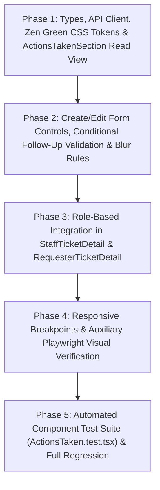

# Technical Implementation Plan: Issue 19 — Actions Taken UI, Ticket Detail Integration & Access Control

| Metadata | Value |
| :--- | :--- |
| **Feature Identifier** | `19-actions-taken-ui` (Sprint 4 — Issue 19) |
| **Target Branch** | `feature/19-actions-taken-ui` |
| **Base Branch** | `lab4-staging` |
| **Authoritative Contract** | [`docs/features/19-actions-taken-ui/contract.md`](file:///c:/Users/xande/Documents/Year%203%20Sem%201/CPE%20334/Lab%201/toktickit/docs/features/19-actions-taken-ui/contract.md) |
| **Backend Dependency** | [`docs/features/18-actions-taken-foundation/contract.md`](file:///c:/Users/xande/Documents/Year%203%20Sem%201/CPE%20334/Lab%201/toktickit/docs/features/18-actions-taken-foundation/contract.md) |
| **Status** | **READY FOR REVIEW** |

---

## 1. Target File Inventory

The following client-side files will be created or modified to fulfill the Issue 19 engineering contract (`FR-02`, `BR-02`, `BR-03`, `BR-04`, `BR-05`, `BR-12`, `NFR-03`, `UI-03`, `UI-04`, `AC-19.1`..`AC-19.4`). No server-side routes or database models require modification, as `/api/v1/tickets/:ticketId/actions-taken` is already implemented by Issue 18.

| Action | File Path | Responsibility & Planned Changes |
| :--- | :--- | :--- |
| **[MODIFY]** | [`client/src/types/index.ts`](file:///c:/Users/xande/Documents/Year%203%20Sem%201/CPE%20334/Lab%201/toktickit/client/src/types/index.ts) | Add `ActionTakenPerformerDTO`, `ActionTakenDTO`, `ActionTakenListResponseDTO`, `CreateActionTakenPayload`, and `UpdateActionTakenPayload` interfaces matching `docs/lab-04/api-spec.md` §3; add optional `actionsTaken?: ActionTakenDTO[]` field to `TicketDetail` for test/component interoperability. |
| **[MODIFY]** | [`client/src/api.ts`](file:///c:/Users/xande/Documents/Year%203%20Sem%201/CPE%20334/Lab%201/toktickit/client/src/api.ts) | Add API client functions `getActionsTakenApi(ticketId, requesterId?)`, `createActionTakenApi(ticketId, payload)`, and `updateActionTakenApi(ticketId, actionId, payload)` targeting `/api/v1/tickets/:ticketId/actions-taken` with session cookie credentials (`credentials: "include"`), optional `x-requester-id` header for Requester read access, and structured error handling (`400`, `403`, `404`, `409 Conflict`, `422 Unprocessable Entity`). |
| **[MODIFY]** | [`client/src/index.css`](file:///c:/Users/xande/Documents/Year%203%20Sem%201/CPE%20334/Lab%201/toktickit/client/src/index.css) | Add Sprint 4 Zen Green line-item CSS custom properties (`--color-action-item-border: #D1D5DB`, `--color-action-item-hover: #F0FDF4`, `--color-action-performer-bg: #E0E7FF`, `--color-action-performer-text: #3730A3`, `--color-followup-alert-bg: #FEF3C7`, `--color-followup-alert-text: #92400E`) and responsive classes for Desktop (`>= 1200px` 7-column table), Tablet (`768px–1024px` condensed/stacked cards), and Mobile (`< 768px` stacked cards with `>= 44px` touch targets and zero horizontal overflow). |
| **[NEW]** | [`client/src/components/ActionsTakenSection.tsx`](file:///c:/Users/xande/Documents/Year%203%20Sem%201/CPE%20334/Lab%201/toktickit/client/src/components/ActionsTakenSection.tsx) | Modular line-item component rendering chronological Actions Taken (`actionDateTime ASC`), performer role badge (`IT Staff` / `Admin`), follow-up status badge (`Follow-Up Required` / `Completed`), follow-up note callout, attachment notes, loading skeletons, empty state, error retry banner, and (when `canEdit={true}`) the Create/Edit modal/form with blur validation and optimistic concurrency (`version`) handling. |
| **[MODIFY]** | [`client/src/components/StaffTicketDetail.tsx`](file:///c:/Users/xande/Documents/Year%203%20Sem%201/CPE%20334/Lab%201/toktickit/client/src/components/StaffTicketDetail.tsx) | Embed `<ActionsTakenSection />` above the Activity & Communication panels with `canEdit={true}` and `currentUser` passed from the authenticated staff/admin session, visually separating structured Actions Taken from Public Comments and Confidential Internal Notes. |
| **[MODIFY]** | [`client/src/components/RequesterTicketDetail.tsx`](file:///c:/Users/xande/Documents/Year%203%20Sem%201/CPE%20334/Lab%201/toktickit/client/src/components/RequesterTicketDetail.tsx) | Embed `<ActionsTakenSection />` in strict read-only mode (`canEdit={false}`, `currentUser={null}`) above the Public Comments card so Requesters can track troubleshooting progress without any create/edit controls in the DOM. |
| **[NEW]** | [`client/src/tests/lab-04/ActionsTaken.test.tsx`](file:///c:/Users/xande/Documents/Year%203%20Sem%201/CPE%20334/Lab%201/toktickit/client/src/tests/lab-04/ActionsTaken.test.tsx) | Automated Vitest + React Testing Library suite (`UI-19.01` through `UI-19.11`, mapping to `UI-03`, `UI-04`, and `AC-19.1`..`AC-19.4`) verifying chronological rendering, dynamic `Follow-Up Note` validation, blur validation rules, create/edit API submission, concurrency conflict preservation, requester read-only enforcement, and responsive/empty/error states. |

---

## 2. Execution Sequence Diagram



---

## 3. Detailed Phase Breakdown

### Phase 1: Component Structure, Types, API Client & Zen Green Theming

#### 1.1 TypeScript Interfaces (`client/src/types/index.ts`)
1. Define `ActionTakenPerformerDTO`:
   ```ts
   export interface ActionTakenPerformerDTO {
     id: string;
     fullName: string;
     email: string;
     role: 'IT_STAFF' | 'ADMINISTRATOR';
   }
   ```
2. Define `ActionTakenDTO`:
   ```ts
   export interface ActionTakenDTO {
     id: string;
     ticketId: string;
     actionDateTime: string;
     performedByUserId: string;
     performedBy: ActionTakenPerformerDTO;
     description: string;
     actionDescription: string;
     result: string;
     followUpRequired: boolean;
     followUpNote: string | null;
     attachmentNotes: string | null;
     version: number;
     createdAt: string;
     updatedAt: string;
   }
   ```
3. Define `ActionTakenListResponseDTO`, `CreateActionTakenPayload`, and `UpdateActionTakenPayload` (requiring `version: number` per `BR-12`).
4. Add optional `actionsTaken?: ActionTakenDTO[]` to `TicketDetail` for clean optional hydration in unit tests and parent views.

#### 1.2 REST API Client Methods (`client/src/api.ts`)
1. Implement `getActionsTakenApi(ticketId: string, requesterId?: string): Promise<ActionTakenListResponseDTO>`:
   - Calls `GET /api/v1/tickets/${encodeURIComponent(ticketId)}/actions-taken` with `credentials: "include"` and optional `x-requester-id` header when invoked from `RequesterTicketDetail`.
   - Unwraps `{ success: true, data: { items, totalCount } }`.
2. Implement `createActionTakenApi(ticketId: string, payload: CreateActionTakenPayload): Promise<ActionTakenDTO>`:
   - Calls `POST /api/v1/tickets/${encodeURIComponent(ticketId)}/actions-taken` with `credentials: "include"`.
   - Throws a typed error preserving `code` (`VALIDATION_ERROR`, `FORBIDDEN`, etc.) and `details` on non-2xx responses.
3. Implement `updateActionTakenApi(ticketId: string, actionId: string, payload: UpdateActionTakenPayload): Promise<ActionTakenDTO>`:
   - Calls `PUT /api/v1/tickets/${encodeURIComponent(ticketId)}/actions-taken/${encodeURIComponent(actionId)}` with `credentials: "include"`.
   - Surfaces HTTP `409 Conflict` (`CONCURRENCY_CONFLICT`) and HTTP `422` (`VALIDATION_ERROR`) so the form can display an inline error banner while preserving user-typed values.

#### 1.3 Zen Green Tokens & Visual Distinction (`client/src/index.css` & `ActionsTakenSection.tsx`)
1. Add the Sprint 4 CSS tokens in `:root` of [`client/src/index.css`](file:///c:/Users/xande/Documents/Year%203%20Sem%201/CPE%20334/Lab%201/toktickit/client/src/index.css):
   - `--color-primary-green: #006B3C`
   - `--color-secondary-green: #0B7A46`
   - `--color-pale-green: #EAF6EF`
   - `--color-page-bg: #F5F7F6`
   - `--color-action-item-border: #D1D5DB`
   - `--color-action-item-hover: #F0FDF4`
   - `--color-action-performer-bg: #E0E7FF`
   - `--color-action-performer-text: #3730A3`
   - `--color-followup-alert-bg: #FEF3C7`
   - `--color-followup-alert-text: #92400E`
2. Establish clear three-way visual separation in the Ticket Detail workspace (`docs/lab-04/ui-spec.md` §1 & §3.2):
   - **Actions Taken Section**: Structured 1:N line-item container with `--color-surface-card` (`#FFFFFF`) background, `4px solid var(--color-primary-green)` (`#006B3C`) left accent border on the header bar, `--color-pale-green` (`#EAF6EF`) table header row and count pill (`Actions Taken (N)`), and `--color-action-item-hover` (`#F0FDF4`) row hover highlight.
   - **Public Comments Section**: Conversational timeline with neutral `#F8FAFB` bubbles and `3px solid var(--color-secondary-green)` (`#0B7A46`) left border.
   - **Confidential Internal Notes Section**: Staff-only amber-tinted container (`#FFFBEB` / `#FEF3C7`) with `Lock` icon badge.
3. Render chronological line items (`actionDateTime ASC`) with all required fields (`docs/ui/line-item-section.pdf` & `docs/lab-04/ui-spec.md` §3.2):
   - **No.**: `1`-based sequential row index (`1`, `2`, `3`, ...).
   - **Date/Time**: Formatted human-readable timestamp (`actionDateTime`).
   - **Performed By**: `performedBy.fullName` plus role badge (`IT Staff` for `IT_STAFF`, `Admin` for `ADMINISTRATOR`) styled with `--color-action-performer-bg` (`#E0E7FF`) and `--color-action-performer-text` (`#3730A3`).
   - **Action Description**: Full description text (`actionDescription || description`) with pre-wrap line breaks.
   - **Result / Outcome**: Full result text (`result`) plus sub-caption for `attachmentNotes` (`Attachment Notes: ...`) when present.
   - **Follow-Up Status**:
     - When `followUpRequired === true`: Amber alert pill `Follow-Up Required` (`--color-followup-alert-bg: #FEF3C7`, `--color-followup-alert-text: #92400E`) + visible `Follow-up Note` callout block.
     - When `followUpRequired === false`: Pale green pill `Completed` (`--color-pale-green: #EAF6EF`, `--color-primary-green: #006B3C`).
   - **Row Actions (Staff/Admin only)**: `Edit` button with `data-tooltip="Edit action record"` (never using native HTML `title`, per `AGENTS.md` §4).

---

### Phase 2: Form Controls, Validation & State Management

#### 2.1 Create & Edit Modes (`ActionsTakenSection.tsx`)
1. **Mode State**:
   - `formMode: 'closed' | 'create' | 'edit'`
   - `editingAction: ActionTakenDTO | null` (stores `id` and `version` for `PUT` requests).
2. **Form Fields & Constraints**:
   - **Performed By (Auto)** (`input[type="text"]`, `readOnly`, `disabled`, `aria-readonly="true"`):
     - In **Create** mode: Displays `${currentUser.fullName} (${currentUser.role === 'ADMINISTRATOR' ? 'Admin' : 'IT Staff'})` (`BR-03`).
     - In **Edit** mode: Displays `${editingAction.performedBy.fullName} (${editingAction.performedBy.role === 'ADMINISTRATOR' ? 'Admin' : 'IT Staff'})`.
   - **Action Date/Time** (`input[type="datetime-local"]`):
     - Defaults to current local timestamp (`YYYY-MM-DDTHH:mm`) on Create; pre-fills from `editingAction.actionDateTime` on Edit.
   - **Action Description** (`textarea`, required, `5`–`1000` trimmed chars, `BR-05`).
   - **Result / Outcome** (`textarea`, required, `2`–`1000` trimmed chars, `BR-05`).
   - **Follow-Up Required?** (`input[type="checkbox"]` / switch with `role="switch"` and `aria-checked`, `BR-04`):
     - Defaults to `false` on Create.
     - Toggling to `true` immediately mounts/reveals the **Follow-Up Note** `textarea` (`required`, `5`–`1000` trimmed chars).
     - Toggling to `false` hides **Follow-Up Note** and clears any pending follow-up note validation error.
   - **Attachment Notes** (`input[type="text"]`, optional, max `255` chars).

#### 2.2 Blur Validation Rule (`AGENTS.md` §4 & `docs/lab-04/ui-spec.md` §5.3)
1. **On Blur (`onBlur`)**:
   - **Action Date/Time**: If the entered value is unparseable (`Number.isNaN( Date.parse(val) )`) or represents a future timestamp (`new Date(val).getTime() > Date.now() + 60_000`), immediately blank out the field (`setActionDateTime('')`) on blur **without** displaying a form-level validation error message.
   - **Text Inputs (`description`, `result`, `followUpNote`, `attachmentNotes`)**: If the user entered whitespace-only characters (`val.length > 0 && val.trim().length === 0`), clear the field to `""` on blur **without** showing an inline error message.
2. **On Explicit Save/Submit (`onSubmit`)**:
   - Validate all constraints only when the user clicks **Save Action** / **Update Action**:
     - `description.trim().length < 5` or `> 1000` $\rightarrow$ `"Action Description is required (5–1000 characters)."`
     - `result.trim().length < 2` or `> 1000` $\rightarrow$ `"Result / Outcome is required (2–1000 characters)."`
     - `followUpRequired === true` and (`followUpNote.trim().length < 5` or `> 1000`) $\rightarrow$ `"Follow-Up Note is required when Follow-Up Required is enabled (5–1000 characters)."`
     - `attachmentNotes.trim().length > 255` $\rightarrow$ `"Attachment Notes cannot exceed 255 characters."`
   - If any validation rule fails, block the API request and render inline error alerts (`role="alert"`, `--color-error: #C62828`).

#### 2.3 Submit Button Busy State & Recoverable Error Preservation
1. **Busy State (`isSubmitting === true`)**:
   - Disable the submit button (`disabled={isSubmitting}`, `aria-busy="true"`), render an inline spinner icon, and change the label to `"Saving..."`.
2. **Success Path**:
   - On `201 Created` or `200 OK`, update the chronological list (sorted by `actionDateTime ASC`), close the form, reset draft fields, and show a brief confirmation alert or updated count badge.
3. **Recoverable Error Path (`409 Conflict` / `422` / `500`)**:
   - Keep the form open and preserve all user-entered field values (`description`, `result`, `followUpRequired`, `followUpNote`, `attachmentNotes`) so no typing is lost (`AC-19.2`, `BR-12`).
   - Display a prominent error banner inside the form (`role="alert"`).

---

### Phase 3: Role-Based Ticket Detail Integration

#### 3.1 Staff & Administrator Integration (`client/src/components/StaffTicketDetail.tsx`)
1. Import `ActionsTakenSection` into [`StaffTicketDetail.tsx`](file:///c:/Users/xande/Documents/Year%203%20Sem%201/CPE%20334/Lab%201/toktickit/client/src/components/StaffTicketDetail.tsx).
2. Render `<ActionsTakenSection />` inside the `.std-workspace` container directly above the `.std-activity-grid` (Public Comments & Confidential Internal Notes):
   ```tsx
   <ActionsTakenSection
     ticketId={ticket.id}
     canEdit={currentUser.role === 'IT_STAFF' || currentUser.role === 'ADMINISTRATOR'}
     currentUser={currentUser}
     initialActions={ticket.actionsTaken}
   />
   ```
3. Ensure `IT_STAFF` and `ADMINISTRATOR` users see the `+ Add Action Taken` button, per-row `Edit` buttons (`data-tooltip="Edit action record"`), and the Create/Edit modal/form (`AC-19.1`, `AC-19.3`).

#### 3.2 Requester Read-Only Integration (`client/src/components/RequesterTicketDetail.tsx`)
1. Import `ActionsTakenSection` into [`RequesterTicketDetail.tsx`](file:///c:/Users/xande/Documents/Year%203%20Sem%201/CPE%20334/Lab%201/toktickit/client/src/components/RequesterTicketDetail.tsx).
2. Render `<ActionsTakenSection />` in strict read-only mode (`canEdit={false}`, `currentUser={null}`, `requesterId={requesterId}`) above the Public Comments card (`AC-19.4`):
   - **Backward-Compatibility Guard for Legacy Lab 2 Unit Tests**: In [`client/tests/lab-02/RequesterTicketDetail.test.tsx`](file:///c:/Users/xande/Documents/Year%203%20Sem%201/CPE%20334/Lab%201/toktickit/client/tests/lab-02/RequesterTicketDetail.test.tsx) (`CT-TD-02`), legacy Lab 2 mock fixtures omit `publicComments` and `actionsTaken` and assert that Lab 2-only views do not render `"Actions Taken"`. Mirroring the existing pattern on line 584 of `RequesterTicketDetail.tsx` (`{ticket.publicComments !== undefined && ...}`), render `<ActionsTakenSection />` when `ticket.publicComments !== undefined || ticket.actionsTaken !== undefined`. Real API responses from `GET /api/tickets/:id` always include `publicComments: [...]`, so production and Lab 4 Requester views always mount `<ActionsTakenSection />`, while legacy Lab 2 unit test fixtures remain 100% green.
3. **Complete DOM Suppression of Write Controls (`BR-02`, `AC-19.4`)**:
   - When `canEdit === false`, `ActionsTakenSection` must **not** render the `+ Add Action Taken` button, per-row `Edit` buttons, or the `<form>` element anywhere in the DOM (`queryByRole('button', { name: /add action/i }) === null`, `queryByRole('button', { name: /edit/i }) === null`).

---

### Phase 4: Responsive Layout & Auxiliary Visual Artifacts

#### 4.1 Responsive Breakpoints (`docs/lab-04/ui-spec.md` §4 & `NFR-03`)
1. **Desktop (`>= 1200px`)**:
   - Full 7-column semantic table (`.at-table-desktop`) with Zen Green pale header (`#EAF6EF`), `1px solid #D1D5DB` cell borders, and `#F0FDF4` row hover state.
2. **Tablet (`768px–1024px`) & Mobile (`< 768px`)**:
   - Stacked vertical card layout (`.at-cards-mobile`) where each action record renders as an individual card with a top header bar (`#No.`, `Date/Time`, `Follow-Up Status` pill, and `Edit` button if `canEdit={true}`), performer badge row, labeled `Description` and `Result` sections, conditional amber `Follow-Up Note` box, and `Attachment Notes` footer.
   - All interactive controls (`+ Add Action Taken`, `Edit`, `Follow-Up Required?` toggle, `Save Action`, `Cancel`) enforce `min-height: 44px` on `< 768px` viewports and `overflow-x: hidden` / `word-break: break-word` for zero horizontal page scrolling.

#### 4.2 Feedback States (`docs/lab-04/ui-spec.md` §5)
1. **Loading State**: Render 3 pulsing skeleton rows (`data-testid="actions-taken-skeleton"`, `aria-busy="true"`) while `getActionsTakenApi` is in flight.
2. **Empty State**: When `items.length === 0`, display a centered empty-state panel (`data-testid="actions-taken-empty"`) with the exact text `"No actions taken recorded yet."` (plus a secondary prompt for Staff/Admin when `canEdit={true}`).
3. **Error State**: When initial fetch fails, render an inline error alert (`role="alert"`, `data-testid="actions-taken-error"`) with a `"Retry"` button (`onClick={() => fetchActions()}`).

#### 4.3 Auxiliary Playwright Visual Verification Safeguard
- **Strict Separation Rule**: Playwright screenshot capture is strictly an **auxiliary developer review step** executed after implementation to verify Desktop (`1280x800`) and Mobile (`375x812`) visual fidelity.
- Screenshot artifacts will be saved exclusively to:
  - `artifacts/lab-04/screenshots/actions-taken/desktop-staff-actions-taken.png`
  - `artifacts/lab-04/screenshots/actions-taken/desktop-action-form-followup.png`
  - `artifacts/lab-04/screenshots/actions-taken/desktop-requester-readonly.png`
  - `artifacts/lab-04/screenshots/actions-taken/mobile-actions-taken-cards.png`
- **Prohibition**: Do **NOT** modify `docs/lab-04/tests.md` or mix Playwright screenshot assertions into the Vitest unit test specifications.

---

### Phase 5: Automated Component Testing (`client/src/tests/lab-04/ActionsTaken.test.tsx`)

Create [`client/src/tests/lab-04/ActionsTaken.test.tsx`](file:///c:/Users/xande/Documents/Year%203%20Sem%201/CPE%20334/Lab%201/toktickit/client/src/tests/lab-04/ActionsTaken.test.tsx) using Vitest and React Testing Library to verify all contract scenarios (`UI-03`, `UI-04`, `AC-19.1`..`AC-19.4`):

| Test ID | STS / AC Mapping | Planned Test Assertion Summary |
| :--- | :--- | :--- |
| **`UI-19.01`** | `AC-19.1`, `FR-02` | Renders chronological Actions Taken records (`actionDateTime ASC`) with 1-based row numbers, Date/Time, Performed By full name + role badge (`IT Staff` / `Admin`), Description, Result, `Follow-Up Required` / `Completed` badge, Follow-up Note, and Attachment Notes. |
| **`UI-19.02`** | `UI-03`, `BR-04`, `AC-19.2` | Dynamic `Follow-Up Required?` toggle: verifies `Follow-Up Note` input is hidden when unchecked, appears and is marked required when checked, blocks submission with inline validation error if left blank or `< 5` chars, and hides/clears error when unchecked. |
| **`UI-19.03`** | `BR-03`, `AC-19.1` | Auto-populated read-only `Performed By`: opening the Add Action form as `IT_STAFF` or `ADMINISTRATOR` displays the current user's name and role in a `readOnly`/`disabled` field. |
| **`UI-19.04`** | `BR-05`, `AC-19.2` | Blur validation & submit-only error messages: entering an invalid/future date or whitespace-only text blanks out on `blur` without showing an inline error; clicking `Save Action` with missing `Description` or `Result` blocks API call and renders validation messages. |
| **`UI-19.05`** | `FR-02`, `AC-19.1` | Create Action submission: submitting valid fields calls `createActionTakenApi`, disables the button with `"Saving..."` while in flight, appends the new record to the list on `201 Created`, and closes the form. |
| **`UI-19.06`** | `FR-02`, `BR-12`, `AC-19.3` | Edit Action submission: clicking `Edit` on an existing row pre-populates all fields, sends `PUT` with the current `version`, and updates the row in place on `200 OK`. |
| **`UI-19.07`** | `BR-12`, `AC-19.2` | Recoverable API error (`409 Conflict` / `422`): when `createActionTakenApi` or `updateActionTakenApi` rejects, renders an inline error banner and preserves all user-typed form values in state. |
| **`UI-19.08`** | `UI-04`, `BR-02`, `AC-19.4` | Requester read-only mode (`canEdit={false}` / `RequesterTicketDetail`): renders all action records and follow-up badges while completely omitting `+ Add Action Taken`, `Edit` buttons, and form inputs from the DOM. |
| **`UI-19.09`** | `AC-19.1` | Empty state resilience: when `items: []` is returned, displays `"No actions taken recorded yet."` without layout errors. |
| **`UI-19.10`** | `AC-19.1` | Loading skeleton & error retry state: renders skeleton placeholders while loading; on network failure, displays error banner and re-invokes `getActionsTakenApi` when `Retry` is clicked. |
| **`UI-19.11`** | `NFR-03`, `AC-19.1` | Responsive structure & Zen Green visual separation: verifies both desktop table (`.at-table-desktop`) and mobile/tablet card list (`.at-cards-mobile`) structures and Zen Green semantic classes separating Actions Taken from Public Comments and Internal Notes. |

---

## 4. Verification Commands

During execution (after plan approval), the following verification commands will be run:
1. **Targeted Lab 04 Component Suite**:
   ```powershell
   npm --prefix client test -- src/tests/lab-04/ActionsTaken.test.tsx
   ```
2. **Full Client Regression Suite (Labs 1–4)**:
   ```powershell
   npm --prefix client test
   ```
3. **Client TypeScript & Production Build Check**:
   ```powershell
   npm --prefix client run build
   ```

---

## 5. Definition of Done Checklist

- [x] `ActionsTakenSection.tsx` renders chronological action records with Zen Green tokens (`#006B3C`, `#0B7A46`, `#EAF6EF`, `#F5F7F6`) visually distinct from Public Comments and Confidential Internal Notes.
- [x] Create and Edit modes enforce read-only auto-populated `Performed By` (`BR-03`), required `Description` & `Result` (`BR-05`), conditional `Follow-Up Note` when `Follow-Up Required?` is toggled (`BR-04`), optimistic concurrency `version` (`BR-12`), and the Blur Validation Rule (`AGENTS.md` §4).
- [x] `StaffTicketDetail.tsx` integrates `ActionsTakenSection` with full create/edit capabilities for `IT_STAFF` and `ADMINISTRATOR`.
- [x] `RequesterTicketDetail.tsx` integrates `ActionsTakenSection` in strict read-only mode (`canEdit={false}`) with zero create/edit DOM controls (`BR-02`).
- [x] Desktop (`>= 1200px`), Tablet (`768px–1024px`), and Mobile (`< 768px`) layouts render with zero horizontal scrolling, loading skeletons, empty states, and retryable error banners.
- [x] All 11 automated tests in `client/src/tests/lab-04/ActionsTaken.test.tsx` (`AC-19.1`..`AC-19.4`, `UI-03`, `UI-04`) and all existing client regression tests pass.
- [x] Auxiliary Playwright visual verification screenshots are saved strictly to `artifacts/lab-04/screenshots/actions-taken/` without modifying `docs/lab-04/tests.md`.

