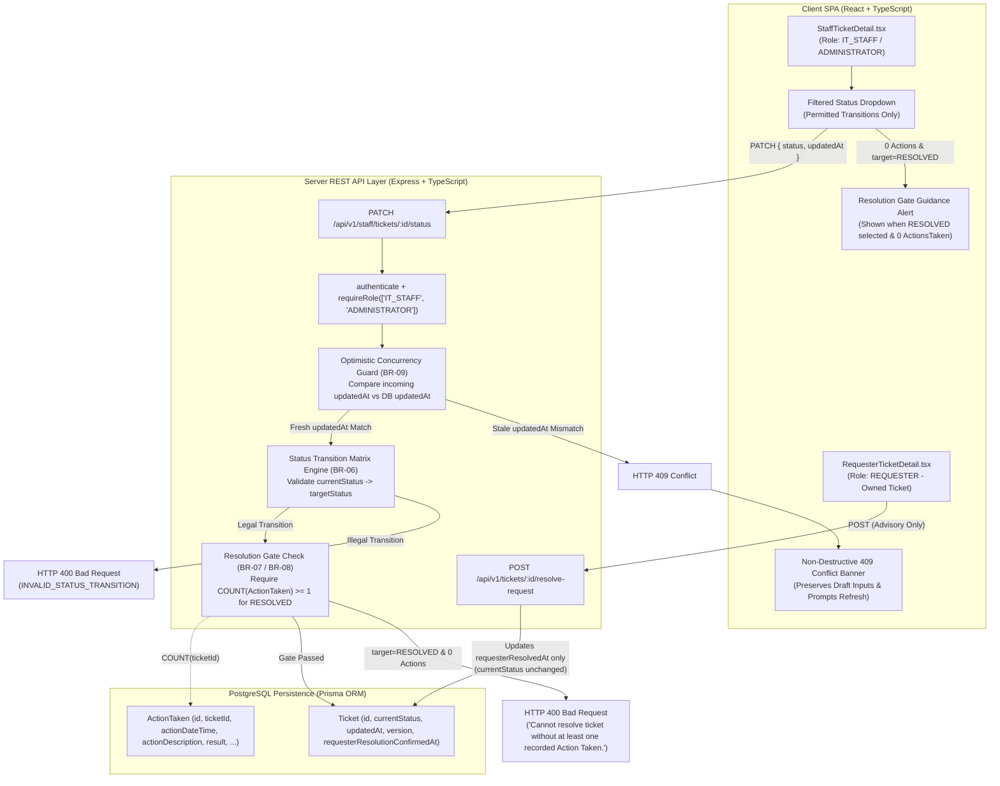
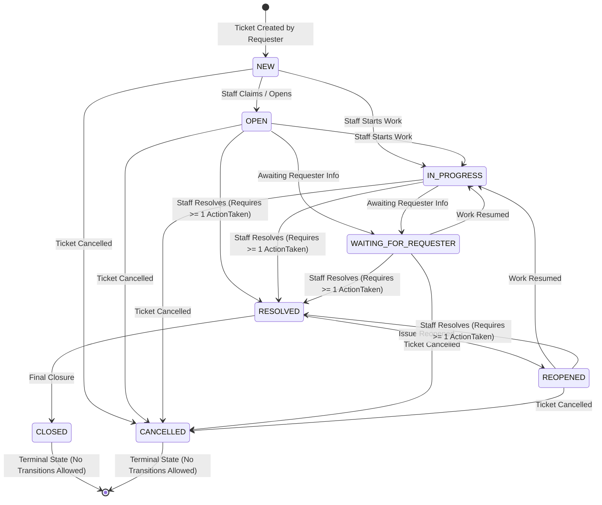

# Feature Engineering Contract: Issue 20 — Ticket Status Lifecycle, Concurrency & Resolution Gate

**Feature Identifier:** Issue 20: Ticket Status Lifecycle, Concurrency & Resolution Gate  
**Target Branch:** `feature/20-ticket-workflow`  
**Base Branch:** `lab4-staging`  
**Sprint / Milestone:** TokTickIT Lab 4 (Sprint 4) — Actions Taken, Dashboards, Workflow Resolution Gate, and Final Regression  
**Specification Version:** 1.0.0  
**Status:** APPROVED ENGINEERING CONTRACT  
**Traceability References:** [AGENTS.md](../../../AGENTS.md), [SE+Lab+4.pdf](../../reference/SE+Lab+4.pdf) (§3, §4.1, §4.2, §4.5, §6.1, §8.4, §8.5), [TokTickIT-System-Level-SDS-v1.0.pdf](../../reference/TokTickIT-System-Level-SDS-v1.0.pdf) (D-02, §7–§10, p. 9–17), [specification.md](../../lab-04/specification.md), [ui-spec.md](../../lab-04/ui-spec.md), [api-spec.md](../../lab-04/api-spec.md), [tests.md](../../lab-04/tests.md), [Issue 18 Contract](../18-actions-taken-foundation/contract.md), [Issue 19 Contract](../19-actions-taken-ui/contract.md)

---

## 1. Feature Goal & Scope

### 1.1 Purpose & Architectural Objectives
This engineering contract establishes the authoritative technical specifications, state transition matrix rules, resolution gate invariants, optimistic concurrency protocols, REST API contracts, frontend workflow controls, and automated test mappings for **Issue 20: Ticket Status Lifecycle, Concurrency & Resolution Gate**.

With the `ActionTaken` persistence foundation (Issue 18) and the `ActionsTakenSection` user interface (Issue 19) established, Issue 20 connects technical work tracking directly to the authoritative ticket status lifecycle:

1. **Ticket Status Transition Matrix Enforcement (`BR-06`):** Enforces the strict 8-state service-desk transition graph (`NEW`, `OPEN`, `IN_PROGRESS`, `WAITING_FOR_REQUESTER`, `RESOLVED`, `CLOSED`, `REOPENED`, `CANCELLED`). `CLOSED` and `CANCELLED` are enforced as strict terminal states with zero outbound transitions. Any disallowed transition attempt is rejected by the backend with HTTP `400 Bad Request`.
2. **Backend Resolution Gate Invariant (`BR-07` & `BR-08`):** Enforces a mandatory server-side resolution gate before a ticket may transition to `RESOLVED`. If a ticket has `0` recorded `ActionTaken` rows in the database, the backend rejects the transition to `RESOLVED` with HTTP `400 Bad Request` and the message `"Cannot resolve ticket without at least one recorded Action Taken."`
3. **Advisory Requester Problem Resolution (`BR-07` & `BR-08`):** Preserves the strictly advisory nature of a Requester's `"Problem Appears Resolved"` action (`POST /api/v1/tickets/:id/resolve-request`). Triggering this endpoint updates the `requesterResolvedAt` (`requesterResolutionConfirmedAt`) timestamp without altering `currentStatus` and without bypassing the backend resolution gate.
4. **Optimistic Concurrency Protection (`BR-09`):** Protects ticket status mutations against lost updates when multiple IT Staff members view and edit the same ticket concurrently. Status update requests require the client's known `updatedAt` timestamp token; if the token is stale relative to the current database record, the server aborts the mutation and responds with HTTP `409 Conflict`.
5. **Frontend Workflow Controls (`StaffTicketDetail.tsx`):**
   - Filters the status selector dropdown to display **only** legally permitted next statuses from the current state (and disables/hides transition controls when the ticket is in terminal state `CLOSED` or `CANCELLED`).
   - Displays an informative guidance alert when an IT Staff or Administrator user attempts to select or submit `RESOLVED` on an action-less ticket (`0` `ActionTaken` records).
   - Displays a non-destructive `409 Conflict` banner upon detecting a stale update conflict, prompting the user to refresh ticket state in-place without wiping unsaved draft inputs (such as public comment or internal note text).
   - Refreshes the ticket header status badge, sidebar badge, `updatedAt` concurrency token, and next permitted options in-place upon a successful status transition without a full page reload.



---

### 1.2 In-Scope Deliverables
* **Backend Status Lifecycle, Concurrency & Resolution Gate (`server/src/routes/staff.ts` & `server/src/routes/tickets.ts`):**
  - Update `isTransitionAllowed(from, to)` and `ALLOWED_STATUS_TRANSITIONS` to enforce the authoritative 8-state transition matrix (`BR-06`), with `CLOSED` and `CANCELLED` as terminal states (`[]`).
  - Update `PATCH /api/v1/staff/tickets/:id/status` to:
    1. Reject disallowed transitions with HTTP `400 Bad Request` (`INVALID_STATUS_TRANSITION`).
    2. Enforce Optimistic Concurrency Control (`BR-09`) by requiring and comparing the incoming `updatedAt` token against the persisted `ticket.updatedAt` timestamp, rejecting stale requests with HTTP `409 Conflict` (`CONCURRENCY_CONFLICT`).
    3. Enforce the Resolution Gate Invariant (`BR-07`, `BR-08`) when transitioning to `RESOLVED`: query `prisma.actionTaken.count({ where: { ticketId } })` and reject with HTTP `400 Bad Request` (`RESOLUTION_GATE_VIOLATION`) and message `"Cannot resolve ticket without at least one recorded Action Taken."` if the count is `0`.
  - Ensure `POST /api/v1/tickets/:id/resolve-request` (`BR-08`) updates `requesterResolutionConfirmedAt` (and returns `requesterResolvedAt` + `requesterResolutionConfirmedAt` in the response and `GET /api/v1/tickets/:id` detail DTO) while keeping `currentStatus` strictly unchanged.
* **Frontend Workflow Controls (`client/src/components/StaffTicketDetail.tsx`, `client/src/api.ts`, `client/src/types/index.ts`):**
  - Update `ALLOWED_STATUS_TRANSITIONS` in `StaffTicketDetail.tsx` to match the authoritative matrix (`RESOLVED` → `["CLOSED", "REOPENED"]`, `REOPENED` → `["IN_PROGRESS", "RESOLVED", "CANCELLED"]`, `CLOSED` → `[]`, `CANCELLED` → `[]`).
  - Update `transitionTicketStatusApi(ticketId, targetStatus, updatedAt)` in `client/src/api.ts` to transmit `{ status: targetStatus, targetStatus, updatedAt }`.
  - Synchronize `actionsTaken` count in `StaffTicketDetail.tsx` via `ActionsTakenSection`'s `onActionsChanged` callback so the workflow panel dynamically knows whether the ticket has $\ge 1$ recorded `ActionTaken`.
  - Render an informative guidance alert when `RESOLVED` is selected on a ticket with `0` `ActionTaken` records.
  - Render a non-destructive `409 Conflict` banner with an in-place **"Refresh Ticket"** action when a concurrency conflict occurs, preserving all unsaved draft text (`publicCommentText`, `internalNoteText`).
  - Refresh header status badge, sidebar status badge, `updatedAt` token, and dropdown options in-place on successful transition without a full page reload.
* **Automated Verification Suites:**
  - Backend API integration tests: `server/tests/lab-04/ticket-workflow.api.test.ts`
  - Frontend UI component tests: `client/src/tests/lab-04/TicketWorkflow.test.tsx`

---

### 1.3 Explicit Exclusions (Out of Scope)
To maintain strict adherence to the Closed-World Rule (`AGENTS.md` §4) and `SE+Lab+4.pdf` §4.2, the following are explicitly excluded from Issue 20:
* **No Multi-Level Approval Hierarchies:** No managerial sign-off workflows, secondary supervisor approvals, or electronic signature gates before resolving or closing a ticket.
* **No Rollback or Saga Transactions:** No distributed saga orchestrators, compensating multi-service rollback pipelines, or status history undo engines.
* **No Re-Opening Closed or Cancelled Tickets:** `CLOSED` and `CANCELLED` are strictly terminal states in this workflow contract; once a ticket reaches `CLOSED` or `CANCELLED`, no further status transitions are permitted (`ALLOWED_STATUS_TRANSITIONS.CLOSED = []`, `ALLOWED_STATUS_TRANSITIONS.CANCELLED = []`).
* **No Automatic SLA Clocks or External Notifications:** No background auto-close timers, SLA countdowns, or outbound email/SMS/LINE notifications on status changes.

---

### 1.4 Requirements & Business Rules Traceability Matrix

| Rule / Req ID | Sprint 4 Spec Ref | Rule Name | Mandatory Enforcement in Issue 20 |
| :--- | :--- | :--- | :--- |
| **BR-06** | `BR-11` / `FR-02.1` | **Status Transition Matrix** | Enforces exact legal transitions from each of the 8 statuses; `CLOSED` and `CANCELLED` are terminal; disallowed transitions return `400 Bad Request`. |
| **BR-07** | `BR-08` / `FR-02.2` | **Resolution Gate Invariant** | Transition to `RESOLVED` requires $\ge 1$ `ActionTaken` record on the ticket. If `0` actions exist, rejects with `400 Bad Request` (`"Cannot resolve ticket without at least one recorded Action Taken."`). |
| **BR-08** | `BR-10` / `FR-02.5` | **Advisory Requester Resolution** | Requester `"Problem Appears Resolved"` sets `requesterResolvedAt` (`requesterResolutionConfirmedAt`) timestamp only; never changes `currentStatus` and never bypasses the resolution gate. |
| **BR-09** | `BR-12` / `FR-05.1–05.3` | **Optimistic Concurrency Control** | Status updates require incoming `updatedAt` token matching current DB timestamp; stale mismatch rejects with `409 Conflict` without overwriting concurrent changes. |
| **AC-20.1** | `AC-07`, `API-13`, `UI-06` | **Matrix & Terminal State Enforcement** | Verified in `ticket-workflow.api.test.ts` and `TicketWorkflow.test.tsx`. |
| **AC-20.2** | `AC-06`, `AC-09`, `API-09..12` | **Resolution Gate & Advisory Resolution** | Verified in `ticket-workflow.api.test.ts` and `TicketWorkflow.test.tsx`. |
| **AC-20.3** | `AC-14`, `API-08` | **Concurrency Conflict (`409`) Protection** | Verified in `ticket-workflow.api.test.ts` and `TicketWorkflow.test.tsx`. |
| **AC-20.4** | `UI-05`, `UI-06` | **Frontend Workflow Controls & In-Place Refresh** | Verified in `TicketWorkflow.test.tsx`. |

---

## 2. Authoritative Status Transition Matrix (`BR-06`)

### 2.1 State Transition Diagram



### 2.2 Permitted Transitions & Preconditions Table

| Current Status (`from`) | Permitted Target Statuses (`to`) | Terminal? | Mandatory Backend Preconditions & Rules |
| :--- | :--- | :---: | :--- |
| **`NEW`** | `OPEN`, `IN_PROGRESS`, `CANCELLED` | No | Cannot jump directly to `WAITING_FOR_REQUESTER`, `RESOLVED`, `CLOSED`, or `REOPENED`. |
| **`OPEN`** | `IN_PROGRESS`, `WAITING_FOR_REQUESTER`, `RESOLVED`, `CANCELLED` | No | Transition to `RESOLVED` must pass the Resolution Gate (`COUNT(ActionTaken) >= 1`). |
| **`IN_PROGRESS`** | `WAITING_FOR_REQUESTER`, `RESOLVED`, `CANCELLED` | No | Transition to `RESOLVED` must pass the Resolution Gate (`COUNT(ActionTaken) >= 1`). |
| **`WAITING_FOR_REQUESTER`** | `IN_PROGRESS`, `RESOLVED`, `CANCELLED` | No | Transition to `RESOLVED` must pass the Resolution Gate (`COUNT(ActionTaken) >= 1`). |
| **`RESOLVED`** | `CLOSED`, `REOPENED` | No | May be formally closed (`CLOSED`) or moved to `REOPENED` if additional work is needed. |
| **`CLOSED`** | *None* (`[]`) | **Yes (Terminal)** | No outbound status transitions permitted. Any transition request is rejected with `400 Bad Request`. |
| **`REOPENED`** | `IN_PROGRESS`, `RESOLVED`, `CANCELLED` | No | Transition to `RESOLVED` must pass the Resolution Gate (`COUNT(ActionTaken) >= 1`). |
| **`CANCELLED`** | *None* (`[]`) | **Yes (Terminal)** | No outbound status transitions permitted. Any transition request is rejected with `400 Bad Request`. |

### 2.3 Disallowed Transition Rejection Rule
* Any request to `PATCH /api/v1/staff/tickets/:id/status` attempting a transition not explicitly listed in Section 2.2 (including self-transitions if disallowed or transitions out of `CLOSED` / `CANCELLED`, or invalid status strings) MUST be rejected with HTTP **`400 Bad Request`**:
```json
{
  "success": false,
  "error": {
    "code": "INVALID_STATUS_TRANSITION",
    "message": "Cannot transition status from NEW to RESOLVED. Allowed transitions: OPEN, IN_PROGRESS, CANCELLED."
  }
}
```

---

## 3. Resolution Gate Invariant & Advisory Requester Resolution (`BR-07` & `BR-08`)

### 3.1 Backend Resolution Gate Invariant (`BR-07` & `BR-08`)
1. **Zero-Action Resolution Block:**
   - Whenever an authorized user (`IT_STAFF` or `ADMINISTRATOR`) requests a transition to `RESOLVED` from any status that legally permits transitioning to `RESOLVED` (`OPEN`, `IN_PROGRESS`, `WAITING_FOR_REQUESTER`, `REOPENED`), the backend MUST query the `actions_taken` table for that ticket:
     ```typescript
     const actionCount = await prisma.actionTaken.count({
       where: { ticketId: ticket.id },
     });
     ```
   - If `actionCount === 0`, the backend MUST abort the status update and return HTTP **`400 Bad Request`**:
     ```json
     {
       "success": false,
       "error": {
         "code": "RESOLUTION_GATE_VIOLATION",
         "message": "Cannot resolve ticket without at least one recorded Action Taken."
       }
     }
     ```
2. **Resolution Gate Satisfaction:**
   - Once at least one `ActionTaken` record has been persisted for the ticket (`actionCount >= 1`), transitioning to `RESOLVED` from a permitted origin status succeeds with HTTP `200 OK`.

### 3.2 Advisory Requester Problem Resolution (`BR-07` & `BR-08`)
1. **Strict Advisory Boundary:**
   - When an authenticated `REQUESTER` who owns the ticket (`ticket.requesterId === req.user.id`) invokes `POST /api/v1/tickets/:id/resolve-request`, the server sets `requesterResolutionConfirmedAt = new Date()` (serialized in API responses as both `requesterResolutionConfirmedAt` and `requesterResolvedAt`).
   - **Invariant 1:** `ticket.currentStatus` MUST remain completely unchanged (e.g., if `currentStatus` was `IN_PROGRESS` or `OPEN`, it remains `IN_PROGRESS` or `OPEN`).
   - **Invariant 2:** Recording `requesterResolvedAt` does **not** satisfy or bypass the Resolution Gate. Even if the Requester has clicked `"Problem Appears Resolved"`, IT Staff still cannot transition the ticket to `RESOLVED` until at least one `ActionTaken` record exists on the ticket.
   - **Invariant 3:** Only `IT_STAFF` and `ADMINISTRATOR` roles can invoke `PATCH /api/v1/staff/tickets/:id/status`. Any attempt by a `REQUESTER` to call the staff status endpoint is rejected with HTTP `403 Forbidden`.

---

## 4. Optimistic Concurrency Control (`BR-09`)

### 4.1 Token Requirement & Stale Update Detection
1. **Incoming `updatedAt` Token:**
   - Every status transition request to `PATCH /api/v1/staff/tickets/:id/status` must supply the ticket's last known `updatedAt` timestamp token (ISO 8601 string, e.g., `"2026-11-01T10:00:00.000Z"`):
     ```json
     {
       "status": "IN_PROGRESS",
       "updatedAt": "2026-11-01T10:00:00.000Z"
     }
     ```
   - If `updatedAt` is missing or cannot be parsed as a valid timestamp, the server rejects the request with HTTP **`400 Bad Request`** (`code: "MISSING_UPDATED_AT"`, message: `"updatedAt timestamp token is required for optimistic concurrency control."`).
2. **Timestamp Comparison & `409 Conflict` Rejection:**
   - The server compares the incoming `updatedAt` millisecond timestamp (`new Date(incomingUpdatedAt).getTime()`) against the database record's current `ticket.updatedAt.getTime()`.
   - If `new Date(incomingUpdatedAt).getTime() !== ticket.updatedAt.getTime()`, a concurrent modification has occurred since the client loaded the ticket. The server aborts the status update and returns HTTP **`409 Conflict`**:
     ```json
     {
       "success": false,
       "error": {
         "code": "CONCURRENCY_CONFLICT",
         "message": "Concurrency conflict: This ticket was modified by another user. Please refresh the ticket to load the latest state before updating status.",
         "currentStatus": "IN_PROGRESS",
         "currentUpdatedAt": "2026-11-01T10:05:12.450Z"
       }
     }
     ```
3. **Advancing `updatedAt` on Successful Transition:**
   - When the concurrency check, transition matrix check, and resolution gate check all pass, the server updates `currentStatus`, increments `version: { increment: 1 }`, and ensures `updatedAt` advances to a new timestamp (strictly greater than the previous `ticket.updatedAt`), returning the new `updatedAt` ISO string in the `200 OK` payload so subsequent in-place transitions by the same client succeed seamlessly.

---

## 5. REST API Endpoint Specifications

### 5.1 Transition Ticket Status (`PATCH /api/v1/staff/tickets/:id/status`)
* **Method & Path:** `PATCH /api/v1/staff/tickets/:id/status` (also mounted at `/api/staff/tickets/:id/status`)
* **Access Control:** Authenticated `IT_STAFF` or `ADMINISTRATOR` only (`401 Unauthorized` if unauthenticated; `403 Forbidden` if `REQUESTER`).
* **URL Parameters:**
  - `id` (integer, required): Target Ticket ID.
* **Request Body Schema:**
  ```typescript
  export interface TransitionStatusRequestDTO {
    /** Target status (accepts either `status` or `targetStatus` property) */
    status?: TicketStatus | string;
    targetStatus?: TicketStatus | string;
    /** Optimistic concurrency token (ISO-8601 timestamp from Ticket.updatedAt) */
    updatedAt: string;
  }
  ```
* **Validation Order & HTTP Status Codes:**
  1. **`400 Bad Request` (`INVALID_TICKET_ID`):** `:id` is not a valid integer.
  2. **`404 Not Found` (`TICKET_NOT_FOUND`):** Ticket does not exist.
  3. **`400 Bad Request` (`INVALID_STATUS`):** `status` / `targetStatus` is missing or not a valid `TicketStatus` value.
  4. **`400 Bad Request` (`MISSING_UPDATED_AT`):** `updatedAt` is missing or not a valid ISO timestamp string.
  5. **`409 Conflict` (`CONCURRENCY_CONFLICT`):** `new Date(updatedAt).getTime() !== ticket.updatedAt.getTime()`.
  6. **`400 Bad Request` (`INVALID_STATUS_TRANSITION`):** `targetStatus` is not permitted from `ticket.currentStatus` per the Status Transition Matrix (`BR-06`).
  7. **`400 Bad Request` (`RESOLUTION_GATE_VIOLATION`):** `targetStatus === "RESOLVED"` and `actionTakenCount === 0` (`"Cannot resolve ticket without at least one recorded Action Taken."`, `BR-07` & `BR-08`).
  8. **`200 OK`:** Status transition persisted.
* **Success Response (`200 OK`):**
  ```json
  {
    "success": true,
    "data": {
      "id": 101,
      "ticketNumber": "TKT-2026-00101",
      "currentStatus": "RESOLVED",
      "version": 2,
      "updatedAt": "2026-11-01T10:20:00.000Z",
      "requesterResolutionConfirmedAt": null,
      "requesterResolvedAt": null
    }
  }
  ```

---

### 5.2 Advisory Requester Resolution Confirmation (`POST /api/v1/tickets/:id/resolve-request`)
* **Method & Path:** `POST /api/v1/tickets/:id/resolve-request` (also accessible at `/api/tickets/:id/resolve-request`)
* **Access Control:** Authenticated `REQUESTER` who owns the ticket (`ticket.requesterId === currentUser.id`). Non-owning users receive HTTP `403 Forbidden`.
* **Request Body:** `{}`
* **Success Response (`200 OK`):**
  ```json
  {
    "success": true,
    "data": {
      "id": 101,
      "ticketNumber": "TKT-2026-00101",
      "currentStatus": "IN_PROGRESS",
      "requesterResolutionConfirmedAt": "2026-11-01T10:15:00.000Z",
      "requesterResolvedAt": "2026-11-01T10:15:00.000Z",
      "message": "Problem resolution indication recorded."
    }
  }
  ```
* **Ticket Detail DTO Enrichment (`GET /api/v1/tickets/:id`):**
  - Includes both `requesterResolutionConfirmedAt` and `requesterResolvedAt` (with identical ISO string or `null` value), `version`, `updatedAt`, and `actionsTaken` (ordered ascending by `actionDateTime`) so `StaffTicketDetail.tsx` has immediate access to the action count and concurrency token on initial load.

---

## 6. Frontend Workflow Controls Specification (`StaffTicketDetail.tsx`)

### 6.1 Permitted Transition Dropdown Filtering (`BR-06`)
* In `client/src/components/StaffTicketDetail.tsx`, `ALLOWED_STATUS_TRANSITIONS` is defined as:
  ```typescript
  export const ALLOWED_STATUS_TRANSITIONS: Record<string, string[]> = {
    NEW: ["OPEN", "IN_PROGRESS", "CANCELLED"],
    OPEN: ["IN_PROGRESS", "WAITING_FOR_REQUESTER", "RESOLVED", "CANCELLED"],
    IN_PROGRESS: ["WAITING_FOR_REQUESTER", "RESOLVED", "CANCELLED"],
    WAITING_FOR_REQUESTER: ["IN_PROGRESS", "RESOLVED", "CANCELLED"],
    RESOLVED: ["CLOSED", "REOPENED"],
    CLOSED: [],
    REOPENED: ["IN_PROGRESS", "RESOLVED", "CANCELLED"],
    CANCELLED: [],
  };
  ```
* The `<select id="staff-status-select">` dropdown renders **only** the options returned by `ALLOWED_STATUS_TRANSITIONS[currentStatusNorm]`.
* When `ticket.currentStatus` is `CLOSED` or `CANCELLED`, `allowedTransitions.length === 0`, so the `<select>` and `Update Status` button are replaced by a clear terminal state notice:
  `"No further status transitions permitted (Terminal State)."`

### 6.2 Informative Resolution Gate Guidance Alert (`BR-07` & `BR-08`)
* `StaffTicketDetail.tsx` tracks `actionsTakenCount` (initialized from `ticket.actionsTaken?.length ?? 0` and updated dynamically via `<ActionsTakenSection onActionsChanged={(items) => setActionsCount(items.length)} />`).
* When the staff member selects `RESOLVED` in the status dropdown (`statusToConfirm === "RESOLVED"`) while `actionsCount === 0`:
  1. An informative amber/red guidance alert (`role="alert"`, `data-testid="resolution-gate-alert"`) is immediately rendered inside the Operational Controls card:
     > **Resolution Gate Warning:** Cannot resolve ticket without at least one recorded Action Taken. Please log an Action Taken before transitioning to RESOLVED.
  2. If the user attempts to submit or if the backend returns HTTP `400 Bad Request` (`"Cannot resolve ticket without at least one recorded Action Taken."`), the guidance message is prominently displayed without crashing or losing page state.
  3. As soon as an Action Taken is recorded via `ActionsTakenSection` (`actionsCount >= 1`), the guidance warning automatically clears and the transition to `RESOLVED` proceeds cleanly.

### 6.3 Non-Destructive `409 Conflict` Banner (`BR-09`)
* When `transitionTicketStatusApi(ticket.id, statusToConfirm, ticket.updatedAt)` rejects with HTTP `409 Conflict`:
  1. `StaffTicketDetail.tsx` sets a dedicated `concurrencyConflict` state and renders a prominent conflict banner (`role="alert"`, `data-testid="status-conflict-banner"`):
     > **Concurrency Conflict (409):** This ticket was modified by another user since you opened it. Your draft inputs have been preserved. Click **Refresh Ticket State** to load the latest status and timestamp.
  2. The banner includes an interactive **`Refresh Ticket State`** button (`type="button"`) that re-fetches `getTicketDetailApi(ticket.id)` and updates `ticket` state (including `currentStatus` and `updatedAt`) while **strictly preserving** any unsaved draft text in `publicCommentText` and `internalNoteText`.

### 6.4 In-Place UI Header & Badge Refresh
* When `transitionTicketStatusApi` succeeds (`200 OK`):
  1. `StaffTicketDetail.tsx` updates `ticket.currentStatus` (to the returned `currentStatus`) and `ticket.updatedAt` (to the returned `updatedAt` token) in React state.
  2. Both the top action bar status badge and the Operational Controls sidebar status badge immediately re-render with the new status.
  3. The status dropdown resets its selection (`setStatusToConfirm(null)`) and recalculates `allowedTransitions` for the new status—all in-place without a full page reload.

---

## 7. Automated Test Mappings

### 7.1 Backend API Integration Tests (`server/tests/lab-04/ticket-workflow.api.test.ts`)

| Test ID | Master STS ID | Requirement / Rule | Test Scenario Description | Expected Deterministic Result |
| :--- | :---: | :--- | :--- | :--- |
| **API-20.01** | `API-13` | `BR-06`, `AC-20.1` | Valid transitions across the lifecycle (`NEW` → `OPEN` → `IN_PROGRESS` → `WAITING_FOR_REQUESTER`) | HTTP `200 OK` on each transition; `currentStatus` and `updatedAt` advance accurately. |
| **API-20.02** | `API-13` | `BR-06`, `AC-20.1` | Reject disallowed transitions (`NEW` → `RESOLVED`, `NEW` → `CLOSED`, `OPEN` → `CLOSED`, `RESOLVED` → `IN_PROGRESS`) | HTTP `400 Bad Request` with `code: "INVALID_STATUS_TRANSITION"`; DB status unchanged. |
| **API-20.03** | `API-13` | `BR-06`, `AC-20.1` | Terminal state enforcement for `CLOSED` and `CANCELLED` | Attempting any transition from `CLOSED` (e.g., `CLOSED` → `REOPENED` or `IN_PROGRESS`) or from `CANCELLED` (e.g., `CANCELLED` → `REOPENED` or `OPEN`) returns HTTP `400 Bad Request`. |
| **API-20.04** | `API-09` | `BR-07`, `BR-08`, `AC-20.2` | Resolution Gate blocks transitioning to `RESOLVED` when ticket has `0` `ActionTaken` records | HTTP `400 Bad Request` with message `"Cannot resolve ticket without at least one recorded Action Taken."`; status remains unchanged. |
| **API-20.05** | `API-10` | `BR-07`, `BR-08`, `AC-20.2` | Resolution Gate allows transitioning to `RESOLVED` once $\ge 1$ `ActionTaken` record exists, followed by `RESOLVED` → `CLOSED` or `RESOLVED` → `REOPENED` | HTTP `200 OK`; ticket transitions to `RESOLVED`, and subsequently allows `CLOSED` or `REOPENED`. |
| **API-20.06** | `API-12` | `BR-08`, `AC-20.2` | Requester `"Problem Appears Resolved"` (`POST /api/v1/tickets/:id/resolve-request`) is strictly advisory | Sets `requesterResolvedAt` (`requesterResolutionConfirmedAt`) timestamp, leaves `currentStatus` unchanged, and does not bypass the Resolution Gate if `0` `ActionTaken` records exist. |
| **API-20.07** | `API-08` | `BR-09`, `AC-20.3` | Optimistic Concurrency Control rejects status update with stale `updatedAt` token | Submitting a previously superseded `updatedAt` timestamp returns HTTP `409 Conflict` (`CONCURRENCY_CONFLICT`) without mutating ticket status. |
| **API-20.08** | `API-08` | `BR-09`, `AC-20.3` | Role-based access control on status endpoint | `REQUESTER` calling `PATCH /api/v1/staff/tickets/:id/status` is rejected with HTTP `403 Forbidden`. |

### 7.2 Frontend Component Tests (`client/src/tests/lab-04/TicketWorkflow.test.tsx`)

| Test ID | Master STS ID | Requirement / Rule | Test Scenario Description | Expected Deterministic Result |
| :--- | :---: | :--- | :--- | :--- |
| **UI-20.01** | `UI-06` | `BR-06`, `AC-20.1`, `AC-20.4` | Status dropdown filters options to only legally permitted transitions & enforces terminal states | For `NEW`, shows only `OPEN`, `IN_PROGRESS`, `CANCELLED`; for `RESOLVED`, shows only `CLOSED`, `REOPENED`; for `CLOSED` and `CANCELLED`, hides selector and shows terminal state message. |
| **UI-20.02** | `UI-05` | `BR-07`, `BR-08`, `AC-20.2`, `AC-20.4` | Informative guidance alert when selecting `RESOLVED` on an action-less ticket (`0` `ActionTaken` records) | Selecting `RESOLVED` when `actionsTaken` is empty renders the Resolution Gate guidance alert (`"Cannot resolve ticket without at least one recorded Action Taken"`). |
| **UI-20.03** | `UI-05`, `UI-06` | `BR-09`, `AC-20.3`, `AC-20.4` | Non-destructive `409 Conflict` banner preserves unsaved draft inputs and supports state refresh | When `transitionTicketStatusApi` rejects with `409 Conflict`, displays conflict banner with `Refresh Ticket State` button while keeping typed public comment and internal note drafts intact. |
| **UI-20.04** | `UI-06` | `BR-06`, `BR-07`, `AC-20.4` | In-place UI header & badge refresh upon successful status transition | Clicking `Update Status` passes `(ticketId, targetStatus, ticket.updatedAt)` to API and updates header/sidebar status badges and permitted options in-place without full page reload. |

---

## 8. Acceptance Criteria (`AC-20.1` to `AC-20.4`)

### AC-20.1: Status Transition Matrix & Terminal State Enforcement (`BR-06`)
- **Given** an authenticated `IT_STAFF` or `ADMINISTRATOR` user submitting a status update to `PATCH /api/v1/staff/tickets/:id/status` with a valid `updatedAt` token,
- **When** the requested `status` is a permitted target from the ticket's `currentStatus` (`NEW` → `OPEN`/`IN_PROGRESS`/`CANCELLED`; `OPEN` → `IN_PROGRESS`/`WAITING_FOR_REQUESTER`/`RESOLVED`/`CANCELLED`; `IN_PROGRESS` → `WAITING_FOR_REQUESTER`/`RESOLVED`/`CANCELLED`; `WAITING_FOR_REQUESTER` → `IN_PROGRESS`/`RESOLVED`/`CANCELLED`; `RESOLVED` → `CLOSED`/`REOPENED`; `REOPENED` → `IN_PROGRESS`/`RESOLVED`/`CANCELLED`),
- **Then** the server transitions the ticket status and returns HTTP `200 OK`;
- **Conversely, when** the requested transition is not in the permitted list or originates from a terminal status (`CLOSED` or `CANCELLED`),
- **Then** the server rejects the request with HTTP `400 Bad Request` and code `INVALID_STATUS_TRANSITION`.

### AC-20.2: Backend Resolution Gate & Advisory Requester Resolution (`BR-07` & `BR-08`)
- **Given** a ticket in `OPEN`, `IN_PROGRESS`, `WAITING_FOR_REQUESTER`, or `REOPENED` status that has `0` associated `ActionTaken` records,
- **When** an `IT_STAFF` or `ADMINISTRATOR` user attempts to transition the ticket to `RESOLVED` (even if the Requester has previously triggered `"Problem Appears Resolved"`),
- **Then** the backend rejects the transition with HTTP `400 Bad Request` and message `"Cannot resolve ticket without at least one recorded Action Taken."`;
- **Furthermore, when** an owning `REQUESTER` invokes `"Problem Appears Resolved"` (`POST /api/v1/tickets/:id/resolve-request`),
- **Then** the server updates `requesterResolvedAt` (`requesterResolutionConfirmedAt`) without modifying `currentStatus`, and once an IT Staff member records at least one `ActionTaken` record on the ticket, transitioning to `RESOLVED` succeeds with HTTP `200 OK`.

### AC-20.3: Optimistic Concurrency Control (`409 Conflict`) (`BR-09`)
- **Given** a ticket whose `updatedAt` timestamp has been modified by a concurrent update since a client last fetched it,
- **When** the client submits `PATCH /api/v1/staff/tickets/:id/status` with the stale `updatedAt` timestamp token,
- **Then** the backend aborts the mutation and responds with HTTP `409 Conflict` (`CONCURRENCY_CONFLICT`), and `StaffTicketDetail.tsx` displays a non-destructive conflict banner prompting state refresh without wiping any unsaved draft inputs in the UI.

### AC-20.4: Frontend Workflow Controls, Guidance Alert & In-Place Refresh
- **Given** an `IT_STAFF` or `ADMINISTRATOR` user viewing `StaffTicketDetail.tsx`,
- **When** interacting with the Operational Controls status workflow selector,
- **Then** the dropdown lists only legally permitted target statuses for the current status (or displays a terminal state notice for `CLOSED` and `CANCELLED`), displays an informative guidance alert if `RESOLVED` is selected while `0` `ActionTaken` records exist, and refreshes the ticket header/sidebar status badges and allowed transitions in-place upon a successful status update without reloading the page.

---

## 9. Playwright Visual Verification Safeguard

> [!IMPORTANT]
> **CRITICAL RULE FOR PLAYWRIGHT VISUAL VERIFICATION:**
> Playwright screenshot generation is strictly an auxiliary visual verification step for developer review (saving screenshot artifacts to `artifacts/lab-04/screenshots/actions-taken/`).
> **Do NOT** add, alter, or mix Playwright visual checks into `docs/lab-04/tests.md` or existing STS/Vitest/Jest unit test specifications.

---

## 10. Issue 20 Definition of Done (DoD) Checklist

- [x] **Authoritative Feature Contract:** `docs/features/20-ticket-workflow/contract.md` authored and aligned with Sprint 4 specifications.
- [ ] **Status Transition Matrix Enforced (`BR-06`):** 8-state transition matrix with terminal `CLOSED` and `CANCELLED` states enforced on both backend (`400 Bad Request` on illegal transition) and frontend dropdown.
- [ ] **Backend Resolution Gate Enforced (`BR-07`, `BR-08`):** Transition to `RESOLVED` blocked with `400 Bad Request` (`"Cannot resolve ticket without at least one recorded Action Taken."`) when ticket has `0` `ActionTaken` records.
- [ ] **Advisory Requester Resolution Verified (`BR-08`):** `POST /api/v1/tickets/:id/resolve-request` updates `requesterResolvedAt` (`requesterResolutionConfirmedAt`) without mutating `currentStatus`.
- [ ] **Optimistic Concurrency Enforced (`BR-09`):** Status updates validate incoming `updatedAt` token and reject stale requests with `409 Conflict`.
- [ ] **Frontend Workflow Controls Updated (`StaffTicketDetail.tsx`):** Filtered transition dropdown, action-less resolution guidance alert, non-destructive `409 Conflict` refresh banner preserving draft inputs, and in-place status badge refresh implemented.
- [ ] **Automated Tests Passing:** `server/tests/lab-04/ticket-workflow.api.test.ts` and `client/src/tests/lab-04/TicketWorkflow.test.tsx` implemented and passing 100% with zero regressions across Labs 1–4.

