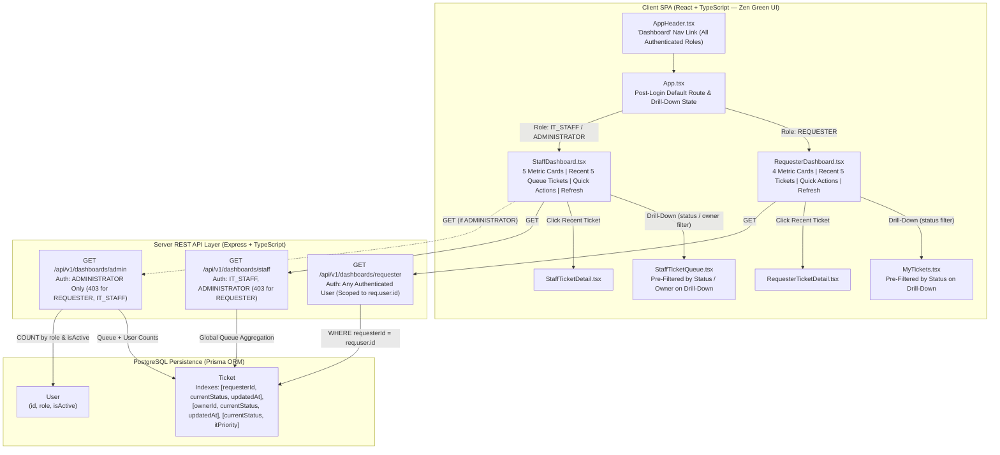

# Feature Engineering Contract: Issue 21 — Role-Based Dashboards (Requester, IT Staff & Admin) & Drill-Downs

**Feature Identifier:** Issue 21: Role-Based Dashboards (Requester, IT Staff & Admin) & Drill-Downs  
**Target Branch:** `feature/21-role-dashboards`  
**Base Branch:** `lab4-staging`  
**Sprint / Milestone:** TokTickIT Lab 4 (Sprint 4) — Actions Taken, Dashboards, Workflow Resolution Gate, and Final Regression  
**Specification Version:** 1.0.0  
**Status:** APPROVED ENGINEERING CONTRACT  
**Traceability References:** [AGENTS.md](../../../AGENTS.md), [SE+Lab+4.pdf](../../reference/SE+Lab+4.pdf) (§3, §4.1, §4.2, §4.6, §6.2, §7, §8.1, §8.2), [TokTickIT-System-Level-SDS-v1.0.pdf](../../reference/TokTickIT-System-Level-SDS-v1.0.pdf) (D-02, D-09, §7–§10, p. 10–18), [specification.md](../../lab-04/specification.md), [ui-spec.md](../../lab-04/ui-spec.md), [api-spec.md](../../lab-04/api-spec.md), [tests.md](../../lab-04/tests.md), [Issue 18 Contract](../18-actions-taken-foundation/contract.md), [Issue 19 Contract](../19-actions-taken-ui/contract.md), [Issue 20 Contract](../20-ticket-workflow/contract.md)

---

## 1. Feature Goal & Scope

### 1.1 Purpose & Architectural Objectives
This engineering contract establishes the authoritative technical specifications, backend query calculations, role-based access control (RBAC) boundaries, strict requester data isolation rules, REST API response schemas, Zen Green UI component designs, interactive filter drill-down behaviors, and automated test specifications for **Issue 21: Role-Based Dashboards (Requester, IT Staff & Admin) & Drill-Downs**.

In Sprints 2 and 3, TokTickIT introduced the Requester ticket list (`MyTickets.tsx`), the IT Staff ticket queue (`StaffTicketQueue.tsx`), ticket detail screens, and Administrator user management (`UserManagement.tsx`). In Sprint 4 Issues 18–20, the platform added the `ActionTaken` work-tracking subsystem and the authoritative 8-state ticket lifecycle with resolution gate protection. Issue 21 completes the operational experience by delivering concise, real-time, role-appropriate **Operational Dashboards** connected directly to detailed ticket queues and detail views:

1. **Authoritative Backend Dashboard Query Endpoints (`/api/v1/dashboards/*`):**
   - `GET /api/v1/dashboards/requester`: Computes personal ticket metrics (`totalOpen`, `waitingForRequester`, `inProgress`, `resolved`, `closed`) and the 5 most recently updated tickets strictly isolated to the authenticated user (`requesterId === req.user.id`, `BR-13`).
   - `GET /api/v1/dashboards/staff`: Restricted to `IT_STAFF` and `ADMINISTRATOR` (`403 Forbidden` for `REQUESTER`). Computes global service-desk queue metrics (`newCount`, `openCount`, `inProgressCount`, `waitingForRequesterCount`, `myAssignedCount`, `unassignedCount`, `statusBreakdown`, `priorityBreakdown`) and the 5 most recently updated queue tickets (`BR-14`).
   - `GET /api/v1/dashboards/admin`: Restricted exclusively to `ADMINISTRATOR` (`403 Forbidden` for `REQUESTER` and `IT_STAFF`). Returns all staff operational queue metrics plus authoritative user account statistics (`totalUsers`, `activeUsers`, `requestersCount`, `staffCount`, `adminCount`).
2. **Safe Zero-Value Empty Behavior (`BR-13`, `BR-14`):** When a requester or the global queue has zero matching tickets, all metric counters return `0` and `recentTickets` returns an empty array `[]` without null-pointer exceptions or HTTP errors.
3. **Zen Green Frontend Dashboard Views (`RequesterDashboard.tsx` & `StaffDashboard.tsx`):**
   - Clean, responsive operational dashboards built with KMUTT Zen Green design tokens (`#006B3C`, `#0B7A46`, `#EAF6EF`, `#F5F7F6`), featuring personalized welcome banners, scannable metric cards, interactive filter drill-downs, recent ticket tables with direct detail navigation, quick action shortcuts, and an in-place refresh button with a loading spinner.
4. **Interactive Filter Drill-Downs (`BR-14`):**
   - Clicking a metric card or `"View all"` link on `RequesterDashboard.tsx` navigates to `MyTickets.tsx` with the corresponding status filter pre-selected.
   - Clicking a metric card on `StaffDashboard.tsx` navigates to `StaffTicketQueue.tsx` with the corresponding `status` or `owner` filter pre-selected.
5. **Application Shell Navigation & Default Post-Login Routing (`AppHeader.tsx` & `App.tsx`):**
   - Adds a top-level `"Dashboard"` navigation link in `AppHeader.tsx` (both desktop bar and mobile drawer) for all authenticated roles.
   - Configures the default post-login landing view so authenticated `REQUESTER` users land on `RequesterDashboard` and authenticated `IT_STAFF` / `ADMINISTRATOR` users land on `StaffDashboard`.



---

### 1.2 In-Scope Deliverables
* **Backend Dashboard Router & Controller (`server/src/routes/dashboards.ts`, mounted in `server/src/app.ts`):**
  - `GET /api/v1/dashboards/requester` (and alias `/api/dashboards/requester`)
  - `GET /api/v1/dashboards/staff` (and alias `/api/dashboards/staff`)
  - `GET /api/v1/dashboards/admin` (and alias `/api/dashboards/admin`)
* **Typed Frontend Dashboard Contracts & API Client (`client/src/types/index.ts` & `client/src/api.ts`):**
  - `RequesterDashboardMetricsDTO`, `RequesterDashboardResponseDTO`
  - `StaffDashboardMetricsDTO`, `StaffDashboardResponseDTO`
  - `AdminUserMetricsDTO`, `AdminDashboardResponseDTO`
  - `DashboardRecentTicketDTO`
  - `getRequesterDashboardApi()`, `getStaffDashboardApi()`, `getAdminDashboardApi()`
* **Frontend Dashboard Components:**
  - `client/src/components/RequesterDashboard.tsx`: Requester operational overview, 4 primary metric cards (`My Open Tickets`, `In Progress`, `Resolved`, `Closed`) plus `Waiting for Requester` attention indicator, interactive `"View all"` drill-down triggers, recent 5 tickets table/cards, quick actions (`Create Ticket`, `View My Tickets`), and in-place refresh button.
  - `client/src/components/StaffDashboard.tsx`: IT Staff & Administrator operational overview, 5 primary metric cards (`New`, `Open`, `In Progress`, `Waiting for Requester`, `My Assigned`) plus `Unassigned` queue indicator and Admin user statistics summary (when viewed by `ADMINISTRATOR`), interactive queue drill-down triggers, recent 5 queue tickets list with status/priority badges, quick actions (`Create Ticket`, `Search Tickets`, `My Queue`), and in-place refresh button with spinner.
* **Navigation & Drill-Down Integration (`AppHeader.tsx`, `App.tsx`, `MyTickets.tsx`, `StaffTicketQueue.tsx`):**
  - `"Dashboard"` navigation button in `AppHeader.tsx` for all authenticated roles.
  - Default post-login tab set to `"dashboard"` in `App.tsx` (rendering `RequesterDashboard` for `REQUESTER` and `StaffDashboard` for `IT_STAFF` / `ADMINISTRATOR`).
  - Filter drill-down state synchronization between `App.tsx`, `MyTickets.tsx` (`initialStatusFilter`), and `StaffTicketQueue.tsx` (`initialStatusFilter`, `initialOwnerFilter`, `autoFocusSearch`).
* **Automated Verification Suites:**
  - Backend API tests: `server/tests/lab-04/requester-dashboard.api.test.ts` and `server/tests/lab-04/staff-dashboard.api.test.ts`
  - Frontend UI tests: `client/src/tests/lab-04/RequesterDashboard.test.tsx` and `client/src/tests/lab-04/StaffDashboard.test.tsx`

---

### 1.3 Explicit Scope Exclusions (Out of Scope)
In strict compliance with the Closed-World Rule (`AGENTS.md` §4) and `SE+Lab+4.pdf` §4.2, the following are explicitly excluded from Issue 21:
* **No Heavy Graphical Charting Libraries:** No third-party SVG or HTML5 Canvas charting dependencies (such as Chart.js, Recharts, Victory, D3.js, or ApexCharts). All operational metrics are presented using accessible, high-contrast Zen Green numeric metric cards and semantic badges.
* **No Custom Business Intelligence (BI) or Data-Warehouse Query Builders:** No drag-and-drop report generators, ad-hoc SQL/OLAP pivot builders, custom date-range analytics warehouses, or CSV/PDF/Excel batch export pipelines.
* **No Real-Time WebSockets or Aggressive Background Polling:** Dashboards fetch live data from the backend on component mount and via the explicit in-place **"Refresh Dashboard"** button (`specification.md` §11.3).
* **No SLA Countdown Clocks or Automated Escalation Alerts:** No SLA breach timers or external email/SMS/LINE notification triggers.

---

### 1.4 Requirements & Business Rules Traceability Matrix

| Requirement / Rule ID | Sprint 4 Spec Ref | Description | Issue 21 Enforcement Target |
| :--- | :--- | :--- | :--- |
| **BR-10 / BR-13** | `FR-04.1–04.3`, `BR-13` | **Strict Requester Dashboard Isolation & Safe Zero-Value Empty Behavior**: `GET /api/v1/dashboards/requester` strictly scopes all counts (`totalOpen`, `waitingForRequester`, `inProgress`, `resolved`, `closed`) and top 5 `recentTickets` to `requesterId === req.user.id`, returning `0` / `[]` when empty. | `GET /api/v1/dashboards/requester` Prisma `where` clause & `requester-dashboard.api.test.ts` |
| **BR-11** | `FR-03.1–03.3`, `BR-14` | **IT Staff Queue Dashboard Metrics & RBAC**: `GET /api/v1/dashboards/staff` restricted to `IT_STAFF` and `ADMINISTRATOR` (`403 Forbidden` for `REQUESTER`), dynamically computing `newCount`, `openCount`, `inProgressCount`, `waitingForRequesterCount`, `myAssignedCount`, `unassignedCount`, and top 5 `recentTickets`. | `GET /api/v1/dashboards/staff` & `staff-dashboard.api.test.ts` |
| **BR-12** | `FR-03.4`, `BR-14` | **Administrator Dashboard & User Account Summary**: `GET /api/v1/dashboards/admin` restricted to `ADMINISTRATOR` only (`403 Forbidden` for `REQUESTER` and `IT_STAFF`), appending user account statistics (`totalUsers`, `activeUsers`, `requestersCount`, `staffCount`, `adminCount`) to staff queue metrics. | `GET /api/v1/dashboards/admin` & `staff-dashboard.api.test.ts` |
| **BR-14** | `FR-04.4`, `BR-14` | **Authoritative Dynamic Metric Calculations & Interactive Filter Drill-Downs**: Backend computes all counts dynamically; clicking metric cards in `RequesterDashboard.tsx` or `StaffDashboard.tsx` navigates to `MyTickets.tsx` or `StaffTicketQueue.tsx` with pre-selected status/owner filters. | Backend aggregation & UI drill-down props (`RequesterDashboard.test.tsx`, `StaffDashboard.test.tsx`) |
| **FR-03.1–03.4** | `docs/lab-04/specification.md` | IT Staff and Administrator Operational Dashboard functional requirements | `dashboardsRouter` & `StaffDashboard.tsx` |
| **FR-04.1–04.4** | `docs/lab-04/specification.md` | Requester Operational Dashboard functional requirements | `dashboardsRouter` & `RequesterDashboard.tsx` |

---

## 2. Backend Dashboard Endpoints & Access Control

All dashboard endpoints are mounted at `/api/v1/dashboards` (with backward-compatible alias `/api/dashboards`) and protected by `authenticate` and `requirePasswordChanged` middleware (`BR-02` from Lab 3: users with `mustChangePassword === true` receive HTTP `403 Forbidden` with `code: "PASSWORD_CHANGE_REQUIRED"`).

### 2.1 Access Control Matrix

| Endpoint | Unauthenticated | `REQUESTER` | `IT_STAFF` | `ADMINISTRATOR` | Data Scope & Isolation Invariant |
| :--- | :---: | :---: | :---: | :---: | :--- |
| **`GET /api/v1/dashboards/requester`** | `401 Unauthorized` | **`200 OK`** | **`200 OK`** (Personal requested tickets) | **`200 OK`** (Personal requested tickets) | Strictly scoped to `WHERE ticket.requesterId = req.user.id` (`BR-13`). |
| **`GET /api/v1/dashboards/staff`** | `401 Unauthorized` | **`403 Forbidden`** | **`200 OK`** | **`200 OK`** | Global queue metrics; `myAssignedCount` scoped to `ownerId = req.user.id` (`BR-14`). |
| **`GET /api/v1/dashboards/admin`** | `401 Unauthorized` | **`403 Forbidden`** | **`403 Forbidden`** | **`200 OK`** | Global queue metrics + system-wide `User` account statistics (`FR-03.4`). |

---

### 2.2 `GET /api/v1/dashboards/requester` — Requester Operational Dashboard (`BR-10`, `BR-13`)

* **Method & Path:** `GET /api/v1/dashboards/requester`
* **Authentication & Authorization:** Requires valid authenticated session (`authenticate` + `requirePasswordChanged`, or `x-requester-id` header fallback in development/simulated mode).
* **Strict Data Isolation (`BR-10`, `BR-13`):**
  - Every database query executed by this endpoint MUST include `requesterId: currentUserId`.
  - Any query parameter attempting to override `requesterId` (e.g., `?requesterId=999`) MUST be ignored.
* **Authoritative Metric Definitions (`BR-10`, `BR-13`, `BR-14`):**
  Let **Active / Open Statuses** be defined as `["NEW", "OPEN", "IN_PROGRESS", "WAITING_FOR_REQUESTER", "REOPENED"]`.
  - `totalOpen` (also aliased as `totalOpenTickets`): Count of tickets where `requesterId === req.user.id` AND `currentStatus IN ("NEW", "OPEN", "IN_PROGRESS", "WAITING_FOR_REQUESTER", "REOPENED")`.
  - `waitingForRequester` (also aliased as `waitingForRequesterTickets`): Count of tickets where `requesterId === req.user.id` AND `currentStatus === "WAITING_FOR_REQUESTER"`.
  - `inProgress` (also aliased as `inProgressTickets`): Count of tickets where `requesterId === req.user.id` AND `currentStatus === "IN_PROGRESS"`.
  - `resolved` (also aliased as `recentlyResolvedTickets` and `resolvedTickets`): Count of tickets where `requesterId === req.user.id` AND `currentStatus === "RESOLVED"`.
  - `closed` (also aliased as `closedTickets`): Count of tickets where `requesterId === req.user.id` AND `currentStatus === "CLOSED"`.
* **Recent Owned Tickets (`recentTickets`):**
  - Up to **5** tickets where `requesterId === req.user.id`, ordered by `updatedAt DESC, id DESC` (`take: 5`).
  - Each item includes `id`, `ticketNumber`, `summary`, `categoryName` (and `category: { id, name, code }`), `requestedPriority`, `itPriority`, `currentStatus`, `createdAt`, and `updatedAt`.
* **Safe Zero-Value Empty Behavior (`BR-13`):**
  - If the authenticated user has submitted `0` tickets, all metric properties return integer `0` and `recentTickets` returns `[]` with HTTP `200 OK`.
* **Response `200 OK` Schema:**
  ```json
  {
    "success": true,
    "data": {
      "totalOpen": 3,
      "waitingForRequester": 1,
      "inProgress": 2,
      "resolved": 5,
      "closed": 12,
      "metrics": {
        "totalOpen": 3,
        "waitingForRequester": 1,
        "inProgress": 2,
        "resolved": 5,
        "closed": 12,
        "totalOpenTickets": 3,
        "waitingForRequesterTickets": 1,
        "inProgressTickets": 2,
        "recentlyResolvedTickets": 5,
        "resolvedTickets": 5,
        "closedTickets": 12
      },
      "recentTickets": [
        {
          "id": 101,
          "ticketNumber": "TKT-2026-00234",
          "summary": "Laptop battery drains quickly",
          "categoryId": 1,
          "categoryName": "Hardware",
          "category": {
            "id": 1,
            "name": "Hardware",
            "code": "HW"
          },
          "requestedPriority": "HIGH",
          "itPriority": "HIGH",
          "currentStatus": "IN_PROGRESS",
          "createdAt": "2026-05-10T08:00:00.000Z",
          "updatedAt": "2026-05-12T09:14:00.000Z"
        }
      ]
    }
  }
  ```

---

### 2.3 `GET /api/v1/dashboards/staff` — IT Staff Operational Dashboard (`BR-11`)

* **Method & Path:** `GET /api/v1/dashboards/staff`
* **Access Control (`BR-11`):** Authenticated `IT_STAFF` or `ADMINISTRATOR` only (`requireRole(["IT_STAFF", "ADMINISTRATOR"])`).
  - Unauthenticated requests receive HTTP `401 Unauthorized`.
  - Authenticated `REQUESTER` users receive HTTP `403 Forbidden` (`code: "FORBIDDEN"`).
* **Authoritative Metric Definitions (`BR-11`, `BR-14`):**
  Let **Active (Non-Terminal) Statuses** be defined as `ACTIVE_STATUSES = ["NEW", "OPEN", "IN_PROGRESS", "WAITING_FOR_REQUESTER", "REOPENED"]` (i.e., excluding terminal/resolved states `RESOLVED`, `CLOSED`, `CANCELLED`).
  - `newCount`: Global count of tickets where `currentStatus === "NEW"`.
  - `openCount`: Global count of tickets where `currentStatus === "OPEN"`.
  - `inProgressCount`: Global count of tickets where `currentStatus === "IN_PROGRESS"`.
  - `waitingForRequesterCount`: Global count of tickets where `currentStatus === "WAITING_FOR_REQUESTER"`.
  - `myAssignedCount`: Count of active tickets assigned to the current staff user (`ownerId === req.user.id` AND `currentStatus IN ACTIVE_STATUSES`).
  - `unassignedCount`: Count of active tickets with no assigned owner (`ownerId === null` AND `currentStatus IN ACTIVE_STATUSES`).
  - `resolvedCount`: Global count of tickets where `currentStatus === "RESOLVED"`.
  - `closedCount`: Global count of tickets where `currentStatus === "CLOSED"`.
  - `reopenedCount`: Global count of tickets where `currentStatus === "REOPENED"`.
  - `cancelledCount`: Global count of tickets where `currentStatus === "CANCELLED"`.
  - `urgentAttentionCount`: Count of active tickets (`currentStatus IN ACTIVE_STATUSES`) where `itPriority IN ("HIGH", "URGENT")`.
  - `statusBreakdown`: Object mapping each of the 8 `TicketStatus` keys (`NEW`, `OPEN`, `IN_PROGRESS`, `WAITING_FOR_REQUESTER`, `RESOLVED`, `CLOSED`, `REOPENED`, `CANCELLED`) to its exact integer count (defaulting to `0`).
  - `priorityBreakdown`: Object mapping each `Priority` key (`LOW`, `MEDIUM`, `HIGH`, `URGENT`) to the count of active tickets with that `itPriority` (defaulting to `0`).
* **Recent Queue Tickets (`recentTickets`):**
  - Up to **5** most recently updated tickets across the service-desk queue (`orderBy: [{ updatedAt: "desc" }, { id: "desc" }], take: 5`).
  - Each item includes `id`, `ticketNumber`, `summary`, `categoryName`, `category`, `requestedPriority`, `itPriority`, `currentStatus`, `ownerId`, `ownerName`, `owner`, `requesterName`, `requester`, `createdAt`, and `updatedAt`.
* **Safe Zero-Value Empty Behavior (`BR-13`, `BR-14`):**
  - When the database contains `0` tickets, all count fields return `0` and `recentTickets` returns `[]`.
* **Response `200 OK` Schema:**
  ```json
  {
    "success": true,
    "data": {
      "newCount": 14,
      "openCount": 23,
      "inProgressCount": 18,
      "waitingForRequesterCount": 7,
      "myAssignedCount": 16,
      "unassignedCount": 14,
      "resolvedCount": 35,
      "closedCount": 82,
      "reopenedCount": 2,
      "cancelledCount": 5,
      "urgentAttentionCount": 4,
      "statusBreakdown": {
        "NEW": 14,
        "OPEN": 23,
        "IN_PROGRESS": 18,
        "WAITING_FOR_REQUESTER": 7,
        "RESOLVED": 35,
        "CLOSED": 82,
        "REOPENED": 2,
        "CANCELLED": 5
      },
      "priorityBreakdown": {
        "LOW": 12,
        "MEDIUM": 28,
        "HIGH": 18,
        "URGENT": 4
      },
      "metrics": {
        "newCount": 14,
        "openCount": 23,
        "inProgressCount": 18,
        "waitingForRequesterCount": 7,
        "myAssignedCount": 16,
        "unassignedCount": 14,
        "resolvedCount": 35,
        "closedCount": 82,
        "reopenedCount": 2,
        "cancelledCount": 5,
        "urgentAttentionCount": 4,
        "statusBreakdown": {
          "NEW": 14,
          "OPEN": 23,
          "IN_PROGRESS": 18,
          "WAITING_FOR_REQUESTER": 7,
          "RESOLVED": 35,
          "CLOSED": 82,
          "REOPENED": 2,
          "CANCELLED": 5
        },
        "priorityBreakdown": {
          "LOW": 12,
          "MEDIUM": 28,
          "HIGH": 18,
          "URGENT": 4
        }
      },
      "recentTickets": [
        {
          "id": 101,
          "ticketNumber": "TKT-2026-00234",
          "summary": "Laptop battery drains quickly",
          "categoryId": 1,
          "categoryName": "Hardware",
          "category": { "id": 1, "name": "Hardware", "code": "HW" },
          "requestedPriority": "HIGH",
          "itPriority": "HIGH",
          "currentStatus": "IN_PROGRESS",
          "ownerId": 6,
          "ownerName": "Sompong IT",
          "owner": { "id": 6, "name": "Sompong IT", "email": "sompong@kmutt.ac.th", "role": "IT_STAFF" },
          "requesterId": 1,
          "requesterName": "Somchai Rattanakorn",
          "requester": { "id": 1, "name": "Somchai Rattanakorn", "email": "somchai@kmutt.ac.th", "department": "Computer Engineering" },
          "createdAt": "2026-05-10T08:00:00.000Z",
          "updatedAt": "2026-05-12T09:14:00.000Z"
        }
      ]
    }
  }
  ```

---

### 2.4 `GET /api/v1/dashboards/admin` — Administrator Operational Dashboard (`BR-12`)

* **Method & Path:** `GET /api/v1/dashboards/admin`
* **Access Control (`BR-12`):** Authenticated `ADMINISTRATOR` only (`requireRole(["ADMINISTRATOR"])`).
  - Unauthenticated requests receive HTTP `401 Unauthorized`.
  - Authenticated `REQUESTER` and `IT_STAFF` users receive HTTP `403 Forbidden` (`code: "FORBIDDEN"`).
* **Authoritative Metric Definitions (`BR-12`, `FR-03.4`, `BR-14`):**
  - Includes all staff operational queue metrics (`newCount`, `openCount`, `inProgressCount`, `waitingForRequesterCount`, `myAssignedCount`, `unassignedCount`, `statusBreakdown`, `priorityBreakdown`, `recentTickets`) PLUS authoritative user account statistics from the `users` table:
    - `totalUsers`: Total count of all user accounts in `users`.
    - `activeUsers` (and alias `activeUsersCount`): Count of users where `isActive === true`.
    - `inactiveUsers` (and alias `inactiveUsersCount`): Count of users where `isActive === false`.
    - `requestersCount`: Count of users where `role === "REQUESTER"`.
    - `staffCount`: Count of users where `role === "IT_STAFF"`.
    - `adminCount`: Count of users where `role === "ADMINISTRATOR"`.
    - `usersByRole`: `{ REQUESTER: requestersCount, IT_STAFF: staffCount, ADMINISTRATOR: adminCount }`.
* **Response `200 OK` Schema:**
  ```json
  {
    "success": true,
    "data": {
      "newCount": 14,
      "openCount": 23,
      "inProgressCount": 18,
      "waitingForRequesterCount": 7,
      "myAssignedCount": 16,
      "unassignedCount": 14,
      "totalUsers": 25,
      "activeUsers": 23,
      "inactiveUsers": 2,
      "requestersCount": 16,
      "staffCount": 7,
      "adminCount": 2,
      "operationalMetrics": {
        "newCount": 14,
        "openCount": 23,
        "inProgressCount": 18,
        "waitingForRequesterCount": 7,
        "myAssignedCount": 16,
        "unassignedCount": 14,
        "urgentAttentionCount": 4,
        "statusBreakdown": {
          "NEW": 14,
          "OPEN": 23,
          "IN_PROGRESS": 18,
          "WAITING_FOR_REQUESTER": 7,
          "RESOLVED": 35,
          "CLOSED": 82,
          "REOPENED": 2,
          "CANCELLED": 5
        },
        "priorityBreakdown": {
          "LOW": 12,
          "MEDIUM": 28,
          "HIGH": 18,
          "URGENT": 4
        }
      },
      "userMetrics": {
        "totalUsers": 25,
        "activeUsers": 23,
        "activeUsersCount": 23,
        "inactiveUsers": 2,
        "inactiveUsersCount": 2,
        "requestersCount": 16,
        "staffCount": 7,
        "adminCount": 2,
        "usersByRole": {
          "REQUESTER": 16,
          "IT_STAFF": 7,
          "ADMINISTRATOR": 2
        }
      },
      "recentTickets": [ ... ]
    }
  }
  ```

---

## 3. Frontend Dashboard Views (Zen Green Design System)

Both dashboard views strictly adhere to the KMUTT **Zen Green** design palette (`--color-primary-green: #006B3C`, `--color-secondary-green: #0B7A46`, `--color-pale-green: #EAF6EF`, `--color-page-bg: #F5F7F6`, `--color-surface-card: #FFFFFF`), use `data-tooltip` instead of native HTML `title` attributes where applicable (`AGENTS.md` §4), pair status colors with text and icons (WCAG 2.2 AA), and guarantee zero horizontal overflow across Desktop ($\ge 1200\text{px}$), Tablet ($768\text{px}\text{–}1024\text{px}$), and Mobile ($< 768\text{px}$) viewports.

### 3.1 `RequesterDashboard.tsx` (`client/src/components/RequesterDashboard.tsx`)

#### Component Props Contract
```typescript
export interface RequesterDashboardProps {
  /** Navigate to MyTickets.tsx with optional pre-selected status filter */
  onNavigateToMyTickets?: (statusFilter?: string) => void;
  /** Navigate directly to RequesterTicketDetail.tsx for the clicked ticket */
  onSelectTicket?: (ticketId: number) => void;
  /** Navigate to CreateTicket.tsx */
  onCreateTicket?: () => void;
}
```

#### Layout & Functional Specifications
1. **Personalized Welcome Banner:**
   - Displays `Welcome, {userName}!` (`h2` / `24px` bold, `#1F2937`) and subtitle `Here's the latest on your support requests.` (`14px`, `#5B6573`).
   - Displays an accessible in-place **`Refresh Dashboard`** button (`data-testid="requester-dashboard-refresh"`, `min-height: 40px`) with a sync SVG icon (spinning while `isRefreshing || loading` is true) that re-fetches `GET /api/v1/dashboards/requester` without reloading the browser page.
2. **Zen Green Operational Metric Cards (Grid of 4 Cards + Attention Callout):**
   - Renders a responsive 4-column card grid (`col-12 col-sm-6 col-xl-3`):
     | Card Title | Metric Property | Test ID | Drill-Down Action (`onNavigateToMyTickets`) |
     | :--- | :--- | :--- | :--- |
     | **My Open Tickets** | `totalOpen` | `metric-card-open` | Calls `onNavigateToMyTickets("")` (or `"OPEN"` / all active open requests; also displays `"Waiting for Requester: {waitingForRequester}"` sub-badge if $> 0$ with direct filter link `"Pending Requester"` / `"WAITING_FOR_REQUESTER"`) |
     | **In Progress** | `inProgress` | `metric-card-in-progress` | Calls `onNavigateToMyTickets("In Progress")` |
     | **Resolved** | `resolved` | `metric-card-resolved` | Calls `onNavigateToMyTickets("Resolved")` |
     | **Closed** | `closed` | `metric-card-closed` | Calls `onNavigateToMyTickets("Closed")` |
   - Each card displays its label (`14px/600`), high-contrast count (`32px/700`, `--color-primary-green`), and an interactive **`View all →`** drill-down button/link (`data-testid="drilldown-{key}"`).
   - Additionally, if `waitingForRequester > 0` (or via a dedicated filter pill / card action `data-testid="drilldown-waiting"`), clicking it drills down to `onNavigateToMyTickets("Pending Requester")`.
3. **My Recent Tickets Panel (Left Column, `col-12 col-lg-8`):**
   - Header: `My Recent Tickets` with a `View All` link (`data-testid="recent-tickets-view-all"`) that invokes `onNavigateToMyTickets("")`.
   - Lists up to 5 recent owned tickets returned by `recentTickets`.
   - Each ticket row/card (`data-testid="recent-ticket-row-{id}"`) displays:
     - Monospace `ticketNumber` in `#006B3C`
     - `summary`
     - `categoryName` pill
     - Semantic `currentStatus` badge (with icon + label)
     - Formatted `updatedAt` timestamp
   - Clicking any recent ticket row invokes `onSelectTicket(ticket.id)` to open `RequesterTicketDetail.tsx`.
   - **Empty State:** When `recentTickets.length === 0`, renders a friendly Zen Green empty state (`data-testid="requester-dashboard-empty"`): *"You have no support tickets yet."* with a `+ Create Ticket` button.
4. **Quick Actions Panel (Right Column, `col-12 col-lg-4`):**
   - **Create Ticket** button/card (`data-testid="quick-action-create-ticket"`): Invokes `onCreateTicket()`.
   - **View My Tickets** button/card (`data-testid="quick-action-view-my-tickets"`): Invokes `onNavigateToMyTickets("")`.

---

### 3.2 `StaffDashboard.tsx` (`client/src/components/StaffDashboard.tsx`)

#### Component Props Contract
```typescript
export interface StaffDashboardDrillDownFilter {
  status?: string;
  owner?: string;
  focusSearch?: boolean;
}

export interface StaffDashboardProps {
  /** Navigate to StaffTicketQueue.tsx with pre-applied status/owner filter or search focus */
  onNavigateToQueue?: (filter?: StaffDashboardDrillDownFilter) => void;
  /** Navigate directly to StaffTicketDetail.tsx for the clicked ticket */
  onSelectTicket?: (ticketId: number) => void;
  /** Navigate to CreateTicket.tsx */
  onCreateTicket?: () => void;
}
```

#### Layout & Functional Specifications
1. **Welcome Banner & In-Place Refresh:**
   - Displays `Welcome back, {userName}!` (`h2` / `24px` bold) and subtitle `Here's what's happening with your queue today.`
   - Displays an accessible **`Refresh Dashboard`** button (`data-testid="staff-dashboard-refresh"`) with a spinner indicator while refreshing in-place.
2. **Operational Queue Metric Cards (Grid of 5 Primary Cards + Unassigned Callout):**
   - Renders 5 interactive Zen Green metric cards (`row-cols-1 row-cols-sm-2 row-cols-xl-5 g-3`):
     | Card Title | Metric Property | Test ID | Drill-Down Filter (`onNavigateToQueue`) |
     | :--- | :--- | :--- | :--- |
     | **New** | `newCount` | `staff-metric-new` | `{ status: "NEW" }` |
     | **Open** | `openCount` | `staff-metric-open` | `{ status: "OPEN" }` |
     | **In Progress** | `inProgressCount` | `staff-metric-in-progress` | `{ status: "IN_PROGRESS" }` |
     | **Waiting for Requester** | `waitingForRequesterCount` | `staff-metric-waiting` | `{ status: "WAITING_FOR_REQUESTER" }` |
     | **My Assigned** | `myAssignedCount` | `staff-metric-my-assigned` | `{ owner: String(user.id) }` (or staff member's name/ID) |
   - Also displays an interactive **Unassigned Tickets (`unassignedCount`)** badge/pill (`data-testid="staff-metric-unassigned"`) that drills down to `{ owner: "unassigned" }`.
   - Every metric card is keyboard-operable (`<button type="button">` or interactive card with `role="button"`, `tabIndex={0}`) and triggers `onNavigateToQueue(...)` on click.
3. **Administrator System Overview Bar (Conditional for `ADMINISTRATOR` Role):**
   - When the logged-in user has `user.role === "ADMINISTRATOR"`, `StaffDashboard.tsx` also fetches `GET /api/v1/dashboards/admin` (or displays the returned `userMetrics`) showing concise user account counts (`Total Users: {totalUsers}`, `Active: {activeUsers}`, `Requesters: {requestersCount}`, `IT Staff: {staffCount}`, `Admins: {adminCount}`) in a clean Zen Green summary strip (`data-testid="admin-user-metrics-strip"`).
4. **Recent Queue Tickets Panel (Left Column, `col-12 col-lg-8`):**
   - Header: `My Recent Tickets` (or `Recent Queue Tickets`) with a `View All` button (`data-testid="staff-recent-view-all"`) calling `onNavigateToQueue({})`.
   - Renders the 5 most recently updated tickets from `recentTickets` (`data-testid="staff-recent-ticket-{id}"`), showing `ticketNumber`, `summary`, `currentStatus` badge, `itPriority` badge, `ownerName` (or `Unassigned`), and `updatedAt` timestamp.
   - Clicking any ticket row calls `onSelectTicket(ticket.id)` to open `StaffTicketDetail.tsx`.
   - **Empty State:** If `recentTickets.length === 0`, renders `"No tickets currently require attention."` (`data-testid="staff-dashboard-empty"`).
5. **Quick Actions Panel (Right Column, `col-12 col-lg-4`):**
   - **Create Ticket** (`data-testid="staff-quick-create-ticket"`): Calls `onCreateTicket()`.
   - **Search Tickets** (`data-testid="staff-quick-search-tickets"`): Calls `onNavigateToQueue({ focusSearch: true })` to open the queue and focus the search input.
   - **My Queue** (`data-testid="staff-quick-my-queue"`): Calls `onNavigateToQueue({ owner: String(user.id) })` (or `{}` for full queue).

---

## 4. Navigation, Routing & Filter Drill-Down Integration

### 4.1 `AppHeader.tsx` Navigation Updates
* Expand `AppTab` type in `AppHeader.tsx` and `App.tsx` to include `"dashboard"`:
  ```typescript
  export type AppTab = "dashboard" | "my-tickets" | "create-ticket" | "ticket-queue" | "admin-users";
  ```
* When `showNavigationLinks === true` (authenticated user with `mustChangePassword === false`, or simulated requester mode):
  - Render a **"Dashboard"** navigation button (`data-testid="nav-dashboard"` on desktop and `data-testid="nav-dashboard-mobile"` in the mobile drawer) as the first navigation item for **all** roles (`REQUESTER`, `IT_STAFF`, `ADMINISTRATOR`).
  - Active state styling matches existing Zen Green header links (`fontWeight: 700` and `borderBottom: "2px solid #ffffff"` on desktop; highlighted background pill in mobile drawer).

### 4.2 Default Post-Login Landing View in `App.tsx`
* Upon authentication (or role initialization in `MainApp` within `App.tsx`), the default `activeTab` is `"dashboard"` (or users can navigate between `"dashboard"`, `"my-tickets"`, `"ticket-queue"`, `"create-ticket"`, and `"admin-users"`):
  - When `activeTab === "dashboard"`:
    - If `user?.role === "IT_STAFF" || user?.role === "ADMINISTRATOR"`, render `<StaffDashboard />`.
    - Otherwise (authenticated `REQUESTER` or simulated requester), render `<RequesterDashboard />`.

### 4.3 Pre-Selected Filter Drill-Down Plumbing (`BR-14`)
1. **`MyTickets.tsx` Drill-Down Props:**
   - Extend `MyTicketsProps` with `initialStatusFilter?: string`.
   - Initialize `selectedStatus` state from `initialStatusFilter ?? ""` and synchronize via `useEffect` whenever `initialStatusFilter` changes so drilling down from `RequesterDashboard` (`My Open Tickets`, `In Progress`, `Waiting for Requester`, `Resolved`, `Closed`) immediately filters the ticket list.
   - Support normalized status filter values in `MyTickets.tsx` and `GET /api/tickets` (accepting both title-case `"In Progress"`, `"Resolved"`, `"Closed"`, `"Pending Requester"` and enum-case `"IN_PROGRESS"`, `"WAITING_FOR_REQUESTER"`, `"RESOLVED"`, `"CLOSED"`, or `"OPEN_ALL"` / `""`).
2. **`StaffTicketQueue.tsx` Drill-Down Props:**
   - Extend `StaffTicketQueueProps` with:
     ```typescript
     interface StaffTicketQueueProps {
       onSelectTicket?: (ticketId: number) => void;
       initialStatusFilter?: string;
       initialOwnerFilter?: string;
       autoFocusSearch?: boolean;
     }
     ```
   - Initialize `selectedStatus` from `initialStatusFilter ?? ""` and `selectedOwner` from `initialOwnerFilter ?? ""` (supporting `"unassigned"`, numeric user ID strings like `"6"`, and staff user names in both `StaffTicketQueue.tsx` and `GET /api/v1/staff/tickets`).
   - When `autoFocusSearch === true`, focus the `#queue-search` input on mount.

---

## 5. Software Test Specification (STS) Mapping

### 5.1 Backend API Integration Tests

#### A. `server/tests/lab-04/requester-dashboard.api.test.ts` (Fulfilling `API-14` / `AC-12`)
| Test ID | Requirement / Rule | Test Scenario Description | Expected Deterministic Assertion |
| :--- | :--- | :--- | :--- |
| **API-21.01** | `FR-04.1`, `AC-21.1` | Unauthenticated request to `GET /api/v1/dashboards/requester` | Returns HTTP `401 Unauthorized` (or `400` if no session and no header). |
| **API-21.02** | `FR-04.2`, `BR-13`, `AC-21.1` | Authenticated Requester receives accurate personal ticket metrics (`totalOpen`, `waitingForRequester`, `inProgress`, `resolved`, `closed`) and top 5 `recentTickets` | Returns HTTP `200 OK`; counts match the requester's tickets across statuses; `recentTickets.length <= 5` ordered by `updatedAt DESC`. |
| **API-21.03** | `BR-13`, `AC-21.1` | Strict data isolation across requesters | Tickets belonging to Requester B are completely excluded from Requester A's metrics and `recentTickets`. |
| **API-21.04** | `BR-13`, `AC-21.1` | Safe zero-value empty behavior for a requester with 0 tickets | Returns HTTP `200 OK` with `totalOpen: 0`, `waitingForRequester: 0`, `inProgress: 0`, `resolved: 0`, `closed: 0`, and `recentTickets: []`. |

#### B. `server/tests/lab-04/staff-dashboard.api.test.ts` (Fulfilling `API-15`, `API-16`, `API-17` / `AC-10`, `AC-15`)
| Test ID | Requirement / Rule | Test Scenario Description | Expected Deterministic Assertion |
| :--- | :--- | :--- | :--- |
| **API-21.05** | `FR-03.1`, `AC-21.2` | RBAC enforcement on `GET /api/v1/dashboards/staff` | Unauthenticated returns `401`; `REQUESTER` returns `403 Forbidden`; `IT_STAFF` and `ADMINISTRATOR` return `200 OK`. |
| **API-21.06** | `FR-03.2`, `BR-14`, `AC-21.2` | Accurate global queue metrics (`newCount`, `openCount`, `inProgressCount`, `waitingForRequesterCount`, `myAssignedCount`, `unassignedCount`) & recent 5 tickets | Returns HTTP `200 OK`; `myAssignedCount` reflects active tickets owned by `req.user.id`; `unassignedCount` reflects active tickets with `ownerId === null`; `recentTickets.length <= 5`. |
| **API-21.07** | `FR-03.4`, `AC-21.2` | RBAC enforcement on `GET /api/v1/dashboards/admin` | `REQUESTER` and `IT_STAFF` receive `403 Forbidden`; `ADMINISTRATOR` receives `200 OK`. |
| **API-21.08** | `FR-03.4`, `AC-21.2` | Administrator dashboard returns staff operational metrics plus user account statistics | Response includes `totalUsers`, `activeUsers`, `requestersCount`, `staffCount`, `adminCount` matching database user counts. |

---

### 5.2 Frontend Component Tests

#### A. `client/src/tests/lab-04/RequesterDashboard.test.tsx` (Fulfilling `UI-02` / `AC-12`, `AC-13`)
| Test ID | Requirement / Rule | Test Scenario Description | Expected Deterministic Assertion |
| :--- | :--- | :--- | :--- |
| **UI-21.01** | `FR-04.2`, `AC-21.3` | Renders personalized welcome banner, 4 metric cards (`My Open Tickets`, `In Progress`, `Resolved`, `Closed`), and recent tickets table | Displays user name, accurate metric card figures, and recent ticket summaries with status badges. |
| **UI-21.02** | `FR-04.4`, `BR-14`, `AC-21.3` | Interactive `"View all"` drill-down links navigate to `MyTickets` with pre-selected status filter | Clicking `"View all"` on `In Progress`, `Resolved`, or `Closed` invokes `onNavigateToMyTickets` with the corresponding status filter. |
| **UI-21.03** | `FR-04.3`, `AC-21.3` | Clicking a recent ticket navigates to `RequesterTicketDetail` & Quick Actions work | Clicking a ticket row calls `onSelectTicket(ticketId)`; clicking `Create Ticket` calls `onCreateTicket()`. |
| **UI-21.04** | `BR-13`, `AC-21.3` | In-place Refresh button & safe zero-ticket Empty State | Clicking `Refresh Dashboard` re-invokes `getRequesterDashboardApi()`; when 0 tickets exist, renders zero counts and empty state message. |

#### B. `client/src/tests/lab-04/StaffDashboard.test.tsx` (Fulfilling `UI-01` / `AC-10`, `AC-11`, `AC-15`)
| Test ID | Requirement / Rule | Test Scenario Description | Expected Deterministic Assertion |
| :--- | :--- | :--- | :--- |
| **UI-21.05** | `FR-03.2`, `AC-21.4` | Renders welcome banner, 5 operational metric cards (`New`, `Open`, `In Progress`, `Waiting for Requester`, `My Assigned`), unassigned indicator, and recent tickets | Displays staff user name, all 5 metric counts, unassigned count, and recent queue tickets with status badges. |
| **UI-21.06** | `FR-03.2`, `BR-14`, `AC-21.4` | Interactive metric card drill-downs navigate to `StaffTicketQueue` with active status/owner filter | Clicking `New` passes `{ status: "NEW" }`; clicking `In Progress` passes `{ status: "IN_PROGRESS" }`; clicking `My Assigned` passes `{ owner: String(user.id) }`; clicking `Unassigned` passes `{ owner: "unassigned" }`. |
| **UI-21.07** | `FR-03.3`, `AC-21.4` | Quick actions (`Create Ticket`, `Search Tickets`, `My Queue`), recent ticket click, and in-place Refresh with spinner | Quick action clicks invoke corresponding callbacks; clicking `Refresh Dashboard` re-fetches `getStaffDashboardApi()` and shows busy state. |
| **UI-21.08** | `FR-03.4`, `AC-21.5` | Administrator view & `AppHeader` / `App` default post-login routing | Admin sees user account metrics strip; `AppHeader` renders `Dashboard` link for all authenticated roles; post-login default view renders `RequesterDashboard` for Requester and `StaffDashboard` for IT Staff/Admin. |

---

## 6. Acceptance Criteria (`AC-21.1` to `AC-21.5`)

### AC-21.1: Requester Dashboard Data Isolation & Safe Zero-Value Behavior (`BR-13`)
- **Given** an authenticated `REQUESTER` user (e.g., User A),
- **When** the client requests `GET /api/v1/dashboards/requester`,
- **Then** the server returns HTTP `200 OK` with `totalOpen` (`NEW`, `OPEN`, `IN_PROGRESS`, `WAITING_FOR_REQUESTER`, `REOPENED`), `waitingForRequester`, `inProgress`, `resolved`, `closed`, and up to 5 `recentTickets` strictly filtered to tickets where `requesterId === req.user.id` (excluding all tickets owned by other requesters), and safely returns `0` for all counts and `[]` for `recentTickets` when the requester has zero tickets.

### AC-21.2: Staff & Admin Dashboard Endpoints & Role-Based Authorization (`BR-14`)
- **Given** the dashboard API endpoints `/api/v1/dashboards/staff` and `/api/v1/dashboards/admin`,
- **When** a `REQUESTER` attempts to access `/api/v1/dashboards/staff` or `/api/v1/dashboards/admin`, or an `IT_STAFF` user attempts to access `/api/v1/dashboards/admin`,
- **Then** the server rejects the request with HTTP `403 Forbidden`;
- **Whereas when** an `IT_STAFF` or `ADMINISTRATOR` user requests `GET /api/v1/dashboards/staff`, the server returns HTTP `200 OK` with accurate global queue metrics (`newCount`, `openCount`, `inProgressCount`, `waitingForRequesterCount`, `myAssignedCount`, `unassignedCount`) and the 5 most recent queue tickets; and when an `ADMINISTRATOR` requests `GET /api/v1/dashboards/admin`, the server returns HTTP `200 OK` with staff metrics plus user account statistics (`totalUsers`, `activeUsers`, `requestersCount`, `staffCount`, `adminCount`).

### AC-21.3: Requester Dashboard UI & Pre-Filtered Drill-Downs (`RequesterDashboard.tsx`)
- **Given** an authenticated `REQUESTER` viewing `RequesterDashboard.tsx`,
- **When** the dashboard loads,
- **Then** it renders a personalized welcome banner, Zen Green metric cards (`My Open Tickets`, `In Progress`, `Resolved`, `Closed`), the 5 most recent owned tickets, quick actions (`Create Ticket`, `View My Tickets`), and an in-place `Refresh Dashboard` button;
- **And when** the requester clicks `"View all"` on a metric card or clicks a recent ticket row, the application navigates to `MyTickets.tsx` with the corresponding status filter pre-selected (`BR-14`) or opens `RequesterTicketDetail.tsx` for that ticket.

### AC-21.4: IT Staff Dashboard UI, Queue Drill-Downs & In-Place Refresh (`StaffDashboard.tsx`)
- **Given** an authenticated `IT_STAFF` or `ADMINISTRATOR` user viewing `StaffDashboard.tsx`,
- **When** the dashboard loads,
- **Then** it renders a personalized welcome banner, 5 primary Zen Green metric cards (`New`, `Open`, `In Progress`, `Waiting for Requester`, `My Assigned`) plus unassigned count, the 5 most recent queue tickets with status badges, quick actions (`Create Ticket`, `Search Tickets`, `My Queue`), and a `Refresh Dashboard` button with loading spinner;
- **And when** the staff member clicks any metric card, the application navigates to `StaffTicketQueue.tsx` with the corresponding `status` or `owner` filter active (`BR-14`).

### AC-21.5: Header Navigation & Default Post-Login Routing (`AppHeader.tsx` & `App.tsx`)
- **Given** any authenticated user with `mustChangePassword === false`,
- **When** the application shell renders after login,
- **Then** `AppHeader.tsx` displays an accessible `"Dashboard"` navigation link for all authenticated roles (`REQUESTER`, `IT_STAFF`, `ADMINISTRATOR`), and `App.tsx` routes `REQUESTER` users to `RequesterDashboard.tsx` and `IT_STAFF` / `ADMINISTRATOR` users to `StaffDashboard.tsx` as their default post-login view.

---

## 7. Playwright Visual Verification Safeguard

> [!IMPORTANT]
> **CRITICAL RULE FOR PLAYWRIGHT VISUAL VERIFICATION:**
> Playwright screenshot generation is strictly an auxiliary visual verification step for developer review (saving screenshot artifacts to `artifacts/lab-04/screenshots/requester-dashboard/` and `artifacts/lab-04/screenshots/staff-dashboard/`).
> **Do NOT** add, alter, or mix Playwright visual checks into `docs/lab-04/tests.md` or existing STS/Jest/Vitest unit test specifications.

---

## 8. Issue 21 Definition of Done (DoD) Checklist

- [x] **Authoritative Feature Contract:** `docs/features/21-role-dashboards/contract.md` authored and aligned with Sprint 4 specifications.
- [ ] **Backend Dashboard Endpoints Implemented:** `GET /api/v1/dashboards/requester`, `GET /api/v1/dashboards/staff`, and `GET /api/v1/dashboards/admin` implemented with strict RBAC (`403 Forbidden` on unauthorized roles), requester data isolation (`BR-13`), dynamic metric queries (`BR-14`), and safe zero-value empty handling.
- [ ] **Requester Dashboard View Implemented (`RequesterDashboard.tsx`):** Welcome banner, 4 Zen Green metric cards, interactive `"View all"` status drill-downs to `MyTickets.tsx`, recent tickets table linking to `RequesterTicketDetail.tsx`, quick actions, and in-place refresh button.
- [ ] **IT Staff & Admin Dashboard View Implemented (`StaffDashboard.tsx`):** Welcome banner, 5 Zen Green metric cards + unassigned count (and Admin user metrics strip for `ADMINISTRATOR`), interactive status/owner drill-downs to `StaffTicketQueue.tsx`, recent tickets list, quick actions, and refresh button with spinner.
- [ ] **Navigation & Routing Integrated (`AppHeader.tsx` & `App.tsx`):** `"Dashboard"` link added for all authenticated roles and default post-login view configured per role.
- [ ] **Automated Tests Passing:** `server/tests/lab-04/requester-dashboard.api.test.ts`, `server/tests/lab-04/staff-dashboard.api.test.ts`, `client/src/tests/lab-04/RequesterDashboard.test.tsx`, and `client/src/tests/lab-04/StaffDashboard.test.tsx` passing 100% with zero regressions across Labs 1–4.

