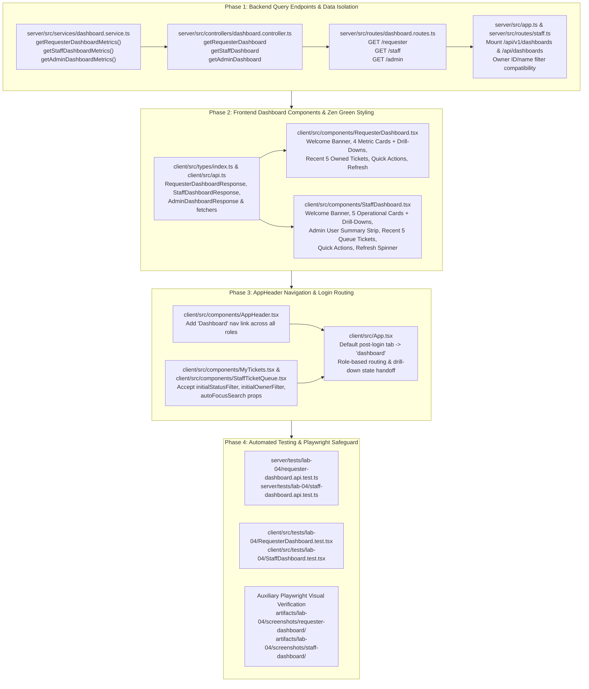

# Technical Implementation Plan — Issue 21: Role-Based Dashboards (Requester, IT Staff & Admin) & Drill-Downs

| Metadata | Value |
| :--- | :--- |
| **Issue ID** | Issue #21 |
| **Branch** | `feature/21-role-dashboards` |
| **Sprint** | Sprint 4 (Lab 04 — Actions Taken, Ticket Lifecycle & Role Dashboards) |
| **Feature Contract** | `docs/features/21-role-dashboards/contract.md` |
| **Governing Specs** | `docs/lab-04/specification.md`, `docs/lab-04/ui-spec.md`, `docs/lab-04/api-spec.md`, `docs/lab-04/tests.md` |
| **Traceability IDs** | `FR-08`, `FR-09`, `FR-10`, `FR-11`, `BR-10`, `BR-11`, `BR-12`, `BR-13`, `BR-14`, `AC-21.1`..`AC-21.5`, `D-02`, `D-03`, `D-12` |
| **Status** | Planned (Ready for Review) |

---

## Architecture & Execution Sequence Overview



---

## 1. Target File Inventory

The following table lists every file to be created or modified across the backend, frontend, and test suites.

| Layer | File Path | Action | Responsibility / Scope Summary |
| :--- | :--- | :--- | :--- |
| **Backend** | `server/src/services/dashboard.service.ts` | **CREATE** | Pure query & aggregation service implementing `getRequesterDashboardData(requesterId)`, `getStaffDashboardData(staffUserId, staffUserName)`, and `getAdminDashboardData(adminUserId, adminUserName)` with Prisma/store queries, strict requester isolation (`BR-10`), global queue counts (`BR-11`), admin user statistics (`BR-12`), and safe zero-value empty fallback (`BR-13`). |
| **Backend** | `server/src/controllers/dashboard.controller.ts` | **CREATE** | Express request handlers (`getRequesterDashboardHandler`, `getStaffDashboardHandler`, `getAdminDashboardHandler`) resolving authenticated identity, enforcing RBAC (`401`/`403`), and returning HTTP `200 OK` JSON payloads matching `docs/lab-04/api-spec.md`. |
| **Backend** | `server/src/routes/dashboard.routes.ts` | **CREATE** | Express router defining `GET /requester`, `GET /staff`, and `GET /admin` protected by `authenticate`, `requirePasswordChanged`, and `requireRole`. |
| **Backend** | `server/src/app.ts` | **MODIFY** | Register `dashboardRouter` at both `/api/v1/dashboards` and `/api/dashboards`. |
| **Backend** | `server/src/routes/staff.ts` | **MODIFY** | Enhance `GET /api/v1/staff/tickets` `ownerId` query filter to match either numeric staff `user.id` or `user.name` (so `ownerId=me` or `ownerId=<user.id>` from `StaffDashboard` drill-downs resolves accurately alongside existing name-based dropdown selections). |
| **Frontend** | `client/src/types/index.ts` | **MODIFY** | Add TypeScript interfaces: `DashboardRecentTicket`, `RequesterDashboardResponse`, `StaffDashboardResponse`, and `AdminDashboardResponse`. |
| **Frontend** | `client/src/api.ts` | **MODIFY** | Add typed API client functions: `fetchRequesterDashboard()`, `fetchStaffDashboard()`, and `fetchAdminDashboard()`. |
| **Frontend** | `client/src/components/RequesterDashboard.tsx` | **CREATE** | Requester landing dashboard (`FR-08`, `FR-10`, `BR-10`, `BR-13`, `BR-14`): personalized welcome banner, 4 Zen Green metric cards (`My Open Tickets`, `In Progress`, `Resolved`, `Closed`) with `"View all"` drill-down links, recent 5 owned tickets table, quick actions panel (`Create Ticket`, `View My Tickets`), and in-place refresh button with spinner. |
| **Frontend** | `client/src/components/StaffDashboard.tsx` | **CREATE** | IT Staff & Admin landing dashboard (`FR-09`, `FR-11`, `BR-11`, `BR-12`, `BR-13`, `BR-14`): welcome banner, 5 operational metric cards (`New Tickets`, `Open Tickets`, `In Progress`, `Waiting for Requester`, `My Assigned Tickets`) with interactive filter drill-downs, optional Admin User Account Summary strip (`ADMINISTRATOR` role), recent 5 global queue tickets table, quick actions panel (`Create Ticket`, `Search Tickets`, `My Queue`), and in-place refresh button with spinner. |
| **Frontend** | `client/src/components/AppHeader.tsx` | **MODIFY** | Extend `AppTab` union type to include `"dashboard"` and render the `"Dashboard"` navigation button as the first primary link for all authenticated roles (`REQUESTER`, `IT_STAFF`, `ADMINISTRATOR`). |
| **Frontend** | `client/src/components/MyTickets.tsx` | **MODIFY** | Accept optional `initialStatusFilter?: string` prop in `MyTicketsProps` and synchronize `selectedStatus` state when navigating via a `RequesterDashboard` metric card `"View all"` drill-down (`BR-14`). |
| **Frontend** | `client/src/components/StaffTicketQueue.tsx` | **MODIFY** | Accept optional `initialStatusFilter?: string`, `initialOwnerFilter?: string`, and `autoFocusSearch?: boolean` props in `StaffTicketQueueProps` to pre-apply status/owner filters and focus search input when drilling down from `StaffDashboard` (`BR-14`). |
| **Frontend** | `client/src/App.tsx` | **MODIFY** | Configure default post-login landing tab to `"dashboard"` (`REQUESTER` $\rightarrow$ `RequesterDashboard`, `IT_STAFF`/`ADMINISTRATOR` $\rightarrow$ `StaffDashboard`), manage drill-down filter state (`requesterStatusFilter`, `staffStatusFilter`, `staffOwnerFilter`, `staffAutoFocusSearch`), and wire ticket detail navigation (`RequesterTicketDetail` / `StaffTicketDetail`). |
| **Tests (API)** | `server/tests/lab-04/requester-dashboard.api.test.ts` | **CREATE** | Backend Supertest + Vitest suite verifying `GET /api/v1/dashboards/requester` data isolation (`BR-10`), status bucket math, recent 5 owned tickets ordering, zero-ticket safe empty state (`BR-13`), and `401` unauthenticated rejection (`AC-21.1`, `AC-21.2`). |
| **Tests (API)** | `server/tests/lab-04/staff-dashboard.api.test.ts` | **CREATE** | Backend Supertest + Vitest suite verifying `GET /api/v1/dashboards/staff` and `GET /api/v1/dashboards/admin` RBAC (`403` for `REQUESTER` on `/staff`; `403` for `REQUESTER` and `IT_STAFF` on `/admin`), queue counts (`BR-11`), admin user summary counts (`BR-12`), and recent 5 queue tickets (`AC-21.3`, `AC-21.4`). |
| **Tests (UI)** | `client/src/tests/lab-04/RequesterDashboard.test.tsx` | **CREATE** | Frontend React Testing Library + Vitest suite verifying `RequesterDashboard.tsx` metric card rendering, zero-ticket empty state (`BR-13`), `"View all"` drill-down callbacks (`BR-14`, `AC-21.5`), recent ticket row click navigation, quick actions, and in-place refresh. |
| **Tests (UI)** | `client/src/tests/lab-04/StaffDashboard.test.tsx` | **CREATE** | Frontend React Testing Library + Vitest suite verifying `StaffDashboard.tsx` 5 operational metric cards, status & `My Assigned Tickets` drill-down callbacks (`BR-14`, `AC-21.5`), admin user summary visibility (`BR-12`), recent queue ticket row navigation, quick actions, and refresh spinner state. |

---

## 2. Phase 1: Backend Query Endpoints & Data Isolation

### 2.1 Service Layer (`server/src/services/dashboard.service.ts`)

1. **Ticket Normalization & Status Mapping Helper**:
   - Reuse the canonical status normalization convention established in `server/src/services/ticketWorkflow.service.ts` so both Prisma DB enums/strings and legacy Title-Case strings map deterministically to canonical uppercase codes:
     - `"New"` / `"NEW"` $\rightarrow$ `"NEW"`
     - `"Assigned"` / `"OPEN"` $\rightarrow$ `"OPEN"`
     - `"In Progress"` / `"IN_PROGRESS"` $\rightarrow$ `"IN_PROGRESS"`
     - `"Pending Requester"` / `"Waiting for Requester"` / `"WAITING_FOR_REQUESTER"` $\rightarrow$ `"WAITING_FOR_REQUESTER"`
     - `"Resolved"` / `"RESOLVED"` $\rightarrow$ `"RESOLVED"`
     - `"Closed"` / `"CLOSED"` $\rightarrow$ `"CLOSED"`
     - `"Reopened"` / `"REOPENED"` $\rightarrow$ `"REOPENED"`
     - `"Cancelled"` / `"CANCELLED"` $\rightarrow$ `"CANCELLED"`
   - Define `ACTIVE_QUEUE_STATUSES = new Set(["NEW", "OPEN", "IN_PROGRESS", "WAITING_FOR_REQUESTER", "REOPENED"])`.
   - Map recent tickets to `DashboardRecentTicket` DTO:
     ```ts
     export interface DashboardRecentTicket {
       id: number;
       ticketNumber: string;
       title: string;
       category: string;
       priority: string;
       status: string;
       requesterId: number;
       ownerId: number | null;
       updatedAt: string;
     }
     ```
     - Populate `ticketNumber` from `ticket.ticketId` (e.g., `"TK-882401"`), `title` from `ticket.subject`, `status` as canonical uppercase status code, `requesterId` as numeric requester ID, `ownerId` resolved to numeric staff user ID (or `null` if unassigned), and `updatedAt` as ISO-8601 string.

2. **`getRequesterDashboardData(requesterId: number)` (`FR-08`, `BR-10`, `BR-13`)**:
   - Query only tickets strictly matching `Number(ticket.requesterId) === Number(requesterId)`. Never include tickets belonging to other requesters.
   - Compute counts with `0` defaults (`BR-13`):
     - `totalOpen`: count of owned tickets with canonical status in `{"NEW", "OPEN", "IN_PROGRESS", "WAITING_FOR_REQUESTER", "REOPENED"}`
     - `waitingForRequester`: count of owned tickets with canonical status `"WAITING_FOR_REQUESTER"`
     - `inProgress`: count of owned tickets with canonical status `"IN_PROGRESS"`
     - `resolved`: count of owned tickets with canonical status `"RESOLVED"`
     - `closed`: count of owned tickets with canonical status `"CLOSED"`
   - Sort owned tickets by `updatedAt DESC, id DESC` and slice top `5` into `recentTickets`.
   - When the requester has 0 tickets, return `{ totalOpen: 0, waitingForRequester: 0, inProgress: 0, resolved: 0, closed: 0, recentTickets: [] }`.

3. **`getStaffDashboardData(staffUser: { id: number; name?: string })` (`FR-09`, `BR-11`, `BR-13`)**:
   - Query all tickets in the global service desk queue.
   - Determine whether a ticket is assigned to the current staff member (`isAssignedToCurrentStaff`):
     - Matches if `Number(ticket.ownerId) === Number(staffUser.id)` OR `String(ticket.ownerId) === String(staffUser.id)` OR (when `ticket.ownerId` stores staff display name) `ticket.ownerId.toLowerCase() === staffUser.name?.toLowerCase()`.
   - Determine whether a ticket is unassigned (`isUnassigned`):
     - Matches if `ticket.ownerId === null || ticket.ownerId === undefined || String(ticket.ownerId).trim() === ""`.
   - Compute global counts (`0` defaults):
     - `newCount`: canonical status `=== "NEW"`
     - `openCount`: canonical status `=== "OPEN"`
     - `inProgressCount`: canonical status `=== "IN_PROGRESS"`
     - `waitingForRequesterCount`: canonical status `=== "WAITING_FOR_REQUESTER"`
     - `myAssignedCount`: `isAssignedToCurrentStaff && ACTIVE_QUEUE_STATUSES.has(canonicalStatus)`
     - `unassignedCount`: `isUnassigned && ACTIVE_QUEUE_STATUSES.has(canonicalStatus)`
   - Sort all tickets by `updatedAt DESC, id DESC` and slice top `5` into `recentTickets`.

4. **`getAdminDashboardData(adminUser: { id: number; name?: string })` (`BR-12`, `BR-13`)**:
   - Invoke `getStaffDashboardData(adminUser)` to obtain all staff queue metrics and `recentTickets`.
   - Query all user accounts from the user store/repository and compute:
     - `totalUsers`: total user rows
     - `activeUsers`: users where `isActive === true`
     - `requestersCount`: users where `role === "REQUESTER"`
     - `staffCount`: users where `role === "IT_STAFF"`
     - `adminCount`: users where `role === "ADMINISTRATOR"`
   - Return combined `AdminDashboardResponse`.

### 2.2 Controller & Routes (`server/src/controllers/dashboard.controller.ts`, `server/src/routes/dashboard.routes.ts`, `server/src/app.ts`)

1. **`GET /api/v1/dashboards/requester`**:
   - Supports standard session cookie / Bearer token authentication (`authenticate` + `requirePasswordChanged`), plus `x-requester-id` header fallback in development/test mode (matching `server/src/routes/tickets.ts` behavior) when `req.user` is resolved. Returns `401 Unauthorized` if no valid session or user identity is provided.
   - Calls `getRequesterDashboardData(req.user.id)` and responds with `200 OK`.

2. **`GET /api/v1/dashboards/staff`**:
   - Protected by `authenticate`, `requirePasswordChanged`, and `requireRole(["IT_STAFF", "ADMINISTRATOR"])`.
   - Any `REQUESTER` receives `403 Forbidden` with `{ error: "Forbidden", message: "Insufficient permissions to access staff dashboard." }`.
   - Calls `getStaffDashboardData(req.user)` and responds with `200 OK`.

3. **`GET /api/v1/dashboards/admin`**:
   - Protected by `authenticate`, `requirePasswordChanged`, and `requireRole(["ADMINISTRATOR"])`.
   - Any `REQUESTER` or `IT_STAFF` receives `403 Forbidden` with `{ error: "Forbidden", message: "Administrator privileges required." }`.
   - Calls `getAdminDashboardData(req.user)` and responds with `200 OK`.

4. **Mounting in `server/src/app.ts`**:
   - Import `dashboardRouter` from `./routes/dashboard.routes` and register:
     ```ts
     app.use("/api/v1/dashboards", dashboardRouter);
     app.use("/api/dashboards", dashboardRouter);
     ```

---

## 3. Phase 2: Frontend Dashboard Components & Zen Green Styling

### 3.1 Zen Green Visual Tokens & Design System (`docs/lab-04/ui-spec.md`)

Both `RequesterDashboard.tsx` and `StaffDashboard.tsx` will strictly adhere to the Zen Green visual theme:
- **Primary Brand Green**: `#006B3C` (`var(--zen-primary, #006B3C)`)
- **Primary Hover Green**: `#0B7A46` (`var(--zen-primary-hover, #0B7A46)`)
- **Soft Accent Surface**: `#EAF6EF` (`var(--zen-primary-soft, #EAF6EF)`)
- **Page Canvas Background**: `#F5F7F6` (`var(--bg-canvas, #F5F7F6)`)
- **Card Surface & Border**: `#FFFFFF` background, `1px solid #D8E2DC` border (`1.5px solid #006B3C` on hover), `8px` (`0.5rem`) border radius.
- **No `title` Attribute Rule**: Never use the native HTML `title` attribute; use `data-tooltip` or explicit visible labels (`AGENTS.md` §4).

### 3.2 `client/src/components/RequesterDashboard.tsx` (`FR-08`, `FR-10`, `BR-10`, `BR-13`, `BR-14`)

1. **Component Props**:
   ```ts
   export interface RequesterDashboardProps {
     user?: AuthUser | null;
     requesterId?: number;
     onDrillDownMyTickets: (statusFilter: string) => void;
     onSelectTicket: (ticketId: string) => void;
     onCreateTicket: () => void;
     onViewAllTickets: () => void;
   }
   ```
2. **Welcome Banner & In-Place Refresh**:
   - Displays `"Welcome back, {user?.name || 'Requester'}"` with subtitle `"Track your active service desk requests and recent updates"` and a `"Refresh"` button (`data-testid="requester-dashboard-refresh"`).
   - Clicking `"Refresh"` sets `isRefreshing = true`, displays an inline spinner, and re-invokes `fetchRequesterDashboard(requesterId)` without reloading the page.
3. **4 Metric Summary Cards (`grid-template-columns: repeat(auto-fit, minmax(200px, 1fr))`)**:
   - Card 1: **My Open Tickets** (`data.totalOpen`) — `"View all →"` triggers `onDrillDownMyTickets("OPEN_ACTIVE")` (or maps to active open filter in `MyTickets.tsx`). Also displays a contextual pill when `data.waitingForRequester > 0` (`"{n} waiting for your reply"`).
   - Card 2: **In Progress** (`data.inProgress`) — `"View all →"` triggers `onDrillDownMyTickets("IN_PROGRESS")`.
   - Card 3: **Resolved** (`data.resolved`) — `"View all →"` triggers `onDrillDownMyTickets("RESOLVED")`.
   - Card 4: **Closed** (`data.closed`) — `"View all →"` triggers `onDrillDownMyTickets("CLOSED")`.
4. **Recent Tickets Table & Zero-Ticket Empty State (`BR-13`)**:
   - Displays up to 5 recent owned tickets with columns: `Ticket ID`, `Subject`, `Category`, `Priority`, `Status`, and `Updated`.
   - Clicking a ticket row calls `onSelectTicket(ticket.ticketNumber)` to open `RequesterTicketDetail.tsx`.
   - When `recentTickets.length === 0`, renders a friendly Zen Green empty state card (`"You haven't submitted any support tickets yet."`) with a primary `"Create Your First Ticket"` CTA button (`BR-13`).
5. **Quick Actions Panel**:
   - `"Create Ticket"` primary CTA button (`#006B3C` $\rightarrow$ `#0B7A46` hover) calling `onCreateTicket()`.
   - `"View My Tickets"` secondary button calling `onViewAllTickets()`.

### 3.3 `client/src/components/StaffDashboard.tsx` (`FR-09`, `FR-11`, `BR-11`, `BR-12`, `BR-13`, `BR-14`)

1. **Component Props**:
   ```ts
   export interface StaffDashboardProps {
     user: AuthUser;
     onDrillDownQueue: (filters: { status?: string; ownerId?: string; autoFocusSearch?: boolean }) => void;
     onSelectTicket: (ticketId: string) => void;
     onCreateTicket: () => void;
     onManageUsers?: () => void;
   }
   ```
2. **Welcome Banner & Loading Spinner Refresh**:
   - Displays `"Welcome, {user.name}"` with role badge (`"IT Staff"` or `"Administrator"`) and an in-place `"Refresh"` button (`data-testid="staff-dashboard-refresh"`) with spinner animation while fetching (`fetchAdminDashboard()` when `user.role === "ADMINISTRATOR"`, otherwise `fetchStaffDashboard()`).
3. **5 Operational Metric Cards (`BR-11`, `BR-14`)**:
   - Card 1: **New Tickets** (`data.newCount`) — Drill-down triggers `onDrillDownQueue({ status: "NEW" })`.
   - Card 2: **Open Tickets** (`data.openCount`) — Drill-down triggers `onDrillDownQueue({ status: "OPEN" })`.
   - Card 3: **In Progress** (`data.inProgressCount`) — Drill-down triggers `onDrillDownQueue({ status: "IN_PROGRESS" })`.
   - Card 4: **Waiting for Requester** (`data.waitingForRequesterCount`) — Drill-down triggers `onDrillDownQueue({ status: "WAITING_FOR_REQUESTER" })`.
   - Card 5: **My Assigned Tickets** (`data.myAssignedCount`) — Highlighted with Zen Green soft accent `#EAF6EF`; drill-down triggers `onDrillDownQueue({ ownerId: String(user.id) })`.
   - Also displays an unassigned queue indicator (`Unassigned: {data.unassignedCount}`) with one-click filter `onDrillDownQueue({ ownerId: "unassigned" })`.
4. **Admin User Account Summary Strip (`BR-12`)**:
   - Rendered when `user.role === "ADMINISTRATOR"` and `AdminDashboardResponse` fields are present: displays `Total Users`, `Active Users`, `Requesters`, `IT Staff`, and `Admins`, plus a quick link to `"User Accounts"` (`onManageUsers`).
5. **Recent Queue Tickets Table & Quick Actions**:
   - Lists the 5 most recently updated global queue tickets (`Ticket ID`, `Subject`, `Category`, `Priority`, `Status` badge, `Updated`). Clicking any row calls `onSelectTicket(ticket.ticketNumber)` to open `StaffTicketDetail.tsx`.
   - Quick Actions panel provides:
     - `"Create Ticket"` $\rightarrow$ `onCreateTicket()`
     - `"Search Tickets"` $\rightarrow$ `onDrillDownQueue({ autoFocusSearch: true })`
     - `"My Queue"` $\rightarrow$ `onDrillDownQueue({ ownerId: String(user.id) })`

---

## 4. Phase 3: `AppHeader` Navigation & Login Routing

### 4.1 `client/src/components/AppHeader.tsx`
- Update `export type AppTab = "dashboard" | "my-tickets" | "create-ticket" | "ticket-queue" | "admin-users";`.
- Render a `"Dashboard"` navigation button (`data-testid="nav-dashboard"`) as the first navigation item in `<nav className="app-nav" aria-label="Main navigation">` for all authenticated roles (`REQUESTER`, `IT_STAFF`, `ADMINISTRATOR`), styled with the active Zen Green bottom border when `activeTab === "dashboard"`.

### 4.2 Filter Drill-Down Support in `MyTickets.tsx` and `StaffTicketQueue.tsx` (`BR-14`)
- **`client/src/components/MyTickets.tsx`**:
  - Add `initialStatusFilter?: string;` to `MyTicketsProps`.
  - Initialize `selectedStatus` from `initialStatusFilter` and sync via `useEffect` when `initialStatusFilter` changes.
  - Support canonical uppercase status codes (`"NEW"`, `"OPEN"`, `"IN_PROGRESS"`, `"WAITING_FOR_REQUESTER"`, `"RESOLVED"`, `"CLOSED"`, `"REOPENED"`, plus `"OPEN_ACTIVE"` for all open statuses: `NEW`, `OPEN`, `IN_PROGRESS`, `WAITING_FOR_REQUESTER`, `REOPENED`) alongside legacy display labels so client-side status filtering matches accurately regardless of status string casing.
- **`client/src/components/StaffTicketQueue.tsx`**:
  - Add `initialStatusFilter?: string;`, `initialOwnerFilter?: string;`, and `autoFocusSearch?: boolean;` to `StaffTicketQueueProps`.
  - Sync `selectedStatus` and `selectedOwner` when `initialStatusFilter` or `initialOwnerFilter` changes (resetting `page` to `1`).
  - Include the current authenticated staff user's ID/name option in the Owner filter `<select>` so drilling down from `"My Assigned Tickets"` (`ownerId = String(user.id)` or `user.name`) displays the active owner filter in the UI and passes `ownerId` to `GET /api/v1/staff/tickets`.

### 4.3 Default Post-Login Landing & View Switching in `client/src/App.tsx`
- Update `handleLoginSuccess(loggedInUser)` and initial session restore (`fetchCurrentUser`) so the default post-login `activeTab` is `"dashboard"`:
  - When `activeTab === "dashboard"` and `isStaffOrAdmin` is `true`, render `<StaffDashboard />`.
  - When `activeTab === "dashboard"` and `isStaffOrAdmin` is `false`, render `<RequesterDashboard />`.
- Wire drill-down callbacks:
  - From `RequesterDashboard`: `onDrillDownMyTickets(status)` sets `requesterStatusFilter = status`, clears `selectedTicketId`, and switches `activeTab` to `"my-tickets"`.
  - From `StaffDashboard`: `onDrillDownQueue({ status, ownerId, autoFocusSearch })` sets `staffStatusFilter = status ?? ""`, `staffOwnerFilter = ownerId ?? ""`, `staffAutoFocusSearch = Boolean(autoFocusSearch)`, clears `selectedTicketId`, and switches `activeTab` to `"ticket-queue"`.

---

## 5. Phase 4: Automated Testing & Playwright Safeguard

### 5.1 Automated Test Suites (`AC-21.1` through `AC-21.5`)

| Test Suite Path | Target Under Test | Key Test Cases & Traceability |
| :--- | :--- | :--- |
| `server/tests/lab-04/requester-dashboard.api.test.ts` | `GET /api/v1/dashboards/requester` | 1. **Data Isolation (`BR-10`, `AC-21.1`)**: Requester A only sees counts and recent tickets where `requesterId === A.id`; Requester B's tickets are completely excluded.<br>2. **Status Bucket Accuracy (`FR-08`, `AC-21.1`)**: Verifies `totalOpen` (`NEW`, `OPEN`, `IN_PROGRESS`, `WAITING_FOR_REQUESTER`, `REOPENED`), `waitingForRequester`, `inProgress`, `resolved`, and `closed` counts.<br>3. **Recent 5 Limit & Ordering (`FR-08`)**: Returns at most 5 tickets ordered by `updatedAt DESC`.<br>4. **Zero-Ticket Empty State (`BR-13`, `AC-21.2`)**: Brand-new requester with 0 tickets receives HTTP `200` with all `0` counts and `recentTickets: []` (no `500` or `null`/`NaN`).<br>5. **Unauthenticated Rejection**: Returns HTTP `401` when no session or requester identity is present. |
| `server/tests/lab-04/staff-dashboard.api.test.ts` | `GET /api/v1/dashboards/staff`<br>`GET /api/v1/dashboards/admin` | 1. **Staff Queue Aggregation (`FR-09`, `BR-11`, `AC-21.3`)**: Verifies `newCount`, `openCount`, `inProgressCount`, `waitingForRequesterCount`, `myAssignedCount` (`ownerId === req.user.id` and active), `unassignedCount` (`ownerId === null` and active), and recent 5 global tickets.<br>2. **Staff Endpoint RBAC (`BR-11`, `AC-21.4`)**: `REQUESTER` receives `403 Forbidden` on `GET /api/v1/dashboards/staff`; `IT_STAFF` and `ADMINISTRATOR` receive `200 OK`.<br>3. **Admin Endpoint RBAC & User Stats (`BR-12`, `AC-21.4`)**: `REQUESTER` and `IT_STAFF` receive `403 Forbidden` on `GET /api/v1/dashboards/admin`; `ADMINISTRATOR` receives `200 OK` with staff metrics plus `totalUsers`, `activeUsers`, `requestersCount`, `staffCount`, and `adminCount`. |
| `client/src/tests/lab-04/RequesterDashboard.test.tsx` | `RequesterDashboard.tsx` | 1. **Metric Cards & Welcome Header (`FR-08`, `AC-21.1`)**: Renders welcome message, `My Open Tickets`, `In Progress`, `Resolved`, and `Closed` counts.<br>2. **Zero-Ticket Empty State (`BR-13`, `AC-21.2`)**: Renders `0` on all cards and the friendly empty-state message + `"Create Your First Ticket"` button when `recentTickets` is empty.<br>3. **Interactive Filter Drill-Downs (`FR-10`, `BR-14`, `AC-21.5`)**: Clicking `"View all"` on `In Progress`, `Resolved`, `Closed`, and `My Open Tickets` calls `onDrillDownMyTickets` with the matching filter value.<br>4. **Recent Ticket Navigation & Refresh**: Clicking a recent ticket row invokes `onSelectTicket(ticketNumber)`; clicking `"Refresh"` re-fetches metrics and shows loading state. |
| `client/src/tests/lab-04/StaffDashboard.test.tsx` | `StaffDashboard.tsx` | 1. **Operational Metric Cards (`FR-09`, `BR-11`, `AC-21.3`)**: Renders `New Tickets`, `Open Tickets`, `In Progress`, `Waiting for Requester`, and `My Assigned Tickets` counts.<br>2. **Status & Owner Drill-Downs (`FR-11`, `BR-14`, `AC-21.5`)**: Clicking a status card calls `onDrillDownQueue({ status })`; clicking `My Assigned Tickets` calls `onDrillDownQueue({ ownerId: String(user.id) })`.<br>3. **Admin User Summary (`BR-12`)**: Renders user breakdown strip (`totalUsers`, `activeUsers`, `requestersCount`, `staffCount`, `adminCount`) when `user.role === "ADMINISTRATOR"`.<br>4. **Recent Queue Ticket Navigation, Quick Actions & Refresh**: Clicking a recent ticket calls `onSelectTicket(ticketNumber)`; quick action buttons trigger create/search/queue callbacks; `"Refresh"` button displays loading spinner and re-fetches. |

### 5.2 Playwright Visual Verification Safeguard

- **Strict Separation Rule**: Playwright screenshot capture is strictly an **auxiliary visual verification step** for developer review.
- **Artifact Output Paths**:
  - Requester Dashboard screenshots: `artifacts/lab-04/screenshots/requester-dashboard/`
  - Staff Dashboard screenshots: `artifacts/lab-04/screenshots/staff-dashboard/`
- **Prohibition**: Do **NOT** add, alter, or mix Playwright screenshot requirements into `docs/lab-04/tests.md` or into the Vitest automated test suites.

