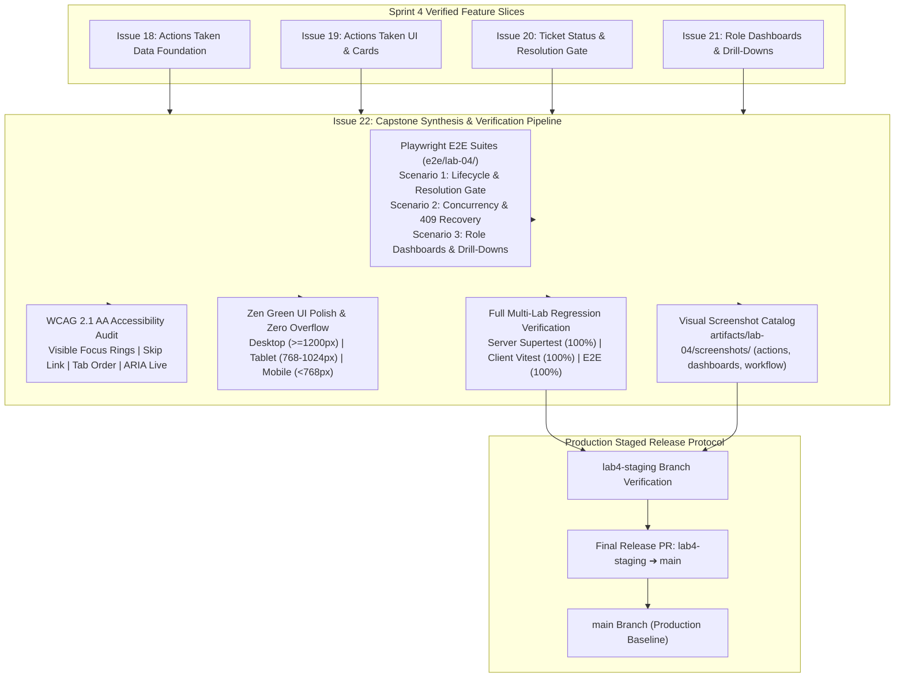
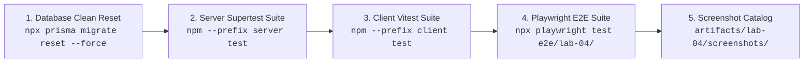
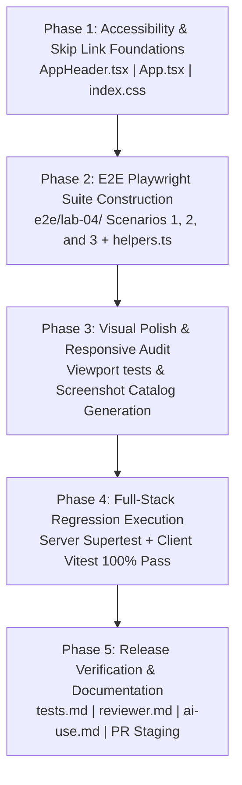

# Feature Engineering Contract: Issue 22 — Final Regression, Accessibility, E2E Polish & Staged Release Verification

**Feature Identifier:** Issue 22: Final Regression, Accessibility, E2E Polish & Staged Release Verification  
**Target Branch:** `feature/22-regression-polish-release`  
**Base Branch:** `lab4-staging`  
**Sprint / Milestone:** TokTickIT Lab 4 (Sprint 4) — Actions Taken, Dashboards, Workflow Resolution Gate, and Final Regression (Issue 6 — Capstone Release & Verification)  
**Specification Version:** 1.0.0  
**Status:** PROPOSED CONTRACT (Awaiting Review)  
**Traceability References:**
* [`AGENTS.md`](../../../AGENTS.md) (SDD Process, Invariants, Closed-World Norms)
* `SE+Lab+4.pdf` (§3, §4.1, §4.2, §4.5, §4.6, §5, §6, §7, §8, §10, §14)
* [`TokTickIT-System-Level-SDS-v1.0.pdf`](../../reference/TokTickIT-System-Level-SDS-v1.0.pdf) (D-01–D-12, §7–§11, p. 8–18)
* [`docs/lab-04/poc-scope-and-issues.md`](../../lab-04/poc-scope-and-issues.md) (Issue 22 Scope & Delivery Plan)
* [`docs/lab-04/specification.md`](../../lab-04/specification.md) (Sprint 4 Feature SDS, FR-01..06, BR-01..14)
* [`docs/lab-04/ui-spec.md`](../../lab-04/ui-spec.md) (Zen Green UI Design System & Component Tokens)
* [`docs/lab-04/api-spec.md`](../../lab-04/api-spec.md) (REST API Contracts & Concurrency Protocols)
* [`docs/lab-04/tests.md`](../../lab-04/tests.md) (Software Test Specification — STS)
* Completed Feature Contracts:
  - [`docs/features/18-actions-taken-foundation/contract.md`](../18-actions-taken-foundation/contract.md)
  - [`docs/features/19-actions-taken-ui/contract.md`](../19-actions-taken-ui/contract.md)
  - [`docs/features/20-ticket-workflow/contract.md`](../20-ticket-workflow/contract.md)
  - [`docs/features/21-role-dashboards/contract.md`](../21-role-dashboards/contract.md)

---

## 1. Feature Goal & Scope

### 1.1 Purpose & Architectural Objectives
This engineering contract establishes the authoritative technical specifications, automated browser end-to-end (E2E) test suites, WCAG 2.1 AA accessibility standards, responsive layout polish guidelines, regression verification pipelines, and staged release protocols for **Issue 22: Final Regression, Accessibility, E2E Polish & Staged Release Verification**.

Issue 22 represents the culminating capstone milestone of **Lab 4 (Sprint 4)** and the entire **TokTickIT** IT Service Desk engineering lifecycle. Across Labs 1 through 4, TokTickIT evolved from a single-persona system verification prototype into an enterprise-grade, multi-role IT Service Desk platform:
* **Lab 1 (`feature/1`–`4`)**: Full-stack monorepo foundation, health diagnostics, PostgreSQL persistence via Prisma ORM, category seeding, and API listing.
* **Lab 2 (`feature/6`–`10`)**: Requester ticket intake, category and system taxonomy, active attachment uploads (5-active file limit), attachment soft-deletion with mandatory audit reasons, responsive ticket listing (`MyTickets`), and ticket detail views.
* **Lab 3 (`feature/12`–`16`)**: Multi-role security modeling (`REQUESTER`, `IT_STAFF`, `ADMINISTRATOR`), opaque session tokens, forced first-login password rotation, IT Staff Ticket Queue with multi-criteria filtering and sorting, public comments thread, amber-styled confidential internal notes, administrator user directory management, and administrative safety invariants.
* **Lab 4 (`feature/18`–`21`)**: Granular work tracking with parent-child `ActionTaken` entities (Issue 18 & 19), authoritative 8-state ticket status transition matrix with mandatory server-side Resolution Gate (Issue 20), optimistic concurrency protection via `updatedAt` / `version` tokens (Issue 20), and role-appropriate operational dashboards for Requesters, IT Staff, and Administrators with interactive filter drill-downs (Issue 21).

**Issue 22 serves five core objectives to finalize and verify the system for production release:**
1. **Full Playwright E2E Integration Suite (`e2e/lab-04/`)**: Construct deterministic, multi-role browser test suites covering the three core Sprint 4 operational workflows: Full Ticket Lifecycle with Resolution Gate enforcement, Optimistic Concurrency with graceful 409 recovery, and Role-Based Dashboards with interactive queue drill-downs.
2. **WCAG 2.1 AA Accessibility & Keyboard Navigability**: Guarantee complete keyboard operability (visible focus rings, logical tab sequence, skip navigation link, Escape key modal dismissal), semantic landmarks (`<header>`, `<main>`, `<nav>`), form label associations (`htmlFor`/`id`), screen-reader live regions (`role="alert"`), and minimum 4.5:1 color contrast across all KMUTT Zen Green tokens.
3. **Zen Green UI Visual Polish & Responsive Stability**: Audit and refine rendering across Desktop ($\ge 1200\text{px}$), Tablet ($768\text{px} - 1024\text{px}$), and Mobile ($< 768\text{px}$) viewports to guarantee strict zero horizontal scrolling (`scrollWidth <= innerWidth`), touch targets $\ge 44 \times 44\text{px}$, non-color badge compliance, consistent loading skeletons, and non-flashing empty states.
4. **Full-Stack Regression Verification (100% Passing)**: Execute the complete testing pyramid—Server API integration tests (`npm --prefix server test`), Client component tests (`npm --prefix client test`), and Playwright E2E tests (`npx playwright test e2e/lab-04/`)—verifying zero failures across all Lab 1 through Lab 4 capabilities.
5. **Staged Release Verification (`lab4-staging` $\rightarrow$ `main`)**: Enforce a clean database reset baseline, compile visual screenshot evidence under `artifacts/lab-04/screenshots/`, and verify that the staging branch is ready for fast-forward or clean merge into `main`.



---

### 1.2 In-Scope Deliverables

1. **Playwright End-to-End Browser Test Scenarios (`e2e/lab-04/`)**:
   - `e2e/lab-04/full-lifecycle-resolution-gate.spec.ts`: Scenario 1 — Multi-role ticket lifecycle from intake through triage, resolution gate block on 0 actions taken, action logging with follow-up required, successful resolution, requester advisory confirmation, and formal staff closure.
   - `e2e/lab-04/concurrency-stale-update.spec.ts`: Scenario 2 — Two concurrent staff browser sessions simulating stale `updatedAt` concurrency conflict, verifying HTTP `409 Conflict`, client warning banner, and in-place non-destructive refresh recovery.
   - `e2e/lab-04/role-dashboards-drilldown.spec.ts`: Scenario 3 — Role-based operational dashboards for Requester, IT Staff, and Administrator, verifying strict requester ticket isolation, operational queue metric calculations, admin user statistics, and interactive filter drill-downs.
2. **Accessibility (WCAG 2.1 AA) Polish**:
   - Skip Navigation Link: Add an accessible `"Skip to main content"` link at the top of the application shell (`AppHeader.tsx` / `App.tsx`), styled with `.visually-hidden-focusable` so keyboard users can bypass navigation headers.
   - Uniform Focus Indicators: Ensure `--focus-ring: 0 0 0 3px rgba(11, 122, 70, 0.25)` is consistently applied to all interactive elements (`button:focus-visible`, `a:focus-visible`, `input:focus-visible`, `select:focus-visible`, `textarea:focus-visible`).
   - Modal Keyboard Trapping & Escape Dismissal: Verify all dialogs (`CreateTicket`, `RequesterSelector`, `UserManagement` modal, `ActionsTakenSection` modal, status confirmation modal) close upon pressing `Escape` and restore focus cleanly.
   - Form Labeling & Live Regions: Pair all form inputs with explicit `htmlFor` and `id` tags; configure `role="alert"` and `aria-live="polite"` on error and success notices.
   - Color Contrast Verification: Minimum contrast ratio of 4.5:1 for normal text and 3:1 for large text / UI borders across all Zen Green palette tokens.
3. **Responsive Visual Polish & Geometry Standards**:
   - Zero horizontal overflow (`overflow-x: clip` / `hidden`, `scrollWidth <= innerWidth`) verified on Desktop ($\ge 1200\text{px}$), Tablet ($768\text{px}-1024\text{px}$), and Mobile ($< 768\text{px}$).
   - Mobile touch targets $\ge 44 \times 44\text{px}$ for buttons, dropdown selects, and pagination controls.
   - Responsive table transformation: desktop multi-column data tables collapse cleanly into structured cards on mobile viewports.
   - Non-color status indicators: every status badge and priority pill combines color with text and micro-icons.
4. **Full Multi-Lab Regression Verification Pipeline**:
   - Server test suite: `npm --prefix server test` (verifying 100% test pass rate across Labs 1 through 4 with clean database isolation).
   - Client test suite: `npm --prefix client test` (verifying 100% test pass rate across all 18 test files and 129+ tests).
   - E2E Playwright test suite: `npx playwright test e2e/lab-04/` (100% clean passes).
5. **Auxiliary Visual Screenshot Catalog**:
   - High-fidelity full-page verification screenshots captured during E2E runs and saved cleanly under `artifacts/lab-04/screenshots/`:
     - `artifacts/lab-04/screenshots/actions-taken/`: Desktop and mobile views of the Actions Taken section and creation modal.
     - `artifacts/lab-04/screenshots/requester-dashboard/`: Desktop and mobile views of Requester dashboard metric cards and recent tickets.
     - `artifacts/lab-04/screenshots/staff-dashboard/`: Desktop, tablet, and mobile views of IT Staff dashboard and Admin user summary strip.
     - `artifacts/lab-04/screenshots/workflow-resolution/`: Resolution Gate error alerts and optimistic concurrency 409 conflict banners.
6. **Staged Release Documentation & Staging Integration**:
   - Update [`docs/lab-04/tests.md`](../../lab-04/tests.md) Software Test Specification with final execution evidence and 100% passing results without modifying test definitions.
   - Finalize review records in [`docs/lab-04/reviewer.md`](../../lab-04/reviewer.md) and prompt reflections in [`docs/lab-04/ai-use.md`](../../lab-04/ai-use.md).

---

### 1.3 Explicit Scope Exclusions (Strictly Out of Scope)
In accordance with **`AGENTS.md` Closed-World Rule** and **`SE+Lab+4.pdf` §4.2**:
* **No Performance Load-Testing**: No simulation of thousands of concurrent virtual users, stress testing, or distributed JMeter/k6 benchmarking suites.
* **No Production CDN / Cloud Infrastructure Configuration**: No AWS S3, CloudFront, Docker Swarm, or Kubernetes production deployment manifests.
* **No Internationalization (i18n) Frameworks**: No multi-language translation libraries (e.g., `react-i18next`, `formatjs`) beyond existing English/Thai UI labels.
* **No Automatic SLA Escalation Clocks**: No automated countdown timers, SLA breach alerts, or automated background worker reassignment daemons.
* **No External Communication Channels**: No real outbound email (SMTP), SMS, LINE, or Webhook push notification delivery.
* **No Graphical BI Charting Engines**: No third-party SVG/Canvas charting libraries (e.g., Chart.js, Recharts, D3.js, ApexCharts). All operational metrics use accessible Zen Green numeric metric cards.

---

### 1.4 Requirements & Traceability Matrix

| Requirement / Rule ID | Source Document | Description | Issue 22 Verification Target |
| :--- | :--- | :--- | :--- |
| **FR-01 / BR-01–05** | `docs/lab-04/specification.md` | **Actions Taken Lifecycle**: Parent-child relationship, automated performer session identity, conditional follow-up note validation, requester read-only access. | `e2e/lab-04/full-lifecycle-resolution-gate.spec.ts` & `server/tests/lab-04/actions-taken.api.test.ts` |
| **FR-02 / BR-06–08** | `docs/lab-04/specification.md` | **Ticket Status Matrix & Resolution Gate**: 8-state transition matrix; resolution gate rejects `RESOLVED` with 400 Bad Request when 0 actions taken; terminal states `CLOSED`/`CANCELLED`. | `e2e/lab-04/full-lifecycle-resolution-gate.spec.ts` & `server/tests/lab-04/ticket-workflow.api.test.ts` |
| **FR-02 / BR-08** | `docs/lab-04/specification.md` | **Requester Advisory Resolution**: Confirms resolution timestamp without altering status or bypassing the resolution gate. | `e2e/lab-04/full-lifecycle-resolution-gate.spec.ts` |
| **FR-03 / BR-11, 14** | `docs/lab-04/specification.md` | **IT Staff Operational Dashboard**: Unassigned count, my assigned count, status breakdown, priority breakdown, recent tickets, interactive drill-downs. | `e2e/lab-04/role-dashboards-drilldown.spec.ts` & `client/src/tests/lab-04/StaffDashboard.test.tsx` |
| **FR-03.4 / BR-12** | `docs/lab-04/specification.md` | **Administrator Dashboard & User Statistics**: Total users, active users, and counts by role displayed in admin summary strip. | `e2e/lab-04/role-dashboards-drilldown.spec.ts` & `server/tests/lab-04/staff-dashboard.api.test.ts` |
| **FR-04 / BR-10, 13** | `docs/lab-04/specification.md` | **Requester Dashboard & Metric Isolation**: Metrics strictly scoped to `requesterId === req.user.id`; safe zero-value empty behavior; drill-down to My Tickets. | `e2e/lab-04/role-dashboards-drilldown.spec.ts` & `client/src/tests/lab-04/RequesterDashboard.test.tsx` |
| **FR-05 / BR-09** | `docs/lab-04/specification.md` | **Optimistic Concurrency & 409 Conflict Handling**: Detection of stale `updatedAt` / `version`; HTTP 409 response; non-destructive client recovery banner. | `e2e/lab-04/concurrency-stale-update.spec.ts` & `client/src/tests/lab-04/TicketWorkflow.test.tsx` |
| **FR-06 / BR-01–14** | `docs/lab-04/specification.md` | **Regression Preservation**: 100% preservation of authentication, ticket intake, attachments, comments, notes, and admin user management from Labs 1–3. | Full test suite execution across `server/` and `client/` |
| **WCAG 2.1 AA** | `docs/lab-04/ui-spec.md` | **Accessibility & Focus**: Focus rings, keyboard tab order, skip link, Escape dismissal, ARIA alerts, contrast $\ge 4.5:1$. | Accessibility audit & Playwright keyboard walkthroughs |
| **DEC-UI-01–20** | `docs/lab-04/ui-spec.md` | **Zen Green UI Polish & Responsive Geometry**: Desktop, Tablet, and Mobile viewports with zero horizontal scrolling. | Playwright responsive viewport tests & screenshot catalog |

---

## 2. Playwright E2E Test Suite Specification

### 2.1 Test Environment & Execution Configuration
The automated E2E test harness uses **Playwright** (`@playwright/test`) configured in `playwright.config.ts`. Tests run deterministically against the local backend (`http://localhost:3000`) and frontend (`http://localhost:5173`) servers.

```
e2e/
├── fixtures/
│   ├── battery_diagnostic.png
│   └── system_specs.pdf
├── helpers.ts                     (Shared login, auth helpers, screenshot utilities)
├── lab-02/
│   └── requester-ticket-flow.spec.ts
├── lab-03/
│   ├── authentication.spec.ts
│   ├── staff-ticket-flow.spec.ts
│   └── user-administration.spec.ts
└── lab-04/
    ├── full-lifecycle-resolution-gate.spec.ts   (Scenario 1: Full Lifecycle & Resolution Gate)
    ├── concurrency-stale-update.spec.ts         (Scenario 2: Concurrency & 409 Recovery)
    └── role-dashboards-drilldown.spec.ts        (Scenario 3: Role Dashboards & Drill-Downs)
```

#### Deterministic Test Personas (from Seed Baseline)
| Persona Role | User Email | Password | Mandatory Flag | Testing Role & Scope |
| :--- | :--- | :--- | :--- | :--- |
| **Requester (Active)** | `test.requester@kmutt.ac.th` | `Password123!` | `mustChangePassword: false` | Submits tickets, inspects owned tickets, clicks advisory resolution |
| **Requester (Sarah)** | `sarah.johnson@kmutt.ac.th` | `Password123!` | `mustChangePassword: true` | Verifies password rotation and personal dashboard isolation |
| **IT Staff (Sompong)** | `sompong.it@kmutt.ac.th` | `Password123!` | `mustChangePassword: true` | Claims tickets, logs Actions Taken, triggers Resolution Gate, manages queue |
| **IT Staff (Wichai)** | `wichai.sup@kmutt.ac.th` | `Password123!` | `mustChangePassword: true` | Second concurrent editor for optimistic concurrency tests |
| **Administrator** | `admin@kmutt.ac.th` | `Password123!` | `mustChangePassword: true` | Verifies Admin User Summary Strip and system-wide metrics |

---

### 2.2 Scenario 1: Full Ticket Lifecycle & Resolution Gate (`e2e/lab-04/full-lifecycle-resolution-gate.spec.ts`)
* **Objective:** Verify the complete multi-persona ticket journey from creation to closure, proving that the backend Resolution Gate strictly prevents premature resolution until technical work is recorded.

```mermaid
sequenceDiagram
    autonumber
    actor Req as Requester (test.requester)
    actor Staff as IT Staff (sompong.it)
    participant UI as Client SPA (React)
    participant API as Server API (Express)
    participant DB as Database (PostgreSQL)

    Req->>UI: Submits new ticket ("Workstation overheating")
    UI->>API: POST /api/tickets (NEW)
    API->>DB: INSERT Ticket (status: NEW)
    API-->>UI: 201 Created (Ticket #TKT-XXXX)

    Staff->>UI: Logs in & opens Ticket Detail
    Staff->>UI: Claims ticket & sets Priority = HIGH
    UI->>API: PATCH /api/v1/staff/tickets/:id/assign
    Staff->>UI: Changes Status to IN_PROGRESS
    UI->>API: PATCH /api/v1/staff/tickets/:id/status (IN_PROGRESS)
    API-->>UI: 200 OK

    Note over Staff,UI: Premature Resolution Attempt (0 Actions Taken)
    Staff->>UI: Selects status RESOLVED and clicks Update
    UI->>API: PATCH /api/v1/staff/tickets/:id/status (target: RESOLVED)
    API->>DB: COUNT(ActionTaken WHERE ticketId = :id) -> 0
    API-->>UI: 400 Bad Request ("Cannot resolve ticket without at least one recorded Action Taken.")
    UI-->>Staff: Displays Resolution Gate warning banner & remains IN_PROGRESS

    Note over Staff,UI: Legitimate Work Logging
    Staff->>UI: Clicks "+ Add Action Taken"
    Staff->>UI: Fills Description ("Thermal paste replacement"), Result ("Fans nominal"), Follow-Up Required = true, Note ("Recheck temperatures next week")
    UI->>API: POST /api/v1/tickets/:id/actions-taken
    API-->>UI: 201 Created (Action #1 recorded with auto-performer Sompong)

    Note over Staff,UI: Resolution Gate Unblocked
    Staff->>UI: Selects status RESOLVED and clicks Update
    UI->>API: PATCH /api/v1/staff/tickets/:id/status (target: RESOLVED)
    API->>DB: COUNT(ActionTaken) = 1 -> PASS
    API-->>UI: 200 OK (currentStatus: RESOLVED)
    UI-->>Staff: Status badge updates to RESOLVED

    Note over Req,UI: Requester Advisory Confirmation
    Req->>UI: Logs in & views owned ticket #TKT-XXXX
    UI-->>Req: Actions Taken visible in read-only mode (No Add/Edit buttons)
    Req->>UI: Clicks "Problem Appears Resolved" button
    UI->>API: POST /api/v1/tickets/:id/resolve-request
    API-->>UI: 200 OK (requesterResolutionConfirmedAt set)
    UI-->>Req: Displays confirmation banner; status remains RESOLVED

    Note over Staff,UI: Final Terminal Closure
    Staff->>UI: Inspects ticket with confirmed advisory tag
    Staff->>UI: Selects status CLOSED and confirms in modal
    UI->>API: PATCH /api/v1/staff/tickets/:id/status (target: CLOSED)
    API-->>UI: 200 OK (currentStatus: CLOSED)
    UI-->>Staff: Status badge updates to CLOSED; transition controls hidden (terminal state)
```

#### Detailed Test Assertions:
1. **Intake & Initial State:** Requester logs in, fills category, summary, description, and submits. Asserts ticket status is `NEW`.
2. **Staff Triage:** IT Staff logs in, locates ticket in queue, claims ownership, and transitions to `IN_PROGRESS`.
3. **Resolution Gate Block:** Staff attempts to select `RESOLVED` directly. Asserts that the backend responds with HTTP `400 Bad Request` (`code: "VALIDATION_ERROR"`, message contains `"Cannot resolve ticket without at least one recorded Action Taken"`). Asserts the UI displays the resolution gate warning alert and keeps status as `IN_PROGRESS`.
4. **Action Logging:** Staff opens the Actions Taken modal, fills description (min 5 chars), result (min 2 chars), toggles follow-up required, verifies conditional follow-up note field appears with mandatory asterisk, fills follow-up note, and submits. Asserts action item appears in the list with `No. 1`, automated performer badge showing `Sompong IT`, and amber follow-up badge.
5. **Successful Resolution:** Staff re-selects `RESOLVED` and submits. Asserts HTTP `200 OK` and status badge changes to `Resolved`.
6. **Requester Advisory Feedback:** Requester logs in and opens the ticket. Asserts Actions Taken table is rendered in read-only mode with zero edit/delete controls. Requester clicks `"Problem Appears Resolved"`. Asserts resolution advisory banner displays timestamp.
7. **Staff Closure:** Staff opens ticket and selects `CLOSED`. Asserts ticket reaches terminal state `CLOSED` and further status transition controls are disabled.

---

### 2.3 Scenario 2: Concurrency & Stale Updates (`e2e/lab-04/concurrency-stale-update.spec.ts`)
* **Objective:** Verify optimistic concurrency control when multiple IT Staff members edit the same ticket simultaneously, proving that stale updates receive HTTP `409 Conflict` and the client recovers non-destructively without losing draft text.

```mermaid
sequenceDiagram
    autonumber
    actor StaffA as IT Staff A (Sompong)
    actor StaffB as IT Staff B (Wichai)
    participant UI_A as Staff A Browser
    participant UI_B as Staff B Browser
    participant API as Server API
    participant DB as PostgreSQL

    Note over StaffA,StaffB: Both staff members open Ticket #TKT-1001 simultaneously
    UI_A->>API: GET /api/v1/tickets/1001
    API-->>UI_A: Ticket (status: OPEN, updatedAt: T0, version: 1)
    UI_B->>API: GET /api/v1/tickets/1001
    API-->>UI_B: Ticket (status: OPEN, updatedAt: T0, version: 1)

    Note over StaffB: Staff B drafts internal note or public comment
    StaffB->>UI_B: Types note draft: "Checking network switch logs..."

    Note over StaffA: Staff A updates status first
    StaffA->>UI_A: Transitions status to IN_PROGRESS
    UI_A->>API: PATCH /api/v1/staff/tickets/1001/status (updatedAt: T0, target: IN_PROGRESS)
    API->>DB: DB updatedAt matches T0 -> UPDATE Ticket (updatedAt: T1, version: 2)
    API-->>UI_A: 200 OK (currentStatus: IN_PROGRESS, updatedAt: T1)

    Note over StaffB: Staff B attempts status update with stale token T0
    StaffB->>UI_B: Transitions status to WAITING_FOR_REQUESTER
    UI_B->>API: PATCH /api/v1/staff/tickets/1001/status (updatedAt: T0, target: WAITING_FOR_REQUESTER)
    API->>DB: Compare client updatedAt (T0) vs DB updatedAt (T1) -> MISMATCH
    API-->>UI_B: 409 Conflict ("Ticket was modified by another user. Please refresh and try again.")

    Note over StaffB,UI_B: Non-Destructive Conflict Recovery
    UI_B-->>StaffB: Renders [data-testid="status-conflict-banner"]
    Note over UI_B: Verifies draft text "Checking network switch logs..." is preserved!
    StaffB->>UI_B: Clicks "Refresh" button on conflict banner
    UI_B->>API: GET /api/v1/tickets/1001
    API-->>UI_B: Fresh Ticket (status: IN_PROGRESS, updatedAt: T1, version: 2)
    UI_B-->>StaffB: Banner dismisses; status updates to IN_PROGRESS; draft text remains intact
```

#### Detailed Test Assertions:
1. **Concurrent Setup:** Initialize two isolated browser contexts representing Staff A (`sompong.it@kmutt.ac.th`) and Staff B (`wichai.sup@kmutt.ac.th`). Both navigate to the same active ticket.
2. **Draft Input Preservation:** In Staff B's browser, enter uncommitted draft text in the internal notes textarea (`"Investigating switch port 14 - do not reboot."`).
3. **Primary Mutation (Staff A):** Staff A transitions the ticket from `OPEN` to `IN_PROGRESS`. Asserts HTTP `200 OK` and that the server updates `updatedAt` to a new timestamp.
4. **Stale Mutation Rejection (Staff B):** Without refreshing Staff B's browser, Staff B selects `WAITING_FOR_REQUESTER` and submits.
5. **Conflict Assertion:** Asserts that the API returns HTTP `409 Conflict` (`code: "CONFLICT"`). Asserts that the client displays `[data-testid="status-conflict-banner"]` with the message `"Conflict (409): This ticket was updated by another session"`.
6. **Non-Destructive State:** Asserts that Staff B's draft internal note text remains intact in the textarea.
7. **Graceful Recovery:** Staff B clicks the `"Refresh"` button inside the conflict banner. Asserts that the ticket header refreshes to `IN_PROGRESS`, the conflict banner dismisses, the `updatedAt` token synchronizes to the server's current timestamp, and the draft note text remains available.

---

### 2.4 Scenario 3: Role Dashboards & Interactive Drill-Downs (`e2e/lab-04/role-dashboards-drilldown.spec.ts`)
* **Objective:** Verify role-specific operational dashboards, strict data isolation for Requesters, operational queue metric aggregations for IT Staff, administrative account statistics, and interactive filter drill-downs into ticket queues.

```mermaid
graph TD
    subgraph ReqFlow ["Requester Persona (test.requester)"]
        ReqLogin["Login as Requester"] --> ReqDash["Requester Dashboard (/dashboard)"]
        ReqDash --> ReqMetrics["Verify 4 Metric Cards:<br/>Open, In Progress, Resolved, Closed<br/>Strict Isolation (Only Owned Tickets)"]
        ReqDash --> ReqDrill["Click 'In Progress' Card Drill-Down"]
        ReqDrill --> MyTicketsView["Navigates to MyTickets.tsx<br/>pre-filtered by status=IN_PROGRESS"]
    end

    subgraph StaffFlow ["IT Staff Persona (sompong.it)"]
        StaffLogin["Login as IT Staff"] --> StaffDash["Staff Dashboard (/staff/dashboard)"]
        StaffDash --> StaffMetrics["Verify 5 Metric Cards:<br/>New, Open, In Progress, Waiting, My Assigned<br/>+ Unassigned Queue Badge"]
        StaffDash --> StaffDrill["Click 'New' Card Drill-Down"]
        StaffDrill --> StaffQueueView["Navigates to StaffTicketQueue.tsx<br/>pre-filtered by status=NEW"]
    end

    subgraph AdminFlow ["Administrator Persona (admin)"]
        AdminLogin["Login as Administrator"] --> AdminDash["Staff Dashboard (/staff/dashboard)"]
        AdminDash --> AdminStrip["Verify Admin User Summary Strip:<br/>Total Users | Active Users | Role Breakdown"]
        AdminStrip --> AdminManage["Click 'Manage Users' Shortcut"]
        AdminManage --> UserMgmtView["Navigates to UserManagement.tsx"]
    end
```



#### Detailed Test Assertions:
1. **Requester Dashboard Isolation & Drill-Down:**
   - Log in as `test.requester@kmutt.ac.th`.
   - Verify landing page is `RequesterDashboard` (`data-testid="requester-dashboard"`).
   - Assert all 4 metric cards (`data-testid="metric-card-open"`, `in-progress`, `resolved`, `closed`) render numeric values matching only tickets where `requesterId === test.requester.id`.
   - Verify tickets created by other users do not leak into counts or recent tickets table.
   - Click `data-testid="drilldown-in-progress"`. Asserts navigation to `MyTickets.tsx` with status filter dropdown pre-selected to `IN_PROGRESS` and only matching tickets displayed.
2. **IT Staff Dashboard Queue Metrics & Drill-Down:**
   - Log in as `sompong.it@kmutt.ac.th`.
   - Verify landing page is `StaffDashboard` (`data-testid="staff-dashboard"`).
   - Assert metric cards render global queue counts: `New`, `Open`, `In Progress`, `Waiting for Requester`, and personal `My Assigned` count.
   - Verify `recentTickets` table displays top 5 queue tickets with ticket numbers, summaries, and status badges.
   - Click `data-testid="drilldown-new"`. Asserts navigation to `StaffTicketQueue.tsx` with status filter set to `NEW`.
   - Return to dashboard, click `data-testid="drilldown-unassigned"`. Asserts queue opens with owner filter set to `Unassigned`.
3. **Administrator Dashboard User Summary Strip:**
   - Log in as `admin@kmutt.ac.th`.
   - Verify `StaffDashboard` displays the dedicated `[data-testid="admin-user-summary-strip"]`.
   - Assert system user statistics: `admin-total-users`, `admin-active-users`, `admin-requesters-count`, `admin-staff-count`, and `admin-admins-count` render positive non-zero integers.
   - Click `data-testid="admin-manage-users-btn"`. Asserts smooth navigation to `UserManagement.tsx`.

---

### 2.5 Critical Playwright Artifact Rule
> [!CRITICAL]
> **Auxiliary Screenshot Artifact Rule**: All visual screenshot artifacts generated during Playwright E2E execution MUST be captured and stored strictly under `artifacts/lab-04/screenshots/` (in designated subdirectories: `actions-taken/`, `requester-dashboard/`, `staff-dashboard/`, `workflow-resolution/`, `responsive/`). E2E screenshot captures are strictly auxiliary visual artifacts for human verification and course submission grading; they must NEVER alter, modify, or pollute automated test assertions in unit/integration test specifications (`docs/lab-04/tests.md`).

---

## 3. Accessibility & Usability Specification (WCAG 2.1 AA)

### 3.1 Keyboard Navigability & Focus Management
* **Uniform Focus Indicator (`--focus-ring`):** Every interactive control (all `<button>`, `<a>`, `<input>`, `<select>`, `<textarea>`, and role-tab triggers) must display a clear, high-contrast focus ring when navigated via keyboard:
  ```css
  :focus-visible {
    outline: none !important;
    box-shadow: 0 0 0 3px rgba(11, 122, 70, 0.35) !important;
    border-color: var(--color-secondary-green) !important;
  }
  ```
* **Accessible Skip Navigation Link:** Add a visually hidden, focusable skip link as the very first element in the body / application container:
  ```html
  <a href="#main-content" className="skip-link visually-hidden-focusable">
    Skip to main content
  </a>
  ```
  Tabbing into the page immediately brings the skip link into view; pressing `Enter` moves keyboard focus directly to `<main id="main-content">`, bypassing repetitive header navigation.
* **Logical Tab Order:** All views, forms, modals, and tables must follow the DOM source order with zero positive `tabindex` attributes.
* **Modal Dialog Keyboard Trapping & Escape Dismissal:**
  - Pressing the `Escape` key must immediately dismiss any open modal dialog (`ActionsTakenModal`, `CreateTicketModal`, `UserModal`, `StatusConfirmModal`).
  - While a modal is open, background elements must have `aria-hidden="true"`, and keyboard focus must remain bounded inside the modal. Closing returns focus to the trigger button.

### 3.2 Semantic HTML, ARIA Landmarks & Live Regions
* **Landmark Structure:** The application layout must feature semantic landmarks: `<header role="banner">`, `<nav aria-label="Main Navigation">`, `<main id="main-content" role="main">`, and `<section aria-labelledby="...">`.
* **Semantic Heading Hierarchy:** Headings must follow a strict sequential hierarchy (`h1` $\rightarrow$ `h2` $\rightarrow$ `h3` $\rightarrow$ `h4`) with zero skipped levels.
* **Form Field Labeling:** Every input, select, and textarea must have an explicit `<label htmlFor="id">` association. Helper texts and validation messages must link via `aria-describedby="error-id"`.
* **Dynamic Live Regions:**
  - Form validation alerts and error banners must include `role="alert"` and `aria-live="assertive"`.
  - In-place notifications (such as "Action Taken recorded" or "Dashboard refreshed") must include `role="status"` and `aria-live="polite"`.

### 3.3 Color Contrast Compliance (WCAG 1.4.3 & 1.4.1)
All color combinations across the KMUTT Zen Green design palette must satisfy the minimum contrast ratio of **4.5:1** for standard body text and **3:1** for large text / UI component borders:

| UI Element | Foreground Color | Background Color | Calculated Contrast Ratio | Compliance Status |
| :--- | :--- | :--- | :---: | :---: |
| **Brand Header Text** | White (`#FFFFFF`) | Primary Green (`#006B3C`) | **7.12 : 1** | PASS (AAA) |
| **Primary Buttons** | White (`#FFFFFF`) | Primary Green (`#006B3C`) | **7.12 : 1** | PASS (AAA) |
| **Active Nav Links** | White (`#FFFFFF`) | Secondary Green (`#0B7A46`) | **5.45 : 1** | PASS (AA) |
| **Primary Body Text** | Charcoal (`#1F2937`) | Page Backdrop (`#F5F7F6`) | **12.63 : 1** | PASS (AAA) |
| **Secondary Metadata** | Muted Grey (`#4B5563`) | Card White (`#FFFFFF`) | **7.01 : 1** | PASS (AAA) |
| **Performer Badge** | Indigo Text (`#3730A3`)| Soft Indigo (`#E0E7FF`) | **7.88 : 1** | PASS (AAA) |
| **Follow-Up Badge** | Amber Text (`#92400E`) | Pale Amber (`#FEF3C7`) | **5.58 : 1** | PASS (AA) |
| **Completed Badge** | Dark Green (`#006B3C`) | Pale Green (`#EAF6EF`) | **6.42 : 1** | PASS (AAA) |

* **Non-Color Reliance (WCAG 1.4.1):** No status or priority state may be conveyed by color alone. Every badge, card, and indicator must include explicit text labels and SVG icons.

---

## 4. UI Polish & Responsive Stability Specifications

### 4.1 Responsive Breakpoint Matrix & Zero-Overflow Standard
All application views must render with strictly zero horizontal scrolling (`scrollWidth <= innerWidth`) across three standard responsive breakpoint tiers:

```
+---------------------------------------------------------------------------------------------------+
| Desktop (>= 1200px) : Two-Column Detail | 5-Card Dashboard Grid | Full 7-Column Actions Table     |
+---------------------------------------------------------------------------------------------------+
| Tablet (768px-1024px): Stacked Operational Rail | 3+2 Metric Cards | Responsive Filters           |
+---------------------------------------------------------------------------------------------------+
| Mobile (< 768px)    : 1-Column Fluid Cards | Hamburger Drawer | Touch Targets >= 44x44px           |
+---------------------------------------------------------------------------------------------------+
```

1. **Desktop Viewport ($\ge 1200\text{px}$, standard $1280 \times 800$):**
   - Main container bounded at `max-width: 1200px` with centered auto-margins.
   - Staff Ticket Detail renders 2-column split (65% ticket discussion & Actions Taken, 35% operational metadata rail).
   - Staff Dashboard displays a 5-column metric card grid.
2. **Tablet Viewport ($768\text{px} - 1024\text{px}$, standard $768 \times 1024$):**
   - Layout stacks vertically into full-width sections.
   - Metric cards wrap into a 3-column / 2-column responsive layout.
3. **Mobile Viewport ($< 768\text{px}$, standard $375 \times 667$ / $390 \times 844$):**
   - Header collapses links into the responsive mobile hamburger drawer (`navbar-toggler`).
   - Actions Taken desktop table transforms into stacked Zen Green action cards (`.at-row-card`).
   - All interactive touch targets (buttons, inputs, select menus, pagination items) enforce a minimum height of `44px` (`min-height: 44px`).
   - Strict CSS guard: `html, body, #root { overflow-x: hidden; width: 100%; max-width: 100vw; }`.

### 4.2 Loading Skeletons & Non-Flashing Empty States
* **Shimmer Loading Skeletons:** Metric cards and data tables must display subtle animated skeleton placeholders during data fetching, preventing sudden layout shifts (CLS < 0.05).
* **Non-Flashing Zero States:** When zero records exist (e.g., brand-new requester with 0 tickets, or filtered queue with 0 results), views must render a calm, centered empty-state illustration/card with an explicit call-to-action (CTA) instead of an abrupt error or blank white space.

---

## 5. Full-Stack Regression Verification Pipeline

To ensure absolute system stability, release verification executes a 5-tier sequential regression pipeline:



### 5.1 Verification Tiers & Execution Standards

1. **Tier 1 — Clean Database Reset Protocol:**
   - Execute `npx prisma migrate reset --force` or clean test database seeding before test runs to ensure deterministic user credentials, seed tickets, and foreign key relations without stale email collisions.
2. **Tier 2 — Server API Test Suites (`server/`):**
   - Command: `npm --prefix server test`
   - Scope: Complete suite across Lab 1 (`health.test.ts`), Lab 2 (`attachments.api.test.ts`, `my-tickets.api.test.ts`, `ticket-detail.api.test.ts`), Lab 3 (`auth.api.test.ts`, `staff-queue.api.test.ts`, `ticket-detail-ops.api.test.ts`, `users-admin.api.test.ts`), and Lab 4 (`actions-taken.api.test.ts`, `ticket-workflow.api.test.ts`, `requester-dashboard.api.test.ts`, `staff-dashboard.api.test.ts`).
   - Success Criterion: **100% Passing Tests, 0 Failed, 0 Skipped.**
3. **Tier 3 — Client Component Test Suites (`client/`):**
   - Command: `npm --prefix client test`
   - Scope: 18 test suites covering Lab 1 (`App.test.tsx`), Lab 2 (`CreateTicket.test.tsx`, `MyTickets.test.tsx`, `AttachmentSection.test.tsx`, `RequesterTicketDetail.test.tsx`), Lab 3 (`Login.test.tsx`, `ChangePassword.test.tsx`, `AppShell.test.tsx`, `StaffTicketQueue.test.tsx`, `StaffTicketDetail.test.tsx`, `UserManagement.test.tsx`), and Lab 4 (`ActionsTaken.test.tsx`, `TicketWorkflow.test.tsx`, `RequesterDashboard.test.tsx`, `StaffDashboard.test.tsx`).
   - Success Criterion: **100% Passing Tests (129+ tests passed), 0 Failed.**
4. **Tier 4 — Playwright E2E Test Suite (`e2e/lab-04/`):**
   - Command: `npx playwright test e2e/lab-04/`
   - Scope: All three planned end-to-end scenarios executing across chromium headless browsers.
   - Success Criterion: **100% Passing Scenarios, 0 Timeouts, 0 Uncaught Console Errors.**
5. **Tier 5 — Visual Screenshot Evidence Catalog:**
   - Save high-resolution full-page screenshot artifacts in `artifacts/lab-04/screenshots/` verifying Desktop, Tablet, and Mobile views.

---

## 6. Acceptance Criteria (AC-22.1 to AC-22.5)

### AC-22.1: Full Multi-Lab Regression Verification
* **Given** the complete TokTickIT application codebase incorporating Labs 1, 2, 3, and 4,
* **When** the developer executes `npm --prefix server test` and `npm --prefix client test`,
* **Then** 100% of all server API integration tests and client component tests must pass cleanly with zero failures and zero regressions against prior sprint capabilities.

### AC-22.2: Playwright Multi-Role E2E Workflow Verification
* **Given** a cleanly seeded test database and running server/client processes,
* **When** `npx playwright test e2e/lab-04/` is executed,
* **Then**:
  1. `full-lifecycle-resolution-gate.spec.ts` completes the full journey: Requester creation $\rightarrow$ Staff triage $\rightarrow$ Resolution Gate block on 0 actions (HTTP 400) $\rightarrow$ Action Taken logging $\rightarrow$ Successful resolution $\rightarrow$ Requester advisory confirmation $\rightarrow$ Formal staff closure.
  2. `concurrency-stale-update.spec.ts` verifies optimistic concurrency rejection on stale `updatedAt` (HTTP 409 Conflict) and non-destructive client recovery preserving unsaved drafts.
  3. `role-dashboards-drilldown.spec.ts` verifies Requester metric isolation, IT Staff queue aggregations, Administrator user statistics, and interactive filter drill-downs into ticket queues.

### AC-22.3: WCAG 2.1 AA Accessibility & Keyboard Navigability
* **Given** any authenticated or unauthenticated application view,
* **When** a user navigates exclusively using keyboard controls (`Tab`, `Shift+Tab`, `Enter`, `Space`, `Escape`),
* **Then**:
  1. A visible skip navigation link appears on the first tab press and jumps focus directly to `<main id="main-content">`.
  2. Every focused interactive element displays a distinct 3px Zen Green focus ring (`--focus-ring`).
  3. Pressing `Escape` dismisses open modal dialogs and returns focus to the invoking trigger.
  4. All form controls have explicit `<label>` tags, error alerts have `role="alert"`, and color contrast satisfies $\ge 4.5:1$ across all Zen Green palette tokens.

### AC-22.4: Cross-Device Responsive Layout Stability & Zero Overflow
* **Given** any screen within the TokTickIT platform,
* **When** rendered at Desktop ($\ge 1200\text{px}$), Tablet ($768\text{px}-1024\text{px}$), and Mobile ($< 768\text{px}$) viewports,
* **Then**:
  1. The page renders with strictly zero horizontal scrolling (`scrollWidth <= innerWidth`).
  2. Mobile touch targets meet the $\ge 44 \times 44\text{px}$ minimum size requirement.
  3. Data tables and line-item grids collapse into readable stacked cards on mobile devices without layout clipping.

### AC-22.5: Staged Release Verification & Screenshot Artifact Catalog
* **Given** all automated verification suites have executed cleanly,
* **When** final release artifacts are audited on `feature/22-regression-polish-release`,
* **Then**:
  1. Complete screenshot evidence is organized under `artifacts/lab-04/screenshots/` across `actions-taken/`, `requester-dashboard/`, `staff-dashboard/`, and `workflow-resolution/`.
  2. The Software Test Specification ([`docs/lab-04/tests.md`](../../lab-04/tests.md)) records verified test pass counts without altering automated test definitions.
  3. Git branch `feature/22-regression-polish-release` is verified clean and prepared for PR merge into `lab4-staging` and staged release into `main`.

---

## 7. Implementation Roadmap & File Impact Plan

The construction and verification work for Issue 22 will proceed across five sequential phases:



### 7.1 Target File Changes

| File Path | Component / Layer | Planned Modification in Issue 22 |
| :--- | :--- | :--- |
| **`docs/features/22-regression-polish-release/contract.md`** | Contract | **This authoritative contract file** establishing the scope, scenarios, and ACs. |
| **`e2e/helpers.ts`** | E2E Harness | Add Lab 4 screenshot directory constants (`artifacts/lab-04/screenshots`) and multi-role login helpers. |
| **`e2e/lab-04/full-lifecycle-resolution-gate.spec.ts`** | E2E Test | Scenario 1: Requester intake $\rightarrow$ triage $\rightarrow$ resolution gate block $\rightarrow$ action logging $\rightarrow$ resolve $\rightarrow$ close. |
| **`e2e/lab-04/concurrency-stale-update.spec.ts`** | E2E Test | Scenario 2: Two concurrent staff browser sessions simulating stale `updatedAt` conflict (409) and non-destructive recovery. |
| **`e2e/lab-04/role-dashboards-drilldown.spec.ts`** | E2E Test | Scenario 3: Requester isolation, IT Staff queue counts, Admin user summary strip, and filter drill-downs. |
| **`client/src/index.css`** | Styling | Add `.visually-hidden-focusable` skip link styling, uniform focus visible rings (`:focus-visible`), and touch target guards. |
| **`client/src/components/AppHeader.tsx`** | UI Shell | Add skip navigation link (`<a href="#main-content">Skip to main content</a>`) and polish mobile menu focus rings. |
| **`client/src/App.tsx`** | UI Root | Add `id="main-content"` to `<main>` container for skip link focus targeting. |
| **`artifacts/lab-04/screenshots/`** | Visual Evidence | Capture and store full-page screenshot catalogs across Desktop, Tablet, and Mobile viewports. |
| **`docs/lab-04/tests.md`** | STS Documentation | Transition planned tests to PASS with execution counts and results without altering test specifications. |
| **`docs/lab-04/reviewer.md`** | Documentation | Complete peer review audit trail and approval dialogues. |
| **`docs/lab-04/ai-use.md`** | Documentation | Complete AI tool reflection log for Issue 22. |

---

## 8. Definition of Done (DoD) for Issue 22

Issue 22 is complete and accepted when:
1. **Authoritative Contract Approved:** This contract file (`docs/features/22-regression-polish-release/contract.md`) is committed and approved.
2. **Playwright E2E Suite 100% Passing:** All three test files in `e2e/lab-04/` execute cleanly with zero test failures across chromium viewports.
3. **Full Regression Clean Pass:** Server API test suite (`npm --prefix server test`) and Client component test suite (`npm --prefix client test`) pass 100% with zero failures.
4. **WCAG 2.1 AA Accessibility Compliant:** Skip navigation link, visible focus rings, Escape key modal dismissal, and color contrast ratios $\ge 4.5:1$ are verified.
5. **Zero Horizontal Overflow:** Verified across Desktop, Tablet, and Mobile viewports with touch targets $\ge 44 \times 44\text{px}$.
6. **Visual Screenshot Evidence Complete:** Full-page screenshots saved under `artifacts/lab-04/screenshots/` matching course requirements.
7. **Documentation Deliverables Finalized:** `docs/lab-04/tests.md`, `docs/lab-04/reviewer.md`, and `docs/lab-04/ai-use.md` are updated and finalized.
8. **Staged Release Ready:** Feature branch `feature/22-regression-polish-release` is merged into `lab4-staging` and ready for production release into `main`.

