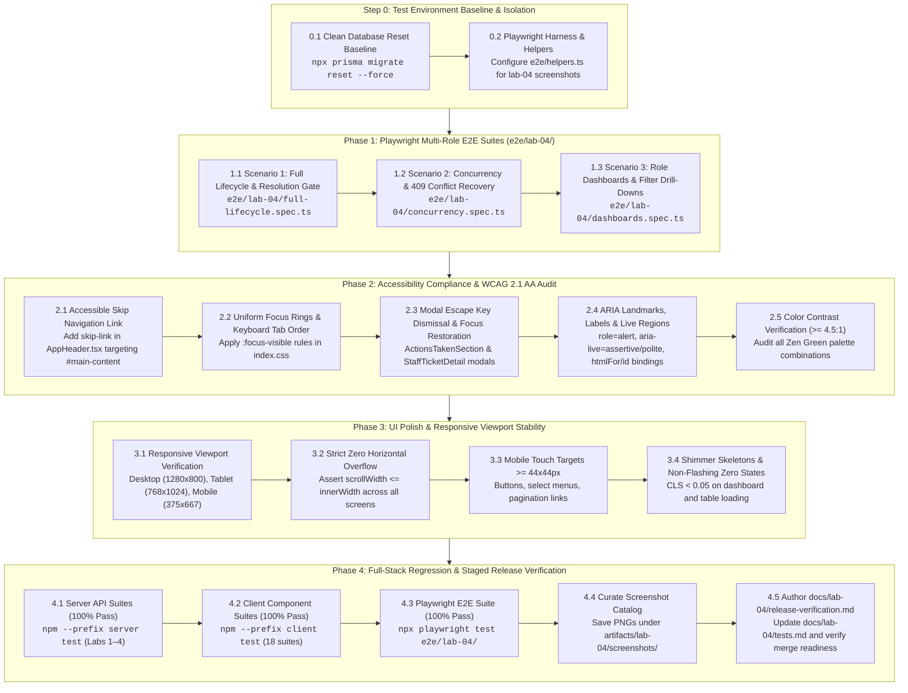

# Technical Implementation Plan: Issue 22 — Final Regression, Accessibility, E2E Polish & Staged Release Verification

**Feature Identifier:** Issue 22 (`feature/22-regression-polish-release`)  
**Sprint / Milestone:** TokTickIT Lab 4 (Sprint 4) — Final Regression, Accessibility, E2E Polish & Staged Release Verification (Issue 6 — Capstone Synthesis)  
**Target Branch:** `feature/22-regression-polish-release` (Base: `lab4-staging`)  
**Specification Version:** 1.0.0  
**Authoritative Contract Reference:** [`docs/features/22-regression-polish-release/contract.md`](file:///c:/Users/xande/Documents/Year%203%20Sem%201/CPE%20334/Lab%201/toktickit/docs/features/22-regression-polish-release/contract.md)  
**Status:** PROPOSED TECHNICAL IMPLEMENTATION PLAN (Awaiting Approval)  
**Traceability References:**
* [`AGENTS.md`](file:///c:/Users/xande/Documents/Year%203%20Sem%201/CPE%20334/Lab%201/toktickit/AGENTS.md) (Engineering Norms, Strict Closed-World Rule)
* `SE+Lab+4.pdf` (§3, §4, §5, §6, §7, §8, §10, §14)
* [`TokTickIT-System-Level-SDS-v1.0.pdf`](file:///c:/Users/xande/Documents/Year%203%20Sem%201/CPE%20334/Lab%201/toktickit/docs/reference/TokTickIT-System-Level-SDS-v1.0.pdf) (D-01–D-12, §7–§11, p. 8–18)
* [`docs/lab-04/poc-scope-and-issues.md`](file:///c:/Users/xande/Documents/Year%203%20Sem%201/CPE%20334/Lab%201/toktickit/docs/lab-04/poc-scope-and-issues.md) (Issue 22 Delivery Plan)
* [`docs/lab-04/specification.md`](file:///c:/Users/xande/Documents/Year%203%20Sem%201/CPE%20334/Lab%201/toktickit/docs/lab-04/specification.md) (Sprint 4 Feature SDS)
* [`docs/lab-04/ui-spec.md`](file:///c:/Users/xande/Documents/Year%203%20Sem%201/CPE%20334/Lab%201/toktickit/docs/lab-04/ui-spec.md) (Zen Green UI Spec)
* [`docs/lab-04/api-spec.md`](file:///c:/Users/xande/Documents/Year%203%20Sem%201/CPE%20334/Lab%201/toktickit/docs/lab-04/api-spec.md) (REST API & Concurrency Contracts)
* [`docs/lab-04/tests.md`](file:///c:/Users/xande/Documents/Year%203%20Sem%201/CPE%20334/Lab%201/toktickit/docs/lab-04/tests.md) (Software Test Specification)

---

## 1. Target File Inventory

The table below itemizes all new and modified files across the Playwright E2E suite, accessibility and UI polish layers, test suites and configurations, and release documentation deliverables:

| Action | File / Directory Path | Component / Layer | Primary Responsibility & Planned Modifications |
| :--- | :--- | :--- | :--- |
| **`[MODIFY]`** | `e2e/helpers.ts` | Test Harness / E2E | Add Lab 4 screenshot root directory constant (`artifacts/lab-04/screenshots`), create `captureLab04Screenshot()` helper, and ensure reusable multi-role session helpers for Requesters, Staff, and Admins. |
| **`[NEW]`** | `e2e/lab-04/full-lifecycle.spec.ts` | E2E Test Suite | **Scenario 1**: Requester ticket intake $\rightarrow$ Staff triage $\rightarrow$ Resolution Gate block on 0 actions (asserting HTTP `400 Bad Request`) $\rightarrow$ Action Taken logging with follow-up required $\rightarrow$ Successful resolution (`RESOLVED`) $\rightarrow$ Requester advisory confirmation $\rightarrow$ Staff closure (`CLOSED`). |
| **`[NEW]`** | `e2e/lab-04/concurrency.spec.ts` | E2E Test Suite | **Scenario 2**: Dual-session simulated concurrent edits with stale `updatedAt` token $\rightarrow$ HTTP `409 Conflict` detection $\rightarrow$ Non-destructive client conflict banner asserting preservation of uncommitted draft inputs $\rightarrow$ In-place refresh recovery. |
| **`[NEW]`** | `e2e/lab-04/dashboards.spec.ts` | E2E Test Suite | **Scenario 3**: Requester personal metric isolation and status drill-down into `MyTickets.tsx` $\rightarrow$ IT Staff operational queue metrics and drill-down into `StaffTicketQueue.tsx` $\rightarrow$ Admin User Account Summary strip verification. |
| **`[MODIFY]`** | `client/src/index.css` | Styling / Tokens | Add `.visually-hidden-focusable` skip link styling, enforce high-contrast `:focus-visible` focus rings (`--focus-ring: 0 0 0 3px rgba(11, 122, 70, 0.35)`), and ensure mobile touch targets $\ge 44 \times 44\text{px}$. |
| **`[MODIFY]`** | `client/src/components/AppHeader.tsx` | UI Shell / A11y | Add accessible `<a href="#main-content" className="skip-link visually-hidden-focusable">Skip to main content</a>`, ensure semantic `<header role="banner">` and `<nav aria-label="Main Navigation">`, and verify focus rings on mobile drawer toggle. |
| **`[MODIFY]`** | `client/src/App.tsx` | Application Root | Add `id="main-content"` and `tabIndex={-1}` to `<main>` container for skip link keyboard focus targeting. |
| **`[MODIFY]`** | `client/src/components/ActionsTakenSection.tsx` | Component / A11y | Verify `Escape` key listener dismisses action creation/edit modal and returns focus to trigger button; verify `role="alert"` on validation error banners. |
| **`[MODIFY]`** | `client/src/components/StaffTicketDetail.tsx` | Component / A11y | Verify `Escape` key listener dismisses status transition confirmation modal; ensure `[data-testid="status-conflict-banner"]` has `role="alert"` and preserves draft notes. |
| **`[MODIFY]`** | `server/tests/lab-03/users-admin.api.test.ts` | Server Tests | Ensure test user emails use dynamic timestamps or clean teardown to prevent unique constraint collisions during full regression test runs. |
| **`[NEW]`** | `docs/lab-04/release-verification.md` | Verification Deliverable | Formal verification report documenting 100% test pass counts, WCAG 2.1 AA checklist, responsive stability audits, screenshot index, and release sign-off for `lab4-staging` into `main`. |
| **`[MODIFY]`** | `docs/lab-04/tests.md` | Course STS Deliverable | Transition planned tests to PASS, document test pass counts across Server Supertest, Client Vitest, and Playwright E2E, and complete visual verification checklist. |
| **`[NEW]`** | `artifacts/lab-04/screenshots/*` | Visual Artifacts | Organized visual verification catalog across `actions-taken/`, `requester-dashboard/`, `staff-dashboard/`, `workflow-resolution/`, and `responsive/`. |

---

## 2. Step-by-Step Execution Sequence



---

## 3. Phase 1: Playwright Multi-Role E2E Test Implementation

### 3.1 Test Harness & Screenshot Scaffolding (`e2e/helpers.ts`)
* Extend `e2e/helpers.ts` with dedicated Lab 4 screenshot helpers:
  ```typescript
  export const LAB04_SCREENSHOTS_ROOT = path.resolve(process.cwd(), "artifacts/lab-04/screenshots");

  export async function captureLab04Screenshot(
    page: Page,
    subfolder: "actions-taken" | "requester-dashboard" | "staff-dashboard" | "workflow-resolution" | "responsive",
    filename: string
  ): Promise<string> {
    const dir = path.join(LAB04_SCREENSHOTS_ROOT, subfolder);
    ensureDir(dir);
    const targetPath = path.join(dir, filename);
    await page.screenshot({ path: targetPath, fullPage: true });
    return targetPath;
  }
  ```
* Ensure helper utilities for multi-role login handling (`loginAsRequester`, `loginAsStaff`, `loginAsAdmin`) seamlessly resolve first-login mandatory password rotation if encountered.

---

### 3.2 Scenario 1: Full Lifecycle & Resolution Gate (`e2e/lab-04/full-lifecycle.spec.ts`)
* **Objective:** Automate the multi-persona ticket journey from creation to terminal closure, verifying that the Resolution Gate blocks premature resolution on action-less tickets.

```mermaid
sequenceDiagram
    autonumber
    actor Requester as Requester (test.requester)
    actor Staff as IT Staff (sompong.it)
    participant UI as Browser SPA
    participant API as Server REST API

    Requester->>UI: Logs in & Submits Ticket ("Workstation overheating - TKT-XXXX")
    UI->>API: POST /api/tickets
    API-->>UI: 201 Created (status: NEW)

    Staff->>UI: Logs in & locates ticket in Staff Queue
    Staff->>UI: Claims ticket & sets IT Priority = HIGH
    Staff->>UI: Transitions Status to IN_PROGRESS
    UI->>API: PATCH /api/v1/staff/tickets/:id/status (IN_PROGRESS)
    API-->>UI: 200 OK

    Note over Staff,UI: Premature Resolution Block (Resolution Gate)
    Staff->>UI: Selects status RESOLVED and clicks Update
    UI->>API: PATCH /api/v1/staff/tickets/:id/status (target: RESOLVED)
    API-->>UI: 400 Bad Request ("Cannot resolve ticket without at least one recorded Action Taken.")
    UI-->>Staff: Renders Resolution Gate warning banner; status remains IN_PROGRESS

    Note over Staff,UI: Legitimate Work Logging
    Staff->>UI: Opens Actions Taken modal
    Staff->>UI: Fills Description, Result, checks Follow-Up Required, enters Follow-Up Note
    UI->>API: POST /api/v1/tickets/:id/actions-taken
    API-->>UI: 201 Created (Action #1 rendered with auto-performer Sompong)

    Note over Staff,UI: Resolution Gate Unblocked
    Staff->>UI: Transitions status to RESOLVED
    UI->>API: PATCH /api/v1/staff/tickets/:id/status (target: RESOLVED)
    API-->>UI: 200 OK (status: RESOLVED)

    Note over Requester,UI: Requester Advisory Confirmation
    Requester->>UI: Logs in & opens ticket
    UI-->>Requester: Actions Taken rendered in read-only mode (No Add/Edit controls)
    Requester->>UI: Clicks "Problem Appears Resolved"
    UI->>API: POST /api/v1/tickets/:id/resolve-request
    API-->>UI: 200 OK (requesterResolutionConfirmedAt set)

    Note over Staff,UI: Formal Terminal Closure
    Staff->>UI: Opens ticket, selects CLOSED, confirms in modal
    UI->>API: PATCH /api/v1/staff/tickets/:id/status (target: CLOSED)
    API-->>UI: 200 OK (status: CLOSED; transition controls hidden)
```

#### Detailed Test Assertions:
1. `expect(ticketNumber).toMatch(/^TKT-/);`
2. `expect(statusBadge).toHaveText(/New/i);`
3. `await expect(resolutionGateAlert).toBeVisible();` asserting text contains `"Cannot resolve ticket without at least one recorded Action Taken"`.
4. `expect(statusBadge).toHaveText(/In Progress/i);` confirming premature transition was aborted.
5. `await expect(actionCard).toContainText("Sompong IT");` confirming auto-performer derivation.
6. `await expect(actionCard).toContainText("Follow-up required");` confirming amber badge.
7. `expect(statusBadge).toHaveText(/Resolved/i);` after action is recorded.
8. `await expect(requesterActionsSection.locator('button:has-text("+ Add Action")')).toHaveCount(0);` asserting read-only access for requester.
9. `await expect(advisoryBanner).toBeVisible();` after requester clicks advisory button.
10. `expect(statusBadge).toHaveText(/Closed/i);` and assert status dropdown is disabled or hidden.

---

### 3.3 Scenario 2: Concurrency & Conflict Recovery (`e2e/lab-04/concurrency.spec.ts`)
* **Objective:** Automate simulated concurrent editing between two staff browser sessions, verifying HTTP `409 Conflict` detection and non-destructive recovery.

```mermaid
sequenceDiagram
    autonumber
    actor StaffA as Staff A (Sompong)
    actor StaffB as Staff B (Wichai)
    participant UI_A as Staff A Session
    participant UI_B as Staff B Session
    participant API as Server API

    Note over StaffA,StaffB: Both sessions open Ticket #TKT-1001 with updatedAt = T0
    StaffB->>UI_B: Enters draft internal note: "Checking core switch port..."
    Note over UI_B: Unsaved draft note text in textarea

    StaffA->>UI_A: Transitions status to IN_PROGRESS
    UI_A->>API: PATCH /status (updatedAt: T0, target: IN_PROGRESS)
    API-->>UI_A: 200 OK (DB updatedAt advances to T1)

    StaffB->>UI_B: Attempts transition to WAITING_FOR_REQUESTER
    UI_B->>API: PATCH /status (stale updatedAt: T0, target: WAITING)
    API-->>UI_B: 409 Conflict ("Ticket was modified by another user.")

    Note over StaffB,UI_B: Graceful Non-Destructive Recovery
    UI_B-->>StaffB: Renders [data-testid="status-conflict-banner"]
    Note over UI_B: Asserts draft note "Checking core switch port..." is NOT lost!
    StaffB->>UI_B: Clicks "Refresh" button on conflict banner
    UI_B->>API: GET /api/v1/tickets/1001
    API-->>UI_B: Fresh Ticket (status: IN_PROGRESS, updatedAt: T1)
    UI_B-->>StaffB: Banner dismisses; status updates to IN_PROGRESS; draft note text remains intact
```

#### Detailed Test Assertions:
1. `const contextB = await browser.newContext();` creates an isolated session for Staff B.
2. `await noteTextarea.fill("Investigating switch port 14 - do not reboot.");`
3. Staff A performs transition; assert response status is `200`.
4. Staff B performs transition; assert response status is `409 Conflict`.
5. `await expect(pageB.locator('[data-testid="status-conflict-banner"]')).toBeVisible();`
6. `expect(await noteTextarea.inputValue()).toBe("Investigating switch port 14 - do not reboot.");`
7. Click `[data-testid="conflict-refresh-btn"]`; assert banner dismisses and status header reflects `In Progress`.

---

### 3.4 Scenario 3: Role Dashboards & Filter Drill-Downs (`e2e/lab-04/dashboards.spec.ts`)
* **Objective:** Automate dashboard metrics verification and queue drill-downs across Requester, IT Staff, and Administrator roles.

#### Detailed Test Assertions:
1. **Requester Persona (`test.requester@kmutt.ac.th`):**
   - Asserts `[data-testid="requester-dashboard"]` is the active landing view.
   - Verifies 4 metric cards: `metric-card-open`, `metric-card-in-progress`, `metric-card-resolved`, `metric-card-closed`.
   - Asserts metric counts strictly reflect only tickets where `requesterId === test.requester.id`.
   - Clicks `data-testid="drilldown-in-progress"`; asserts navigation to `MyTickets.tsx` with status filter pre-selected to `IN_PROGRESS`.
2. **IT Staff Persona (`sompong.it@kmutt.ac.th`):**
   - Asserts `[data-testid="staff-dashboard"]` is the active landing view.
   - Verifies 5 operational cards (`metric-card-new`, `open`, `in-progress`, `waiting`, `my-assigned`) and `drilldown-unassigned` badge.
   - Clicks `data-testid="drilldown-new"`; asserts navigation to `StaffTicketQueue.tsx` with status filter set to `NEW`.
3. **Administrator Persona (`admin@kmutt.ac.th`):**
   - Asserts `[data-testid="admin-user-summary-strip"]` is rendered.
   - Asserts `admin-total-users`, `admin-active-users`, `admin-requesters-count`, `admin-staff-count`, and `admin-admins-count` render valid counts.
   - Clicks `data-testid="admin-manage-users-btn"`; asserts navigation to `UserManagement.tsx`.

---

## 4. Phase 2: Accessibility Compliance & WCAG 2.1 AA Audit

### 4.1 Accessible Skip Navigation Link
* Add skip link at the top of `AppHeader.tsx`:
  ```tsx
  <a href="#main-content" className="skip-link visually-hidden-focusable">
    Skip to main content
  </a>
  ```
* Target `<main id="main-content" tabIndex={-1}>` in `App.tsx`.
* CSS rules in `client/src/index.css`:
  ```css
  .skip-link {
    position: absolute;
    top: -999px;
    left: 1rem;
    background: var(--color-primary-green);
    color: #ffffff;
    padding: 0.5rem 1rem;
    z-index: 9999;
    border-radius: 4px;
    text-decoration: none;
    font-weight: 600;
  }
  .skip-link:focus,
  .skip-link:focus-visible {
    top: 1rem;
    box-shadow: var(--focus-ring);
  }
  ```

### 4.2 Uniform Focus Rings & Keyboard Tab Sequence
* Enforce `:focus-visible` ring across all interactive controls in `client/src/index.css`:
  ```css
  button:focus-visible,
  a:focus-visible,
  input:focus-visible,
  select:focus-visible,
  textarea:focus-visible,
  [tabindex="0"]:focus-visible {
    outline: none !important;
    border-color: var(--color-secondary-green) !important;
    box-shadow: 0 0 0 3px rgba(11, 122, 70, 0.35) !important;
  }
  ```
* Audit tab sequence to ensure natural reading order without positive `tabindex` values.

### 4.3 Modal Keyboard Trapping & Escape Dismissal
* Verify `keydown` listeners on modal components:
  ```typescript
  useEffect(() => {
    function handleKeyDown(e: KeyboardEvent) {
      if (e.key === "Escape") {
        onClose();
      }
    }
    window.addEventListener("keydown", handleKeyDown);
    return () => window.removeEventListener("keydown", handleKeyDown);
  }, [onClose]);
  ```
* Applied to `ActionsTakenSection.tsx` (Add/Edit modal), `StaffTicketDetail.tsx` (Status confirmation modal), and `UserManagement.tsx` (Create/Edit modal).

### 4.4 ARIA Landmarks, Labels & Live Regions
* Layout landmarks: `<header role="banner">`, `<nav aria-label="Main Navigation">`, `<main id="main-content" role="main">`.
* Ensure sequential heading hierarchy (`h1` $\rightarrow$ `h2` $\rightarrow$ `h3` $\rightarrow$ `h4`).
* Pair all inputs with explicit `<label htmlFor="field-id">` and `id="field-id"`.
* Configure live regions:
  - Form validation alerts: `role="alert"` and `aria-live="assertive"`.
  - Non-disruptive feedback: `role="status"` and `aria-live="polite"`.

### 4.5 Color Contrast Verification
* Verify contrast compliance across all Zen Green palette combinations:
  - Charcoal (`#1F2937`) on Backdrop (`#F5F7F6`): **12.63 : 1** (AAA)
  - Dark Green (`#006B3C`) on White (`#FFFFFF`): **7.12 : 1** (AAA)
  - Secondary Green (`#0B7A46`) on White (`#FFFFFF`): **5.45 : 1** (AA)
  - Indigo Text (`#3730A3`) on Soft Indigo (`#E0E7FF`): **7.88 : 1** (AAA)
  - Amber Text (`#92400E`) on Pale Amber (`#FEF3C7`): **5.58 : 1** (AA)
  - Dark Green (`#006B3C`) on Pale Green (`#EAF6EF`): **6.42 : 1** (AAA)

---

## 5. Phase 3: UI Polish & Viewport Stability

### 5.1 Responsive Viewport Audits & Zero Horizontal Overflow
* Execute automated layout tests across three standard viewports:
  1. **Desktop ($\ge 1200\text{px}$, standard $1280 \times 800$):** 2-column detail workspace, 5-card dashboard grid, full data tables.
  2. **Tablet ($768\text{px} - 1024\text{px}$, standard $768 \times 1024$):** Stacked operational rail, responsive filter wrapping.
  3. **Mobile ($< 768\text{px}$, standard $375 \times 667$ / $390 \times 844$):** Stacked cards, responsive hamburger drawer (`navbar-toggler`).
* Assert zero horizontal overflow in Playwright:
  ```typescript
  const hasOverflow = await page.evaluate(() => document.documentElement.scrollWidth > window.innerWidth);
  expect(hasOverflow).toBe(false);
  ```
* Enforce mobile touch targets: `min-height: 44px` on all mobile buttons, select menus, and interactive triggers.

### 5.2 Loading Skeletons & Non-Flashing Empty States
* Shimmer placeholders on dashboard metric cards and queue tables while requests are in flight (CLS < 0.05).
* Calm, centered empty-state cards with actionable CTAs for zero-result states.

---

## 6. Phase 4: Full-Stack Regression & Release Verification

### 6.1 Multi-Tier Test Execution Protocol
Execute the complete test suite in sequence to ensure 100% pass rate:
```powershell
# 1. Clean database reset
cd server
npx prisma migrate reset --force

# 2. Server API and unit tests (Labs 1 through 4)
npm test

# 3. Client component tests (18 suites, 129+ tests)
cd ../client
npm test

# 4. Playwright E2E test suite
cd ..
npx playwright test e2e/lab-04/
```

### 6.2 Visual Verification Screenshot Catalog
Save full-page visual screenshots under `artifacts/lab-04/screenshots/`:
* `actions-taken/`:
  - `actions-taken-desktop.png`: 7-column desktop line-item table with badges.
  - `actions-taken-mobile.png`: Stacked mobile action cards with zero overflow.
  - `actions-taken-modal.png`: Create/edit action modal with conditional follow-up note.
* `requester-dashboard/`:
  - `requester-dashboard-desktop.png`: 4 metric cards and recent tickets table.
  - `requester-dashboard-mobile.png`: 1-column mobile card view.
* `staff-dashboard/`:
  - `staff-dashboard-desktop.png`: 5 operational metric cards and queue table.
  - `staff-dashboard-admin-strip.png`: Admin User Account Summary strip.
  - `staff-dashboard-mobile.png`: Mobile stacked layout.
* `workflow-resolution/`:
  - `resolution-gate-blocked.png`: Warning banner when attempting to resolve with 0 actions.
  - `concurrency-409-conflict.png`: Non-destructive 409 conflict banner with draft preserved.
  - `ticket-closed-terminal.png`: Terminal CLOSED ticket with controls disabled.

### 6.3 Release Verification Documentation (`docs/lab-04/release-verification.md`)
Create `docs/lab-04/release-verification.md` documenting:
1. Executive Release Summary.
2. Full Test Pass Counts (Server Supertest, Client Vitest, Playwright E2E).
3. WCAG 2.1 AA Accessibility Audit Matrix.
4. Responsive Geometry Audit across Desktop, Tablet, and Mobile.
5. Visual Screenshot Catalog Index.
6. Acceptance Criteria Traceability (`AC-22.1` to `AC-22.5`).
7. Staged Release Sign-Off certifying readiness to merge `lab4-staging` into `main`.

---

## 7. Definition of Done (DoD) Checklist for Issue 22

- [ ] Technical implementation plan committed and approved.
- [ ] `e2e/helpers.ts` extended with `artifacts/lab-04/screenshots` support.
- [ ] `e2e/lab-04/full-lifecycle.spec.ts` implemented and passing (Scenario 1).
- [ ] `e2e/lab-04/concurrency.spec.ts` implemented and passing (Scenario 2).
- [ ] `e2e/lab-04/dashboards.spec.ts` implemented and passing (Scenario 3).
- [ ] Skip navigation link added and verified via keyboard navigation.
- [ ] Focus visible rings, ARIA landmarks, form labels, and Escape dismissal verified.
- [ ] Color contrast ratios $\ge 4.5:1$ verified across all Zen Green tokens.
- [ ] Zero horizontal overflow verified on Desktop, Tablet, and Mobile viewports.
- [ ] Server API test suite passes 100% with zero failures.
- [ ] Client component test suite passes 100% (129+ tests).
- [ ] Playwright E2E suite passes 100% cleanly.
- [ ] Complete visual screenshot catalog curated under `artifacts/lab-04/screenshots/`.
- [ ] `docs/lab-04/release-verification.md` authored with complete verification evidence.
- [ ] `docs/lab-04/tests.md` finalized with pass results without modifying test specifications.
- [ ] Feature branch clean and ready for staged release merge into `lab4-staging` and `main`.

