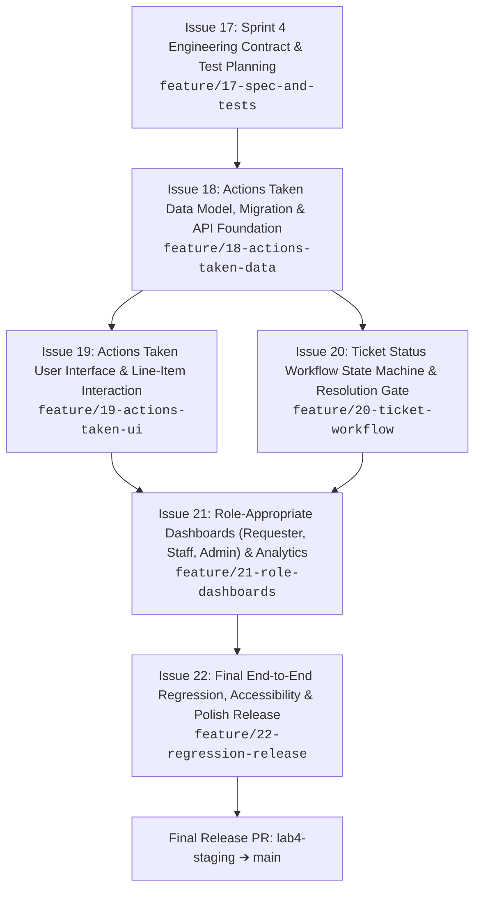

# TokTickIT Sprint 4 (Lab 4) — Scope & Issue Decomposition

**Document Status**: Official Sprint Implementation Plan  
**Target Sprint**: TokTickIT Lab 4 (Sprint 4) — Actions Taken, Dashboards, Workflow Resolution Gate, and Final Regression  
**Base Branch**: `lab4-staging`  
**Active Branch**: `feature/17-spec-and-tests`  
**Traceability Reference**: [SE+Lab+4.pdf](../reference/SE+Lab+4.pdf)

---

## 1. Sprint Architecture & Delivery Plan

### 1.1 Sprint Goal
Complete the core TokTickIT service-desk workflow by adding Actions Taken by IT Staff, enforcing the final Ticket status rules and backend resolution gate, delivering role-appropriate operational dashboards for Requesters, IT Staff, and Administrators, and executing full-system hardening and regression verification under the Zen Green design system.

### 1.2 Git & GitHub Engineering Workflow
* All feature branches are cut from `lab4-staging` and merged back into `lab4-staging` via peer-reviewed Pull Requests.
* The designated peer reviewer reviews and merges approved PRs; the author responds to all review comments.
* When all feature slices are verified on `lab4-staging`, a final release PR is submitted from `lab4-staging` into `main`.
* The GitHub Project Kanban board tracks issues through the 6 approved states:  
  `Backlog` $\rightarrow$ `Specified` $\rightarrow$ `Started` $\rightarrow$ `PR Review` $\rightarrow$ `Fixing` $\rightarrow$ `Done`.

---

## 2. Six Planned GitHub Issues for Sprint 4

---

### Issue 17: Sprint 4 Engineering Contract & Software Test Planning

* **Issue Title**: `Issue 17: Sprint 4 Engineering Contract & Software Test Planning`
* **Branch Name**: `feature/17-spec-and-tests`
* **Base / Target Branch**: `lab4-staging`
* **Labels**: `documentation`, `spec-dd`, `test-dd`, `sprint-4`
* **Dependencies**: Sprint 4 initialization (`lab4-staging` created from `main`).
* **Merge Order**: 1st (Must merge before implementation issues begin).

#### Detailed Scope
1. **Author Authoritative Engineering Contract Documents in `docs/lab-04/`**:
   - `docs/lab-04/specification.md`:
     - Sprint goal and stakeholder request interpretation.
     - Included and explicitly excluded scope boundaries (§4.2).
     - Numbered Functional Requirements (`FR-01` to `FR-06`).
     - Numbered Business Rules (`BR-01` to `BR-14`).
     - Database design decisions and justifications (§5.1).
     - Legacy migration and backfill strategy (§5.2).
     - Acceptance Criteria (`AC-01` to `AC-16`) in Given-When-Then format.
     - Product Definition of Done (DoD).
   - `docs/lab-04/ui-spec.md`:
     - Zen Green design tokens (`#006B3C`, `#0B7A46`, `#EAF6EF`, `#F5F7F6`).
     - Screen layouts and component specs for IT Staff Dashboard, Requester Dashboard, Actions Taken Section (list/table, create/edit, auto-performer, conditional follow-up note), and Ticket Status Workflow Controls.
     - Responsive breakpoints (Desktop $\ge 1200\text{px}$, Tablet $768\text{px}-1024\text{px}$, Mobile $< 768\text{px}$) with zero horizontal scroll.
     - Component feedback states and Accessibility checklist.
   - `docs/lab-04/api-spec.md`:
     - REST API specifications for:
       - `POST /api/v1/tickets/:id/actions-taken`
       - `GET /api/v1/tickets/:id/actions-taken`
       - `PUT /api/v1/tickets/:id/actions-taken/:actionId`
       - `GET /api/v1/dashboards/requester`
       - `GET /api/v1/dashboards/staff`
       - `GET /api/v1/dashboards/admin`
       - `PATCH /api/v1/staff/tickets/:id/status`
     - DTO schemas, request/response JSON payloads, status codes (200, 201, 400, 401, 403, 404, 409 Conflict), and safe error formats.
   - `docs/lab-04/tests.md`:
     - Software Test Specification (STS) mapping every Acceptance Criterion to designated test paths across server, client UI, and E2E test files.
   - `docs/lab-04/reviewer.md` & `docs/lab-04/ai-use.md`:
     - Peer review templates and AI prompt logs.
2. **Directory Scaffolding**:
   - Create directories:
     - `server/tests/lab-04/`
     - `client/src/tests/lab-04/`
     - `e2e/lab-04/`
     - `artifacts/lab-04/screenshots/staff-dashboard/`
     - `artifacts/lab-04/screenshots/requester-dashboard/`
     - `artifacts/lab-04/screenshots/actions-taken/`

#### Explicit Exclusions (Out of Scope)
- Writing application code, backend routes, React components, or test assertion code yet.

#### Acceptance Criteria
- **AC-17.1**: *Given* the Lab 4 handout, *when* `docs/lab-04/specification.md` is authored, *then* it contains numbered functional requirements (FR-01..06), numbered business rules (BR-01..14), database decisions, migration strategy, acceptance criteria (AC-01..16), and Definition of Done.
- **AC-17.2**: *Given* Zen Green design specifications, *when* `docs/lab-04/ui-spec.md` is authored, *then* layout wireframes, color tokens, line-item grid, and responsive breakpoints are fully documented.
- **AC-17.3**: *Given* the REST API requirements, *when* `docs/lab-04/api-spec.md` is authored, *then* all 7 endpoints, DTOs, HTTP statuses, and error formats are specified.
- **AC-17.4**: *Given* the course testing rubric, *when* `docs/lab-04/tests.md` is authored and test directories are created, *then* every acceptance criterion maps to at least one planned test.

---

### Issue 18: Actions Taken Data Model, Migration & API Foundation

* **Issue Title**: `Issue 18: Actions Taken Data Model, Migration & API Foundation`
* **Branch Name**: `feature/18-actions-taken-data`
* **Base / Target Branch**: `lab4-staging`
* **Labels**: `backend`, `database`, `api`, `sprint-4`
* **Dependencies**: Issue 17 merged to `lab4-staging`.
* **Merge Order**: 2nd.

#### Detailed Scope
1. **Database Modeling, Migration & Seed Data**:
   - Add `ActionTaken` model in Prisma schema:
     - `id`: Int PK autoincrement.
     - `ticketId`: FK to `Ticket` with `onDelete: Cascade`.
     - `performedById`: FK to `User` with `onDelete: Restrict`.
     - `actionDateTime`: DateTime default `now()`.
     - `actionDescription`: Text (5–1000 chars).
     - `result`: Text (2–1000 chars).
     - `followUpRequired`: Boolean default `false`.
     - `followUpNote`: Text nullable.
     - `attachmentNotes`: VarChar(255) nullable.
     - `version`: Int default 1.
   - Add optimistic concurrency `version` integer to `Ticket`.
   - Add performance composite indexes.
   - Generate and apply Prisma migration.
   - Update `server/prisma/seed.ts` with tickets having 0, 1, and multiple actions taken.
2. **Backend Actions Taken APIs**:
   - `POST /api/v1/tickets/:id/actions-taken`: create action with session-derived performer (`BR-03`), conditional follow-up note validation (`BR-04`), role guard (`BR-06`), and inactive performer check (`BR-07`).
   - `GET /api/v1/tickets/:id/actions-taken`: list actions in chronological order; enforce ownership for requesters (`BR-06`).
   - `PUT /api/v1/tickets/:id/actions-taken/:actionId`: update existing action with version concurrency check (`BR-12`).
3. **Automated Tests**:
   - `server/tests/lab-04/actions-taken.api.test.ts`: test all CRUD operations, role checks, validation rules, and concurrency conflicts.

---

### Issue 19: Actions Taken User Interface & Line-Item Interaction

* **Issue Title**: `Issue 19: Actions Taken User Interface & Line-Item Interaction`
* **Branch Name**: `feature/19-actions-taken-ui`
* **Base / Target Branch**: `lab4-staging`
* **Labels**: `frontend`, `ui`, `line-item`, `sprint-4`
* **Dependencies**: Issue 18 merged to `lab4-staging`.
* **Merge Order**: 3rd.

#### Detailed Scope
1. **Frontend Actions Taken Section & Modal**:
   - Integrate Actions Taken line-item table/list into IT Staff Ticket Detail.
   - Implement alternating row shades, ordered item numbers (`No.`), auto-performer badge, and follow-up badges.
   - Build accessible Create/Edit Action Taken modal with dynamic character counters.
   - Dynamic conditional follow-up note field: expands with required red asterisk when follow-up checkbox is checked.
   - Responsive presentation: desktop 7-column table converts to stacked Zen Green cards on mobile ($<768\text{px}$) with zero horizontal scroll.
   - Read-only presentation on Requester Ticket Detail screen.
2. **Automated Tests**:
   - `client/src/tests/lab-04/ActionsTaken.test.tsx`: test rendering, form expansion, validation feedback, and mobile viewports.

---

### Issue 20: Ticket Status Workflow State Machine & Resolution Gate

* **Issue Title**: `Issue 20: Ticket Status Workflow State Machine & Resolution Gate`
* **Branch Name**: `feature/20-ticket-workflow`
* **Base / Target Branch**: `lab4-staging`
* **Labels**: `backend`, `frontend`, `workflow`, `sprint-4`
* **Dependencies**: Issue 18 merged to `lab4-staging`.
* **Merge Order**: 4th.

#### Detailed Scope
1. **Backend Resolution Gate & Workflow Engine**:
   - `PATCH /api/v1/staff/tickets/:id/status`:
     - Enforces the 8-state transition matrix (`BR-11`).
     - **Resolution Gate (`BR-08`)**: Rejects transition to `RESOLVED` or `CLOSED` with HTTP `409 Conflict` if any associated action taken has `followUpRequired === true` without resolution.
     - **Atomic Cancellation Cascade (`BR-09`)**: Atomically updates ticket and active actions to cancelled in a Prisma transaction.
     - Reopening workflow: sets status to `IN_PROGRESS` if owned, or `NEW`/`OPEN` if unassigned.
     - Enforces advisory-only nature of Requester resolution indication (`BR-10`).
2. **Frontend Workflow Controls & Feedback**:
   - Operational controls dropdown showing only permitted next states.
   - In-app resolution gate warning callout when open actions prevent resolution.
   - Status confirmation dialog for terminal transitions.
3. **Automated Tests**:
   - `server/tests/lab-04/ticket-workflow.api.test.ts`
   - `client/src/tests/lab-04/TicketWorkflow.test.tsx`

---

### Issue 21: Role-Appropriate Dashboards & Analytics

* **Issue Title**: `Issue 21: Role-Appropriate Dashboards & Analytics`
* **Branch Name**: `feature/21-role-dashboards`
* **Base / Target Branch**: `lab4-staging`
* **Labels**: `backend`, `frontend`, `dashboard`, `sprint-4`
* **Dependencies**: Issues 19 and 20 merged to `lab4-staging`.
* **Merge Order**: 5th.

#### Detailed Scope
1. **Backend Operational Dashboard Endpoints**:
   - `GET /api/v1/dashboards/requester`: calculates open, in progress, waiting, recently resolved metrics strictly scoped to `req.user.id` (`BR-13`).
   - `GET /api/v1/dashboards/staff`: calculates unassigned, my assigned, status breakdown, priority breakdown, and recent tickets (`BR-14`).
   - `GET /api/v1/dashboards/admin`: includes staff operational metrics plus active/inactive user statistics.
2. **Frontend Dashboard Views**:
   - **IT Staff Dashboard** (`/staff/dashboard`): 5 metric cards, quick actions, recent tickets table, drill-down into queue.
   - **Requester Dashboard** (`/dashboard`): 4 metric cards, quick actions, recent tickets, drill-down into My Tickets.
   - Responsive multi-column layout collapsing cleanly to 1-column on mobile.
3. **Automated Tests**:
   - `server/tests/lab-04/requester-dashboard.api.test.ts`
   - `server/tests/lab-04/staff-dashboard.api.test.ts`
   - `client/src/tests/lab-04/StaffDashboard.test.tsx`
   - `client/src/tests/lab-04/RequesterDashboard.test.tsx`

---

### Issue 22: Final End-to-End Regression, Accessibility & Polish Release

* **Issue Title**: `Issue 22: Final End-to-End Regression, Accessibility & Polish Release`
* **Branch Name**: `feature/22-regression-release`
* **Base / Target Branch**: `lab4-staging`
* **Labels**: `testing`, `e2e`, `accessibility`, `release`, `sprint-4`
* **Dependencies**: Issues 18, 19, 20, 21 merged to `lab4-staging`.
* **Merge Order**: 6th (Final Sprint 4 slice).

#### Detailed Scope
1. **Playwright E2E Test Suite**:
   - `e2e/lab-04/actions-taken-flow.spec.ts`: complete action lifecycle, create, edit, auto-performer, requester read-only view.
   - `e2e/lab-04/ticket-resolution.spec.ts`: resolution gate blocking, complete action, successful resolve, cancellation cascade.
   - `e2e/lab-04/dashboards.spec.ts`: requester and staff dashboards, metric card drill-down, quick actions.
2. **Auxiliary Visual Screenshots**:
   - Capture full-page verification screenshots in `artifacts/lab-04/screenshots/` across Desktop, Tablet, and Mobile.
3. **Full System Regression & Hardening**:
   - Verify 100% test pass rate across Labs 1–4.
   - WCAG 2.2 AA accessibility audit, zero console warnings, zero horizontal overflow.
4. **Final Release**:
   - Merge `lab4-staging` into `main`.

