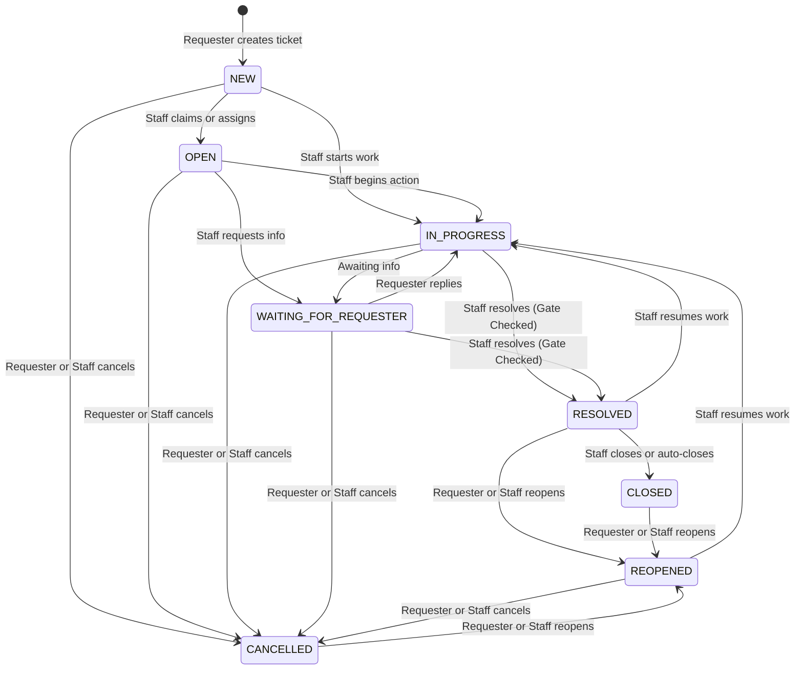

# TokTickIT Sprint 4 (Lab 4) — Sprint Engineering Specification

**Document Status**: Official Engineering Specification  
**Target Sprint**: TokTickIT Lab 4 (Sprint 4) — Actions Taken, Dashboards, Workflow Resolution Gate, and Final Regression  
**Base Branch**: `lab4-staging`  
**Active Branch**: `feature/17-spec-and-tests`  
**Traceability References**: [SE+Lab+4.pdf](../reference/SE+Lab+4.pdf), [TokTickIT-System-Level-SDS-v1.0.pdf](../reference/TokTickIT-System-Level-SDS-v1.0.pdf), [poc-scope-and-issues.md](./poc-scope-and-issues.md)

---

## 1. Sprint Goal

Deliver the concluding, production-grade product increment for the **TokTickIT** IT Service Desk system by implementing the parent-child **Actions Taken** work-tracking subsystem, enforcing the formal **Ticket Status Workflow & Resolution Gate**, delivering role-appropriate **Operational Dashboards** for Requesters, IT Staff, and Administrators, and executing full-system **Regression & Hardening** across all capabilities established in Labs 1 through 3 under the Zen Green design system.

---

## 2. Stakeholder Request Interpretation

The TokTickIT service desk operates reliably for ticket intake, categorization, assignment, public communication, internal notes, and administrative account management. However, operational stakeholders identify three critical missing capabilities necessary for enterprise IT operations:
1. **Granular Work Tracking (Actions Taken)**: The service desk requires a structured way to plan, record, and track actual technical work carried out on each ticket. A single ticket may require multiple sequential or concurrent technical interventions (e.g., diagnostic battery check, OS update, driver reinstallation) performed by different IT staff members, even while the overall ticket remains coordinated by a primary Ticket Owner. Each action must capture the exact action timestamp, description, result, automated performer identity, follow-up flags with mandatory justification notes, and attachment references.
2. **Authoritative Ticket Lifecycle & Resolution Gate**: Requesters may indicate that a problem appears resolved, but this feedback must remain strictly advisory. Only authorized IT Staff or Administrators may formally transition a ticket to `Resolved` or `Closed`. Furthermore, the backend must enforce a strict resolution gate: a ticket cannot be resolved or closed while open or incomplete actions remain, preventing premature closure before technical verification is completed.
3. **Role-Appropriate Operational Dashboards**: Different stakeholders require concise, real-time summaries connected directly to detailed views:
   - **Requesters** need an uncluttered overview of their open tickets, tickets in progress, tickets waiting for requester input, and recently resolved tickets, with direct drill-down to their ticket history.
   - **IT Staff** need operational visibility into queue volume, unassigned tickets, personal workload, tickets broken down by status and priority, and recently updated tickets with instant queue drill-down.
   - **Administrators** require operational dashboard access alongside concise system-wide user account metrics.
4. **Holistic Hardening & Design Consistency**: The entire application must be thoroughly verified, accessible (WCAG 2.2 AA compliant), responsive across desktop, tablet, and mobile with zero horizontal overflow, and resilient against concurrent updates through optimistic concurrency checks.

---

## 3. Scope Boundaries

### 3.1 Included Scope
1. **Actions Taken Subsystem (Parent-Child Work Tracking)**:
   - Dedicated `ActionTaken` relational data model linked to `Ticket` ($1:N$).
   - Endpoints to create (`POST /api/v1/tickets/:id/actions-taken`), list (`GET /api/v1/tickets/:id/actions-taken`), and update (`PUT /api/v1/tickets/:id/actions-taken/:actionId`) actions.
   - Automatic attribution of performer from server-side authenticated session (`req.user.id`).
   - Conditional follow-up note validation: required if and only if `followUpRequired` is `true`.
   - Read-only visibility of Actions Taken for ticket Requesters; full create/edit permissions for IT Staff and Administrators.
2. **Ticket Status Workflow & Resolution Gate**:
   - Strict 8-state ticket status transition matrix (`NEW`, `OPEN`, `IN_PROGRESS`, `WAITING_FOR_REQUESTER`, `RESOLVED`, `CLOSED`, `REOPENED`, `CANCELLED`).
   - Backend-enforced resolution gate: rejecting transitions to `RESOLVED` or `CLOSED` with HTTP `409 Conflict` if any associated action taken is incomplete.
   - Atomic cancellation cascade: transitioning a ticket to `CANCELLED` automatically marks open actions as cancelled.
   - Reopening workflow: moving resolved/closed/cancelled tickets back to `IN_PROGRESS` (if owned) or `OPEN`/`NEW` (if unassigned).
   - Re-confirmation of Requester advisory indication without formal closing authority.
3. **Role-Appropriate Operational Dashboards**:
   - **Requester Dashboard** (`GET /api/v1/dashboards/requester`): Total open tickets, tickets in progress, tickets waiting for requester, recently resolved tickets, and recent tickets list. Strictly scoped to authenticated requester's owned tickets.
   - **IT Staff Dashboard** (`GET /api/v1/dashboards/staff`): Unassigned queue count, my assigned tickets count, breakdown by status, breakdown by IT priority, and recently updated tickets.
   - **Administrator Dashboard** (`GET /api/v1/dashboards/admin`): Reuses IT Staff operational metrics plus concise user account statistics (active/inactive users by role).
   - Interactive drill-down navigation from dashboard metric cards into pre-filtered ticket queues.
4. **Concurrency Control & Stale Update Handling**:
   - Integer versioning / timestamp comparison on ticket mutations to prevent lost updates.
   - Safe HTTP `409 Conflict` error responses upon detecting concurrent modifications.
5. **Zen Green UI Polish, Responsiveness & Accessibility**:
   - KMUTT Zen Green design tokens (`#006B3C`, `#0B7A46`, `#EAF6EF`, `#F5F7F6`).
   - Responsive layouts verified on Desktop ($\ge 1200\text{px}$), Tablet ($768\text{px}-1024\text{px}$), and Mobile ($< 768\text{px}$) with zero horizontal scroll.
   - Screen reader attributes, keyboard navigation, visible focus indicators, and semantic markup.
6. **Regression Preservation & Idempotent Seed Data**:
   - Complete preservation of all Lab 1-3 features (authentication, password rotation, requester ticket creation, attachment storage, public comments, internal notes, admin user management).
   - Comprehensive seed script providing realistic tickets across all statuses with zero, one, and multiple actions taken.

### 3.2 Explicitly Excluded Scope (Honoring §4.2 of Lab 4 Sheet)
The following capabilities are explicitly out of scope for Sprint 4:
* **Automatic SLA Clocks & Escalation Engines**: No automated countdown timers, SLA breach alerts, automated reassignment, or on-call scheduling engines.
* **External Notification Gateways**: No outbound email (SMTP), SMS, LINE, Webhook, or mobile push notification integrations.
* **Inventory & Cost Accounting**: No spare parts inventory deduction, hardware asset tracking, purchasing requests, or service billing.
* **Timesheet & Payroll Tracking**: No hourly labor billing, contractor invoicing, or staff payroll calculations.
* **Multi-Level Approval Workflows**: No electronic signatures, budget approvals, or managerial sign-off hierarchies.
* **Advanced Business Intelligence**: No custom drag-and-drop report builders, OLAP cubes, data warehouse ETL pipelines, or CSV/PDF export engines.
* **Multi-Tenant Architecture**: No organization partition tables, multi-tenant subdomains, or enterprise cloud scaling infrastructure.
* **Unapproved Features**: Any feature not explicitly specified in this Sprint 4 engineering contract is prohibited.

---

## 4. Functional Requirements (FR-01 to FR-06)

### FR-01: Actions Taken Record Management
* **FR-01.1**: The system shall support a parent-child relationship where a single Ticket contains zero or more Actions Taken records.
* **FR-01.2**: The system shall provide an endpoint (`POST /api/v1/tickets/:id/actions-taken`) enabling IT Staff and Administrators to record a technical action.
* **FR-01.3**: The system shall automatically record the authenticated user as the performer (`performedById`) without accepting performer overrides from the client.
* **FR-01.4**: The system shall capture action date/time, action description, result, follow-up required flag, conditional follow-up note, and attachment notes.
* **FR-01.5**: The system shall provide an endpoint (`GET /api/v1/tickets/:id/actions-taken`) to retrieve all actions taken for a ticket in ascending chronological order.
* **FR-01.6**: The system shall provide an endpoint (`PUT /api/v1/tickets/:id/actions-taken/:actionId`) allowing IT Staff and Administrators to update existing actions taken.
* **FR-01.7**: Requesters shall have read-only access to Actions Taken on their owned tickets; Requesters shall be blocked from creating or modifying actions taken with HTTP `403 Forbidden`.

### FR-02: Ticket Status Workflow & Resolution Gate
* **FR-02.1**: The system shall enforce the approved 8-state ticket status lifecycle (`NEW`, `OPEN`, `IN_PROGRESS`, `WAITING_FOR_REQUESTER`, `RESOLVED`, `CLOSED`, `REOPENED`, `CANCELLED`) via `PATCH /api/v1/staff/tickets/:id/status`.
* **FR-02.2**: The backend shall enforce a Resolution Gate: transitioning a ticket to `RESOLVED` or `CLOSED` shall be rejected with HTTP `409 Conflict` if any associated action taken is incomplete (or if follow-up is pending without resolution).
* **FR-02.3**: When an authorized user transitions a ticket to `CANCELLED`, the system shall atomically update the ticket and any active actions taken to cancelled in a single database transaction.
* **FR-02.4**: When an authorized user reopens a ticket from `RESOLVED`, `CLOSED`, or `CANCELLED`, the ticket status shall transition to `IN_PROGRESS` if a Ticket Owner is assigned, or to `OPEN`/`NEW` if unassigned.
* **FR-02.5**: A Requester's "Problem Appears Resolved" indication shall record a confirmation flag and timestamp, but shall not directly change ticket status to `RESOLVED` or bypass the resolution gate.

### FR-03: IT Staff & Administrator Operational Dashboard
* **FR-03.1**: The system shall provide an endpoint (`GET /api/v1/dashboards/staff`) restricted to IT Staff and Administrators.
* **FR-03.2**: The IT Staff Dashboard shall calculate and return authoritative operational counts:
  - `unassignedCount`: Total active tickets with no assigned owner (`ownerId IS NULL`).
  - `myAssignedCount`: Total active tickets assigned to the authenticated user.
  - `statusBreakdown`: Ticket counts grouped by status (`NEW`, `OPEN`, `IN_PROGRESS`, `WAITING_FOR_REQUESTER`, `RESOLVED`, `CLOSED`, `CANCELLED`).
  - `priorityBreakdown`: Active ticket counts grouped by IT Priority (`LOW`, `MEDIUM`, `HIGH`, `URGENT`).
  - `urgentAttentionCount`: High/urgent tickets requiring immediate action.
* **FR-03.3**: The endpoint shall return a list of recent tickets (`recentTickets`) assigned to or updated by staff, limited to 5 records with ticket number, summary, status, IT priority, and last updated timestamp.
* **FR-03.4**: The system shall provide an Administrator dashboard endpoint (`GET /api/v1/dashboards/admin`) returning IT Staff operational metrics plus concise user statistics (`totalUsers`, `activeUsersCount`, `usersByRole`).

### FR-04: Requester Operational Dashboard
* **FR-04.1**: The system shall provide an endpoint (`GET /api/v1/dashboards/requester`) accessible to authenticated Requesters.
* **FR-04.2**: The Requester Dashboard shall calculate metrics strictly scoped to tickets owned by the authenticated user (`requesterId === req.user.id`):
  - `totalOpenTickets`: Count of requester's non-terminal tickets (`NEW`, `OPEN`, `IN_PROGRESS`, `WAITING_FOR_REQUESTER`).
  - `inProgressTickets`: Count of requester's tickets actively being worked on (`IN_PROGRESS`).
  - `waitingForRequesterTickets`: Count of requester's tickets requiring user response (`WAITING_FOR_REQUESTER`).
  - `recentlyResolvedTickets`: Count of requester's tickets resolved within the last 7 days.
* **FR-04.3**: The endpoint shall return the requester's 5 most recently updated tickets for immediate access.
* **FR-04.4**: All metric cards shall support interactive drill-down navigating to the Requester's ticket list with corresponding pre-applied filters.

### FR-05: Concurrency Control & Stale-Update Handling
* **FR-05.1**: The system shall detect concurrent updates to tickets and actions taken using an integer version field or record timestamp comparison.
* **FR-05.2**: If a client submits an update with a stale version or timestamp, the API shall abort the update and return HTTP `409 Conflict` with a machine-readable error payload and the latest server state.
* **FR-05.3**: The client UI shall present a clear conflict dialog allowing the user to refresh the latest changes without losing unsaved draft content.

### FR-06: System Regression Preservation & Hardening
* **FR-06.1**: All authentication, session management, and forced password change workflows from Lab 3 shall function without degradation.
* **FR-06.2**: Requester ticket submission, category selection, and attachment uploads from Lab 2 shall remain fully operational.
* **FR-06.3**: Public Comments and confidential Internal Notes shall strictly maintain their visibility boundaries (Internal Notes hidden from Requesters).
* **FR-06.4**: Administrator User Management safety rules (self-deactivation block, last admin protection) shall remain strictly enforced.
* **FR-06.5**: The user interface shall produce zero console errors, zero broken links, zero placeholder text, and zero horizontal scroll across desktop, tablet, and mobile breakpoints.

---

## 5. Business Rules (BR-01 to BR-14)

| BR ID | Rule Name | Description & Mandatory Enforcement |
| :--- | :--- | :--- |
| **BR-01** | **Strict Parent-Child Relationship** | An Action Taken record belongs to exactly one Ticket (`ticketId` is mandatory and immutable). Deleting a ticket cascades to its actions taken, but tickets are never hard-deleted. |
| **BR-02** | **Separate Ticket Coordination vs Action Performer** | The Ticket Owner coordinates the ticket overall, but individual Actions Taken may be performed and recorded by different IT Staff members. |
| **BR-03** | **Automated Performer Identity** | The performer of an Action Taken (`performedById`) is derived exclusively from the authenticated session (`req.user.id`). Client payloads cannot specify or forge the performer. |
| **BR-04** | **Conditional Follow-Up Note Requirement** | When `followUpRequired` is `true`, `followUpNote` is strictly mandatory (non-empty string after trim, min 5 chars, max 1000 chars). When `followUpRequired` is `false`, `followUpNote` must be `null` or omitted. |
| **BR-05** | **Action Taken Field Validations** | `actionDateTime` is required and cannot be in the future (tolerance: +60 seconds for clock drift); `actionDescription` requires 5–1000 characters; `result` requires 2–1000 characters; `attachmentNotes` is optional (max 255 characters). |
| **BR-06** | **Role-Based Action Taken Authorization** | Only users with role `IT_STAFF` or `ADMINISTRATOR` may create (`POST`) or edit (`PUT`) Actions Taken. Requesters have read-only access to actions on their owned tickets and are rejected with HTTP `403 Forbidden` on write attempts. |
| **BR-07** | **Active Account Invariant for Action Performers** | Actions Taken can only be created or updated by active accounts (`isActive === true`). If a staff user account is deactivated, existing actions preserve historical attribution, but new actions by that user are rejected with HTTP `403 Forbidden`. |
| **BR-08** | **Authoritative Ticket Resolution Gate** | A Ticket CANNOT transition to `RESOLVED` or `CLOSED` status while any associated Action Taken is incomplete or ongoing (specifically: if any action has `followUpRequired === true` without a subsequent resolving action or completion note, or if zero actions exist when technical investigation was required). |
| **BR-09** | **Atomic Cancellation Cascade** | When a Ticket is moved to `CANCELLED`, the system atomically updates any associated open actions taken to a cancelled/closed state in a single Prisma database transaction, recording the cancellation timestamp and reason. |
| **BR-10** | **Advisory Requester Resolution** | A Requester's "Problem Appears Resolved" indication is strictly advisory. It sets `requesterResolutionConfirmedAt` and creates an audit event, but does NOT set `currentStatus` to `RESOLVED` or bypass the backend resolution gate. |
| **BR-11** | **Authoritative Status Transition Matrix** | Ticket status changes must strictly obey the defined 8-state transition matrix. Only IT Staff and Administrators may transition tickets to `RESOLVED` or `CLOSED`. Any user authorized to view a ticket may cancel or reopen it. |
| **BR-12** | **Optimistic Concurrency & Stale Update Detection** | Every update to a Ticket or Action Taken must supply the known `version` or `updatedAt` timestamp. If the database record contains a higher version or newer timestamp, the server must reject the mutation with HTTP `409 Conflict`. |
| **BR-13** | **Strict Requester Isolation on Dashboards** | The Requester Dashboard endpoint must strictly scope all metric calculations and ticket listings to the authenticated user (`WHERE requesterId = :currentUserId`). Cross-requester data leakage is prohibited. |
| **BR-14** | **Authoritative Dynamic Metric Calculations** | All dashboard counts, status distributions, and recent ticket collections must be computed dynamically by the backend using authoritative database queries. No client-side metric aggregation or unverified cache is permitted. |

---

## 6. Ticket Status Transition Matrix

The table below defines the authoritative 8-state ticket status transition matrix, authorized actor roles, and resolution gate constraints:



| Current Status | Allowed Next Statuses | Authorized Roles | Mandatory Business Preconditions & Invariants |
| :--- | :--- | :--- | :--- |
| **NEW** | `OPEN`, `IN_PROGRESS`, `CANCELLED` | IT Staff, Admin (Any authorized user for `CANCELLED`) | Transition to `OPEN` or `IN_PROGRESS` requires an assigned `ownerId`. `CANCELLED` requires a non-empty cancellation reason. |
| **OPEN** | `IN_PROGRESS`, `WAITING_FOR_REQUESTER`, `CANCELLED` | IT Staff, Admin (Any authorized user for `CANCELLED`) | Transition to `IN_PROGRESS` verifies active staff owner. |
| **IN_PROGRESS** | `WAITING_FOR_REQUESTER`, `RESOLVED`, `CANCELLED` | IT Staff, Admin (Any authorized user for `CANCELLED`) | **Resolution Gate**: Transition to `RESOLVED` requires that all Actions Taken are complete and no unresolved follow-up remains (`BR-08`). |
| **WAITING_FOR_REQUESTER** | `IN_PROGRESS`, `RESOLVED`, `CANCELLED` | IT Staff, Admin (Requester reply moves to `IN_PROGRESS`) | Staff may resolve if requester confirms resolution or issue verified; Resolution Gate strictly enforced. |
| **RESOLVED** | `CLOSED`, `REOPENED`, `IN_PROGRESS` | IT Staff, Admin (Any authorized user for `REOPENED`) | Transition to `CLOSED` confirms work is finished and verified. Reopening moves ticket to `IN_PROGRESS` if owned. |
| **CLOSED** | `REOPENED` | Requester (if owned), IT Staff, Admin | Reopening from `CLOSED` transitions to `IN_PROGRESS` (if owner exists) or `OPEN` (if unassigned). |
| **REOPENED** | `IN_PROGRESS`, `CANCELLED` | IT Staff, Admin (Any authorized user for `CANCELLED`) | Resumes technical workflow. |
| **CANCELLED** | `REOPENED` | Requester (if owned), IT Staff, Admin | Reopening creates an audit event and moves ticket to `OPEN` or `IN_PROGRESS`. |

---

## 7. Database Design Decisions & Justifications (§5.1)

### Decision DB-01: `ActionTaken` Relational Data Model & Referential Integrity
- **Specification**: Introduce a dedicated table `actions_taken` linked to `tickets` with a foreign key `ticketId` referencing `Ticket(id)` on delete cascade. Link `performedById` to `users(id)` with `onDelete: Restrict`.
```prisma
model ActionTaken {
  id                Int      @id @default(autoincrement())
  ticketId          Int
  performedById     Int
  actionDateTime    DateTime @default(now())
  actionDescription String   @db.Text
  result            String   @db.Text
  followUpRequired  Boolean  @default(false)
  followUpNote      String?  @db.Text
  attachmentNotes   String?  @db.VarChar(255)
  version           Int      @default(1)
  createdAt         DateTime @default(now())
  updatedAt         DateTime @updatedAt

  ticket      Ticket @relation(fields: [ticketId], references: [id], onDelete: Cascade)
  performedBy User   @relation("StaffActionsTaken", fields: [performedById], references: [id], onDelete: Restrict)

  @@index([ticketId, actionDateTime])
  @@index([performedById])
  @@map("actions_taken")
}
```
- **Justification**:
  1. *Parent-Child Domain Integrity*: Preserves strict relational integrity so technical actions cannot become orphaned. Restricting deletion on `performedById` ensures historical accountability is never compromised if a staff user is deactivated.
  2. *Chronological Sorting*: Indexing `[ticketId, actionDateTime]` guarantees $O(\log N)$ retrieval of chronologically ordered actions taken for any ticket.

### Decision DB-02: Optimistic Concurrency Control via `version` Field
- **Specification**: Add an integer `version` field (defaulting to 1) to `Ticket` and `ActionTaken`. Every mutation increments `version` by 1 and checks `WHERE id = :id AND version = :expectedVersion`.
- **Justification**:
  1. *Prevention of Lost Updates*: In a multi-staff service desk, two IT technicians may simultaneously inspect or update the same ticket. Concurrency control ensures the second submitter receives an HTTP `409 Conflict` instead of silently overwriting earlier work.
  2. *Lightweight & Stateless*: Version numbers eliminate the need for distributed database locks or persistent websocket connections, preserving high throughput and clean REST semantics.

### Decision DB-03: Performance-Optimized Composite Indexing for Dashboards
- **Specification**: Add targeted composite indexes to `tickets`:
  - `@@index([requesterId, currentStatus, updatedAt])`
  - `@@index([ownerId, currentStatus, updatedAt])`
  - `@@index([currentStatus, itPriority])`
- **Justification**:
  1. *Sub-50ms Dashboard Latency*: Dashboard queries aggregate ticket counts grouped by role, status, and priority. The composite index allows PostgreSQL index-only scans, satisfying the System SDS NFR requirement of p95 API response under 500 ms at peak load.
  2. *Requester Privacy Enforcement*: The `[requesterId, currentStatus]` index guarantees that queries fetching a requester's recent or attention-required tickets execute with maximum selectivity.

### Decision DB-04: Non-Destructive Legacy Backfill and Nullability
- **Specification**: The `actions_taken` relation is completely non-destructive to existing tickets. Existing tickets created during Labs 1–3 naturally have zero associated actions taken ($N=0$).
- **Justification**:
  1. *Backward Compatibility*: Adding a child table does not alter existing rows in `tickets`, `users`, `attachments`, `public_comments`, or `internal_notes`.
  2. *Graceful Resolution Check*: For legacy tickets already in `RESOLVED` or `CLOSED` status, the resolution gate check applies to prospective status updates, avoiding retroactive validation errors on historical data.

---

## 8. Legacy Migration & Backfill Strategy

### 8.1 Migration Execution Plan
1. **Migration Artifact**: Generate a versioned Prisma migration (`server/prisma/migrations/20261029140000_lab_04_actions_taken/migration.sql`).
2. **Schema Invariants**:
   - Create table `actions_taken`.
   - Add `version` column with `DEFAULT 1 NOT NULL` to `tickets` and `actions_taken`.
   - Add composite indexes on `tickets` and `actions_taken`.
   - Establish foreign keys with proper cascade and restrict constraints.
3. **Rollback & Recovery Plan**:
   - In the event of a migration failure, the migration runner wraps operations in an atomic DDL transaction (`BEGIN ... COMMIT`).
   - If manual rollback is required:
     ```sql
     DROP TABLE IF EXISTS "actions_taken" CASCADE;
     ALTER TABLE "tickets" DROP COLUMN IF EXISTS "version";
     DROP INDEX IF EXISTS "tickets_requester_status_idx";
     DROP INDEX IF EXISTS "tickets_owner_status_idx";
     ```
   - All historical data in `tickets`, `users`, `attachments`, `public_comments`, and `internal_notes` remains 100% intact.

### 8.2 Seed Data Strategy (`server/prisma/seed.ts`)
The seed script must be updated to run idempotently (`upsert` operations) and provide:
1. **Zero-Action Tickets**: Active tickets in `NEW` and `OPEN` status with 0 actions taken to verify initial UI states and empty-list messaging.
2. **Single-Action Tickets**: Tickets in `IN_PROGRESS` with 1 completed action taken.
3. **Multi-Action Tickets**: Tickets with 2–4 actions taken performed by different IT staff members, demonstrating collaborative technical intervention.
4. **Follow-Up Tickets**: Tickets with `followUpRequired = true` and detailed `followUpNote` to verify follow-up badge rendering and resolution gate enforcement.
5. **Dashboard Verification Distribution**: Balanced ticket counts across all 8 statuses and 4 IT priorities to demonstrate accurate, non-zero metric cards and zero-state handling.

---

## 9. Acceptance Criteria (AC-01 to AC-16)

### AC-01: Record Valid Action Taken by IT Staff
- **Given** an authenticated user with role `IT_STAFF` or `ADMINISTRATOR`,
- **When** submitting a valid payload to `POST /api/v1/tickets/:id/actions-taken` with description, result, and date/time,
- **Then** the action taken is persisted, linked to the ticket, and returns HTTP `201 Created` with the complete record.

### AC-02: Requester View-Only Access to Actions Taken
- **Given** an authenticated `REQUESTER` who owns the ticket (`requesterId === req.user.id`),
- **When** calling `GET /api/v1/tickets/:id/actions-taken`,
- **Then** the server returns HTTP `200 OK` with all actions taken, but rejecting any `POST` or `PUT` calls with HTTP `403 Forbidden`.

### AC-03: Performed-By Auto-Population
- **Given** an authenticated IT Staff user (e.g., "Michael Chen"),
- **When** creating an action taken with or without a client-supplied performer field,
- **Then** the stored `performedById` strictly matches `req.user.id` ("Michael Chen"), ignoring any client attempt to spoof another performer.

### AC-04: Conditional Follow-Up Note Enforcement
- **Given** an IT Staff user submitting an action taken with `followUpRequired = true`,
- **When** `followUpNote` is missing or contains only whitespace,
- **Then** the server rejects the request with HTTP `422 Unprocessable Entity` and a specific validation error indicating the follow-up note is required.

### AC-05: Edit Existing Action Taken
- **Given** an existing action taken on an accessible ticket,
- **When** an authorized IT Staff user submits updated result or follow-up note via `PUT /api/v1/tickets/:id/actions-taken/:actionId`,
- **Then** the record updates, increments its version, and returns HTTP `200 OK`.

### AC-06: Resolution Gate Blocks Premature Closure
- **Given** a ticket in `IN_PROGRESS` status with at least one action taken requiring unresolved follow-up,
- **When** IT Staff attempts to transition `currentStatus` to `RESOLVED` or `CLOSED`,
- **Then** the server rejects the transition with HTTP `409 Conflict` and error code `TICKET_STATE_CONFLICT`.

### AC-07: Successful Resolution After Actions Completed
- **Given** a ticket where all associated actions taken are complete with no outstanding follow-up,
- **When** IT Staff submits `PATCH /api/v1/staff/tickets/:id/status` with `status: "RESOLVED"`,
- **Then** the ticket transitions to `RESOLVED`, updates `updatedAt`, and returns HTTP `200 OK`.

### AC-08: Atomic Cancellation Cascade
- **Given** an active ticket with ongoing actions taken,
- **When** an authorized user cancels the ticket via status transition,
- **Then** the ticket and all ongoing actions are atomically marked cancelled in a single database transaction.

### AC-09: Requester Advisory Indication Preserves Gate
- **Given** an authenticated Requester viewing their open ticket,
- **When** clicking "Problem Appears Resolved",
- **Then** `requesterResolutionConfirmedAt` is recorded, but the ticket status remains unchanged until formal IT Staff review.

### AC-10: IT Staff Dashboard Metrics & Unassigned Count
- **Given** an authenticated IT Staff user accessing `/api/v1/dashboards/staff`,
- **When** the dashboard data is retrieved,
- **Then** the server returns accurate real-time counts for unassigned tickets, my assigned tickets, status breakdown, and priority breakdown.

### AC-11: IT Staff Dashboard Recent Tickets & Drill-Down
- **Given** an IT Staff user viewing the staff dashboard,
- **When** inspecting the "My Recent Tickets" list or clicking a metric card (e.g., "Unassigned"),
- **Then** the user is navigated directly to the ticket queue pre-filtered by that specific criterion.

### AC-12: Requester Dashboard Isolation & Personal Metrics
- **Given** an authenticated Requester accessing `/api/v1/dashboards/requester`,
- **When** the dashboard loads,
- **Then** the returned metrics and recent tickets strictly reflect tickets owned by that requester, completely excluding other requesters' tickets.

### AC-13: Requester Dashboard Drill-Down
- **Given** an authenticated Requester viewing their dashboard,
- **When** clicking "View all" on the "Waiting for Requester" metric card,
- **Then** the application navigates to `/my-tickets?status=WAITING_FOR_REQUESTER` displaying only matching tickets.

### AC-14: Concurrency Conflict Handling
- **Given** a client attempting to update a ticket or action taken with a stale version or timestamp,
- **When** submitting the mutation,
- **Then** the server rejects the request with HTTP `409 Conflict`, prompting the user to refresh the latest data.

### AC-15: Administrator Dashboard System Overview
- **Given** an authenticated Administrator accessing `/api/v1/dashboards/admin`,
- **When** the dashboard data is fetched,
- **Then** the response includes all staff operational metrics plus total, active, and role-based user account statistics.

### AC-16: End-to-End Regression Preservation
- **Given** the complete application running with Lab 4 increments,
- **When** executing all previously established user journeys (login, password change, ticket creation, attachment downloads, comments, notes, admin user management),
- **Then** 100% of previous test suites and user flows continue to pass cleanly with zero regressions.

---

## 10. Product Definition of Done (DoD)

A pull request or deliverable in Sprint 4 is considered **Done** only when all of the following criteria are satisfied:
1. **Spec Alignment**: Implementation strictly matches `specification.md`, `ui-spec.md`, and `api-spec.md` with zero unapproved scope expansion.
2. **Database Integrity**: Prisma schema migration is non-destructive, versioned, reversible, and verified against a fresh database seed.
3. **Backend Authorization**: All endpoints strictly enforce role-based access control and resource ownership checks on the server.
4. **Resolution Gate Enforcement**: Backend rejects premature ticket resolution when open actions or unresolved follow-ups exist.
5. **Zen Green UI Polish**: All screens adhere to the Zen Green palette (`#006B3C`, `#0B7A46`, `#EAF6EF`, `#F5F7F6`) with proper contrast and focus states.
6. **Responsive Fidelity**: Zero horizontal scroll across Desktop ($\ge 1200\text{px}$), Tablet ($768\text{px}-1024\text{px}$), and Mobile ($< 768\text{px}$).
7. **Accessibility (WCAG 2.2 AA)**: Semantic elements, proper ARIA labeling, full keyboard navigability, and non-color-only status cues.
8. **Automated Test Coverage**: 100% pass rate across all Vitest unit tests, Supertest API integration tests, and Playwright E2E suites.
9. **Auxiliary Visual Verification**: Playwright screenshot verification captures full-page evidence stored under `artifacts/lab-04/screenshots/`.
10. **Peer Review & Git Workflow**: Verified via peer-reviewed Pull Requests into `lab4-staging` with documented review logs in `reviewer.md`.

---

## 11. Assumptions and Implementation Decisions

1. **Date/Time Input Format**: Action Date/Time inputs in the UI default to the current local timestamp, formatted as ISO 8601 strings during API transport.
2. **Performer Immutability**: Once created, the original performer (`performedById`) is preserved for auditability; subsequent edits may record an optional `lastModifiedById`.
3. **Dashboard Refresh Cadence**: Dashboards query real-time data upon initial mount and provide an explicit manual "Refresh" button rather than aggressive automatic polling.
4. **Resolution Gate Threshold**: If a ticket has zero actions taken, staff may transition to `RESOLVED` only if no actions were flagged as required; otherwise, at least one completed action must be recorded.

