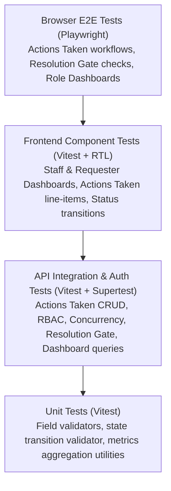

# TokTickIT Sprint 4 (Lab 4) — Software Test Specification (STS) & Test Plan

**Document Status**: Official Software Test Specification  
**Target Sprint**: TokTickIT Lab 4 (Sprint 4) — Actions Taken, Dashboards, Workflow Resolution Gate, and Final Regression  
**Base Branch**: `lab4-staging`  
**Active Branch**: `feature/17-spec-and-tests`  
**Traceability References**: [SE+Lab+4.pdf](../reference/SE+Lab+4.pdf) (§10, §14), [TokTickIT-System-Level-SDS-v1.0.pdf](../reference/TokTickIT-System-Level-SDS-v1.0.pdf) (§10, p. 17-18), [specification.md](./specification.md)

---

## 1. Test Strategy & Verification Pyramid

Testing in TokTickIT Sprint 4 enforces end-to-end quality, relational integrity, multi-role security authorization, and responsive UX consistency across four testing tiers:



* **Unit Tests (Vitest)**: Fast, in-memory validation of conditional follow-up note logic, date validation, state transition matrix rules, and metric aggregations.
* **API Integration Tests (Vitest + Supertest)**: Validates Express API endpoints, PostgreSQL transactions, optimistic concurrency conflicts, resolution gate checks, and strict role authorization boundaries against an isolated test database.
* **Frontend Component Tests (Vitest + React Testing Library)**: Tests React components, metric cards, drill-down links, Actions Taken line-item grid, conditional form fields, and resolution gate warning banners.
* **End-to-End Tests (Playwright)**: Full browser journeys simulating Requesters, IT Staff, and Administrators executing end-to-end workflows across Desktop, Tablet, and Mobile viewports.

> [!IMPORTANT]
> **Auxiliary Visual Verification Rule**: Playwright screenshot generation (saving PNG artifacts to `artifacts/lab-04/screenshots/`) is strictly an auxiliary visual verification step for human developer review and grading evidence. Playwright visual screenshot comparisons are never mixed into this automated Software Test Specification or unit test assertions.

---

## 2. Planned Tests Table

| Test ID | Level | Requirement / AC | What It Tests | Expected Result | Automated Test File Path | Status |
| :--- | :--- | :--- | :--- | :--- | :--- | :---: |
| **API-01** | API | FR-01, BR-01, AC-01 | Create valid Action Taken by IT Staff | HTTP 201 Created; action linked to ticket with performer | `server/tests/lab-04/actions-taken.api.test.ts` | PLANNED |
| **API-02** | API | FR-01, BR-03, AC-03 | Performer auto-population from session | `performedById` matches authenticated session user | `server/tests/lab-04/actions-taken.api.test.ts` | PLANNED |
| **API-03** | API | FR-01, BR-04, AC-04 | Conditional follow-up note validation | HTTP 422 if `followUpRequired=true` and note is missing | `server/tests/lab-04/actions-taken.api.test.ts` | PLANNED |
| **API-04** | API | FR-01, BR-06, AC-02 | Requester blocked from creating action | HTTP 403 Forbidden when Requester attempts POST | `server/tests/lab-04/actions-taken.api.test.ts` | PLANNED |
| **API-05** | API | FR-01, AC-02 | Requester view-only access to actions | HTTP 200 OK returning actions for ticket owned by requester | `server/tests/lab-04/actions-taken.api.test.ts` | PLANNED |
| **API-06** | API | FR-01, BR-06, AC-02 | Non-owner Requester blocked from view | HTTP 403/404 when Requester views another's ticket actions | `server/tests/lab-04/actions-taken.api.test.ts` | PLANNED |
| **API-07** | API | FR-01, AC-05 | Update existing Action Taken | HTTP 200 OK; updates record and increments version | `server/tests/lab-04/actions-taken.api.test.ts` | PLANNED |
| **API-08** | API | FR-05, BR-12, AC-14 | Concurrency conflict on stale update | HTTP 409 Conflict when submitting stale version | `server/tests/lab-04/actions-taken.api.test.ts` | PLANNED |
| **API-09** | API | FR-02, BR-08, AC-06 | Resolution Gate blocks premature resolve | HTTP 409 Conflict if open action requires follow-up | `server/tests/lab-04/ticket-workflow.api.test.ts` | PLANNED |
| **API-10** | API | FR-02, BR-08, AC-07 | Successful resolution after work complete | HTTP 200 OK; transitions status to `RESOLVED` | `server/tests/lab-04/ticket-workflow.api.test.ts` | PLANNED |
| **API-11** | API | FR-02, BR-09, AC-08 | Atomic cancellation cascade | Cancels ticket and marks open actions cancelled atomically | `server/tests/lab-04/ticket-workflow.api.test.ts` | PLANNED |
| **API-12** | API | FR-02, BR-10, AC-09 | Requester advisory resolution indication | Confirms timestamp; ticket status remains unchanged | `server/tests/lab-04/ticket-workflow.api.test.ts` | PLANNED |
| **API-13** | API | FR-02, BR-11, AC-07 | Status transition matrix enforcement | HTTP 400 Bad Request on illegal status transition | `server/tests/lab-04/ticket-workflow.api.test.ts` | PLANNED |
| **API-14** | API | FR-04, BR-13, AC-12 | Requester Dashboard metrics & isolation | HTTP 200 OK; only returns metrics for owned tickets | `server/tests/lab-04/requester-dashboard.api.test.ts` | PLANNED |
| **API-15** | API | FR-03, BR-14, AC-10 | IT Staff Dashboard operational metrics | HTTP 200 OK; accurate counts for unassigned, status, etc. | `server/tests/lab-04/staff-dashboard.api.test.ts` | PLANNED |
| **API-16** | API | FR-03, AC-15 | Administrator Dashboard user stats | HTTP 200 OK; includes staff metrics plus user statistics | `server/tests/lab-04/staff-dashboard.api.test.ts` | PLANNED |
| **API-17** | API | FR-03, AC-10 | Requester blocked from staff dashboard | HTTP 403 Forbidden when Requester accesses staff dashboard | `server/tests/lab-04/staff-dashboard.api.test.ts` | PLANNED |
| **UI-01** | UI | FR-03, AC-10, AC-11 | Staff Dashboard metric cards & drill-down | Renders 5 cards, quick actions, recent tickets, drill-down | `client/src/tests/lab-04/StaffDashboard.test.tsx` | PLANNED |
| **UI-02** | UI | FR-04, AC-12, AC-13 | Requester Dashboard metric cards & links | Renders 4 cards, recent tickets, drill-down navigation | `client/src/tests/lab-04/RequesterDashboard.test.tsx` | PLANNED |
| **UI-03** | UI | FR-01, AC-01, AC-03 | Actions Taken line-item table & modal | Grid display, auto-performer badge, conditional note toggle | `client/src/tests/lab-04/ActionsTaken.test.tsx` | PLANNED |
| **UI-04** | UI | FR-01, BR-04, AC-04 | Actions Taken conditional validation | Red border & tooltip on empty required follow-up note | `client/src/tests/lab-04/ActionsTaken.test.tsx` | PLANNED |
| **UI-05** | UI | FR-02, BR-08, AC-06 | Resolution Gate warning banner in UI | Warning banner and disabled resolve button when action open | `client/src/tests/lab-04/TicketWorkflow.test.tsx` | PLANNED |
| **UI-06** | UI | FR-02, BR-11, AC-07 | Status transition controls & confirm | Dropdown showing only permitted next states; modal confirm | `client/src/tests/lab-04/TicketWorkflow.test.tsx` | PLANNED |
| **E2E-01** | E2E | FR-01, AC-01..05 | Actions Taken complete lifecycle E2E | Staff creates action, auto-performer, edit, requester views | `e2e/lab-04/actions-taken-flow.spec.ts` | PLANNED |
| **E2E-02** | E2E | FR-02, AC-06..09 | Resolution Gate & status workflow E2E | Premature resolve block, complete action, successful resolve | `e2e/lab-04/ticket-resolution.spec.ts` | PLANNED |
| **E2E-03** | E2E | FR-03, FR-04, AC-10..15 | Role Dashboards & drill-down E2E | Requester & Staff dashboards, metric cards, queue drill-down | `e2e/lab-04/dashboards.spec.ts` | PLANNED |

---

## 3. Acceptance-Criterion Traceability Matrix

Every Acceptance Criterion defined in [specification.md](./specification.md) maps directly to verified test paths across API integration, UI component, and E2E tiers:

| Acceptance Criterion | Requirement Description | Planned Test IDs | Test Level | Automated Test File Path | Status |
| :---: | :--- | :--- | :--- | :--- | :---: |
| **AC-01** | Record valid Action Taken by IT Staff | `API-01`, `UI-03`, `E2E-01` | API, UI, E2E | `server/tests/lab-04/actions-taken.api.test.ts` | PLANNED |
| **AC-02** | Requester view-only access to actions | `API-04`, `API-05`, `API-06`, `E2E-01` | API, E2E | `server/tests/lab-04/actions-taken.api.test.ts` | PLANNED |
| **AC-03** | Performed-by auto-population from session | `API-02`, `UI-03`, `E2E-01` | API, UI, E2E | `server/tests/lab-04/actions-taken.api.test.ts` | PLANNED |
| **AC-04** | Conditional follow-up note validation | `API-03`, `UI-04`, `E2E-01` | API, UI, E2E | `server/tests/lab-04/actions-taken.api.test.ts` | PLANNED |
| **AC-05** | Edit existing Action Taken | `API-07`, `UI-03`, `E2E-01` | API, UI, E2E | `server/tests/lab-04/actions-taken.api.test.ts` | PLANNED |
| **AC-06** | Resolution Gate blocks premature resolve | `API-09`, `UI-05`, `E2E-02` | API, UI, E2E | `server/tests/lab-04/ticket-workflow.api.test.ts` | PLANNED |
| **AC-07** | Successful resolution after work complete | `API-10`, `UI-06`, `E2E-02` | API, UI, E2E | `server/tests/lab-04/ticket-workflow.api.test.ts` | PLANNED |
| **AC-08** | Atomic cancellation cascade | `API-11`, `E2E-02` | API, E2E | `server/tests/lab-04/ticket-workflow.api.test.ts` | PLANNED |
| **AC-09** | Requester advisory resolution confirmation | `API-12`, `E2E-02` | API, E2E | `server/tests/lab-04/ticket-workflow.api.test.ts` | PLANNED |
| **AC-10** | IT Staff Dashboard metrics & unassigned count | `API-15`, `API-17`, `UI-01`, `E2E-03` | API, UI, E2E | `server/tests/lab-04/staff-dashboard.api.test.ts` | PLANNED |
| **AC-11** | IT Staff Dashboard recent tickets & drill-down | `API-15`, `UI-01`, `E2E-03` | API, UI, E2E | `client/src/tests/lab-04/StaffDashboard.test.tsx` | PLANNED |
| **AC-12** | Requester Dashboard isolation & personal metrics | `API-14`, `UI-02`, `E2E-03` | API, UI, E2E | `server/tests/lab-04/requester-dashboard.api.test.ts` | PLANNED |
| **AC-13** | Requester Dashboard drill-down navigation | `UI-02`, `E2E-03` | UI, E2E | `client/src/tests/lab-04/RequesterDashboard.test.tsx` | PLANNED |
| **AC-14** | Concurrency conflict handling (HTTP 409) | `API-08` | API | `server/tests/lab-04/actions-taken.api.test.ts` | PLANNED |
| **AC-15** | Administrator Dashboard system overview | `API-16`, `E2E-03` | API, E2E | `server/tests/lab-04/staff-dashboard.api.test.ts` | PLANNED |
| **AC-16** | End-to-end regression preservation (Labs 1–3) | Full Suite Regression | API, UI, E2E | Existing test suites & Lab 4 suites | PLANNED |

### Issue 17 Specification & Planning Criteria (AC-17.1 to AC-17.4)
| Issue 17 Criterion | Scope | Verification Method | Status |
| :---: | :--- | :--- | :---: |
| **AC-17.1** | Author authoritative Sprint 4 specification | Inspect `docs/lab-04/specification.md` for FR-01..06, BR-01..14, DB decisions, migration plan, DoD | **VERIFIED** |
| **AC-17.2** | Author authoritative Zen Green UI specification | Inspect `docs/lab-04/ui-spec.md` for tokens, dashboards, Actions Taken line-item layout, responsive breakpoints | **VERIFIED** |
| **AC-17.3** | Author authoritative REST API specification | Inspect `docs/lab-04/api-spec.md` for all 7 required endpoints, DTO schemas, and safe error formats | **VERIFIED** |
| **AC-17.4** | Complete STS & directory scaffolding | Inspect `docs/lab-04/tests.md`, test directories, and artifact screenshot scaffolding | **VERIFIED** |

---

## 4. Test Execution Instructions

### Run Backend API & Unit Tests
```bash
npm --prefix server test
```

### Run Frontend Component Tests
```bash
npm --prefix client test
```

### Run End-to-End Playwright Tests
```bash
npm run test:e2e
```

